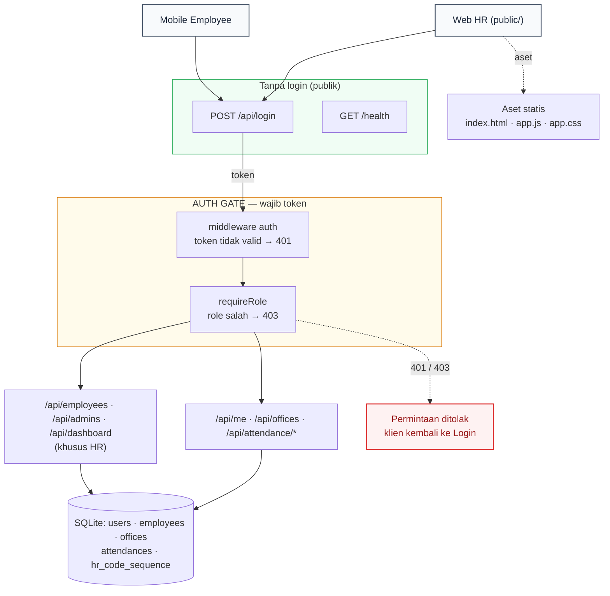

# Software Requirement Specification (SRS)
## Project A — Workforce Attendance System

| Item | Nilai |
|---|---|
| Versi | 2.0 (build) |
| Tanggal | 18 November 2026 |
| Produk | Workforce Attendance System — Tim A |
| Acuan | `docs/ETHES_TECH Project.docx` (Bab 1, 3, 4, 5) · `README.md` · kode `src/` · Web `public/` · tes `test/` |
| Folder | `docs/project-a/` |
| Status | Final draft untuk review mentor |

**Dokumen turunan:** `02` Use Case · `03` Activity · `04` ERD · `05` Flowchart · `06` Functional Requirement · `07` User Story · `08` Business Process.
**Work order & invarian:** `TASK.md`.

---

## 0. Aturan Utama: Semua Fitur Wajib Login (Auth Gate)

> **Tidak ada satu pun fitur yang dapat digunakan tanpa login terlebih dahulu.**

Pernyataan di atas bukan saran desain, melainkan perilaku yang sudah berjalan di kode dan menjadi invarian yang mengikat seluruh dokumen dalam paket ini.

### 0.1 Bukti Implementasi

| Lapisan | Berkas | Perilaku |
|---|---|---|
| Middleware | `src/middleware/auth.js:7-19` | Membaca header `Authorization: Bearer <token>`. Tidak ada token → `401 UNAUTHORIZED`. `jwt.verify` gagal → `401 UNAUTHORIZED`. User tidak ditemukan → `401`. |
| Middleware | `src/middleware/auth.js:21-22` | `requireRole(role)` → role tidak sesuai → `403 FORBIDDEN`. |
| Route HR | `src/routes/employees.js:11`, `admins.js:10`, `dashboard.js:7` | `router.use(auth, requireRole('HR'))` — seluruh route butuh login **dan** role HR. |
| Route absensi | `src/routes/attendance.js:13` | `router.use(auth)`; `requireRole('EMPLOYEE')` pada `today`, `check-in`, `check-out`; `requireRole('HR')` pada daftar absensi. |
| Route office | `src/routes/offices.js:7` | `router.use(auth)`; POST/PUT ditambah `requireRole('HR')`. |
| Web HR | `public/app.js:110` | Tanpa token tersimpan → `renderLogin()`; seluruh halaman lain tidak dirender. |
| Web HR | `public/app.js:24` | Respons `401` (selain `/login`) → `logout()`, kembali ke layar Login. |
| Web HR | `public/app.js:100,111` | Akun dengan role bukan `HR` ditolak di Web: "Akun ini bukan HR. Karyawan login lewat aplikasi mobile." |
| Web HR | `public/app.js:56-60` | Tombol "Keluar" menghapus token, menghentikan timer, menutup modal, menampilkan Login. |

### 0.2 Satu-satunya Pengecualian

| Endpoint / Aset | Status | Tanpa token |
|---|---|---|
| `POST /api/login` | Publik | Bisa dipanggil; 400 `VALIDATION` bila field kosong, 401 `INVALID_CREDENTIALS` bila salah |
| `GET /health` | Publik | `200 { "ok": true }` |
| Aset statis Web (`/index.html`, `/app.js`, `/app.css`, favicon) | Publik (kerangka UI) | Boleh dimuat, tetapi **tidak ada data** yang tampil; layar Login yang dirender |
| Semua endpoint `/api/**` lainnya | **Terproteksi** | `401 UNAUTHORIZED` |

Endpoint foto `GET /api/attendance/:id/photo/:type` **bukan** pengecualian: tetap memerlukan token, dan role `EMPLOYEE` hanya boleh mengakses foto miliknya (`src/routes/attendance.js:155-162`).

### 0.3 Konsekuensi pada Seluruh Dokumen

1. Setiap use case memiliki **prakondisi "sudah login"** — kecuali UC-01 (login itu sendiri).
2. Setiap activity diagram dimulai dengan pemeriksaan token / layar Login.
3. Setiap user story memakai *Given* "saya sudah login" — kecuali story login.
4. Setiap endpoint pada §7.1 memiliki kolom peran; tidak ada kolom "publik" selain §0.2.
5. Business process menempatkan login sebagai langkah pertama, dan `401` sebagai exception yang mengembalikan pengguna ke Login.

---

## 1. Pendahuluan

### 1.1 Tujuan
Menetapkan kebutuhan perangkat lunak **Workforce Attendance System** secara lengkap dan dapat diuji, sebagai baseline bagi engineering, QA, dan mentor.

### 1.2 Ruang Lingkup
Sistem mencatat kehadiran harian karyawan dengan dua antarmuka:

| Antarmuka | Pengguna | Sumber di repo |
|---|---|---|
| **Web HR** | HR Admin | `public/index.html`, `public/app.js`, `public/app.css` (vanilla JS, tanpa build) |
| **Mobile Employee** | Employee | **Belum ada proyek mobile di repo ini.** Mobile diperlakukan sebagai klien REST API (lihat `README.md` baris 68). |

Fitur dalam ruang lingkup:

1. Autentikasi JWT + otorisasi berbasis peran.
2. Manajemen karyawan (CRUD, reset password, pembuatan akun otomatis).
3. Manajemen akun HR Admin.
4. Manajemen lokasi office + radius geofence.
5. Absensi harian: satu pasang IN/OUT per tanggal kerja.
6. Status ketepatan waktu dari jam server `Asia/Jakarta`.
7. Riwayat kehadiran dengan filter, pencarian, urutan, paginasi.
8. Dashboard ringkasan harian + tren 7 hari.
9. Verifikasi foto kamera + koordinat GPS + radius office.
10. Ekspor CSV daftar absensi.

**Di luar ruang lingkup (tidak ada di kode, tidak dikerjakan):** shift malam, lembur, cuti/izin, approval, payroll, notifikasi push, ekspor PDF, deployment produksi, biometrik.

### 1.3 Definisi

| Istilah | Definisi |
|---|---|
| **IN / Check-in** | Pencatatan kedatangan pada tanggal kerja |
| **OUT / Check-out** | Pencatatan kepulangan pada tanggal kerja yang sama |
| **work_date** | Tanggal kerja `YYYY-MM-DD` pada zona `Asia/Jakarta` |
| **TEPAT_WAKTU** | Check-in pada atau sebelum 08:15 WIB |
| **TERLAMBAT** | Check-in setelah 08:15 WIB |
| **BELUM_IN** | Status turunan: karyawan aktif tanpa record absensi pada tanggal tersebut |
| **BELUM_OUT** | Status turunan: sudah IN, `check_out_at` masih NULL |
| **SUDAH_OUT** | Status turunan: `check_out_at` terisi |
| **Office** | Lokasi kerja dengan koordinat + radius (meter) |
| **Geofence** | Batas radius; absensi di luar radius ditolak |
| **JWT** | Token bearer pada header `Authorization` |
| **Auth Gate** | Kewajiban login sebelum mengakses fitur apa pun (§0) |

### 1.4 Referensi

| Kode | Referensi |
|---|---|
| REF-01 | `docs/ETHES_TECH Project.docx` — Project A + business rules ATT-01..ATT-08 |
| REF-02 | `README.md` — kontrak endpoint & aturan bisnis |
| REF-03 | `src/db.js` — skema basis data |
| REF-04 | `test/attendance.test.js` — tes otomatis |
| REF-05 | `public/app.js` — antarmuka Web HR |
| REF-06 | `TASK.md` — work order & invarian |

---

## 2. Deskripsi Umum

### 2.1 Perspektif Produk



> **Baca diagram:** hanya kotak hijau yang dapat diakses tanpa token. Semua permintaan lain melewati kotak kuning (auth → requireRole) sebelum mencapai endpoint. Jalur putus-putus ke kotak merah adalah akhir alur untuk token/peran yang tidak sah.

Web HR disajikan sebagai berkas statis dari `public/` oleh server yang sama (`src/app.js:11`), tanpa proses build.

### 2.2 Aktor

| Aktor | Jumlah | Antarmuka | Hak Akses |
|---|---|---|---|
| **HR Admin** (`role = HR`) | 1–5 | Web HR | Seluruh fitur HR: karyawan, admin, office, absensi, dashboard |
| **Employee** (`role = EMPLOYEE`) | ±100 | Mobile (klien API) | Status hari ini, IN, OUT, riwayat sendiri, foto sendiri, profil |

Tidak ada aktor ketiga. Tidak ada akses anonim ke data apa pun.

### 2.3 Fungsi Utama

| No | Fungsi | Aktor | Wajib Login |
|---|---|---|---|
| F-01 | Login & mengelola sesi | Semua | — (gerbangnya sendiri) |
| F-02 | Melihat profil sendiri | Semua | ✔ |
| F-03 | Menambah karyawan + akun | HR | ✔ |
| F-04 | Melihat/mencari karyawan | HR | ✔ |
| F-05 | Mengubah karyawan / menonaktifkan | HR | ✔ |
| F-06 | Menghapus karyawan | HR | ✔ |
| F-07 | Reset password karyawan | HR | ✔ |
| F-08 | Mengelola akun HR | HR | ✔ |
| F-09 | Mengelola office + radius | HR (Employee: lihat) | ✔ |
| F-10 | Melihat status hari ini | Employee | ✔ |
| F-11 | Check-in | Employee | ✔ |
| F-12 | Check-out | Employee | ✔ |
| F-13 | Riwayat kehadiran sendiri | Employee | ✔ |
| F-14 | Daftar & filter absensi | HR | ✔ |
| F-15 | Lihat foto bukti | HR, Employee (sendiri) | ✔ |
| F-16 | Ekspor CSV | HR | ✔ |
| F-17 | Dashboard + tren | HR | ✔ |

### 2.4 Batasan Umum

| Kode | Batasan |
|---|---|
| BR-01 | Satu pasang IN/OUT per karyawan per tanggal kerja; shift malam di luar scope |
| BR-02 | Waktu memakai jam server, bukan jam perangkat |
| BR-03 | Zona tunggal `Asia/Jakarta` (`src/config.js:20`) |
| BR-04 | Jam masuk 08:00, toleransi 15 menit (`src/config.js:22-23`) |
| BR-05 | Employee tidak boleh mengakses data karyawan lain |
| BR-06 | Token hilang/tidak valid → 401; klien kembali ke login |
| BR-07 | Kegagalan request/timeout tidak boleh tampil sebagai sukses |
| BR-08 | Kredensial demo bukan untuk produksi; `.env` tidak di-commit |
| BR-09 | Foto wajib, JPEG/PNG/WEBP, maks 5 MB (`src/middleware/upload.js:10-19`) |
| BR-10 | Koordinat wajib valid: `|lat| ≤ 90`, `|lng| ≤ 180` (`src/utils/geo.js:8-9`) |
| BR-11 | Absensi harus di dalam radius salah satu office aktif |
| BR-12 | Karyawan `INACTIVE` tidak boleh login maupun absensi |

### 2.5 Asumsi dan Ketergantungan

| Kode | Asumsi |
|---|---|
| AS-01 | Perangkat karyawan memiliki GPS & kamera serta izin diberikan |
| AS-02 | Koneksi internet tersedia saat IN/OUT |
| AS-03 | Minimal satu office aktif terdaftar sebelum absensi |
| AS-04 | Data karyawan diinput HR melalui Web |
| AS-05 | Server dapat dikonversi ke zona `Asia/Jakarta` |

---

## 3. Kebutuhan Fungsional

Prioritas: **M** = Must, **S** = Should, **C** = Could. Rujukan kode disertakan agar dapat diverifikasi.

### 3.1 Modul AUTH

| ID | Kebutuhan | Prioritas | Rujukan |
|---|---|---|---|
| **FR-AUTH-00** | **Sistem wajib menolak seluruh akses fitur sebelum login.** Semua endpoint `/api/**` kecuali `POST /api/login` memerlukan bearer token valid; tanpa token → `401 UNAUTHORIZED`; role tidak sesuai → `403 FORBIDDEN`. | M | `middleware/auth.js`, `src/app.js:13-18` |
| FR-AUTH-01 | Login `email` + `password` → `token`, `role`, `user`. | M | `routes/auth.js:10-21` |
| FR-AUTH-02 | Kredensial salah → `401 INVALID_CREDENTIALS`. | M | `routes/auth.js:15-16` |
| FR-AUTH-03 | Karyawan `INACTIVE` tidak bisa login → `403 ACCOUNT_INACTIVE`. | M | `routes/auth.js:17-18` |
| FR-AUTH-04 | Token divalidasi tiap request; tidak ada/tidak valid/kedaluwarsa → `401 UNAUTHORIZED`. | M | `middleware/auth.js:7-19` |
| FR-AUTH-05 | Otorisasi per peran pada setiap endpoint. | M | `requireRole`, tiap route |
| FR-AUTH-06 | `GET /api/me` mengembalikan profil + data karyawan terkait. | M | `routes/auth.js:24-29` |
| FR-AUTH-07 | Token ditandatangani secret server, masa berlaku default `12h`. | M | `config.js:13-14`, `routes/auth.js:19` |
| FR-AUTH-08 | Klien menghapus token dan kembali ke Login saat menerima 401. | M | `public/app.js:24,56-60` |

**Kriteria penerimaan FR-AUTH-00**

```gherkin
Scenario: Akses endpoint tanpa token ditolak
  Given saya belum login dan tidak memiliki token
  When saya memanggil GET /api/attendance/today
  Then sistem mengembalikan HTTP 401 dengan code "UNAUTHORIZED"

Scenario: Akses fitur HR dengan role Employee ditolak
  Given saya login sebagai Employee
  When saya memanggil GET /api/dashboard/attendance
  Then sistem mengembalikan HTTP 403 dengan code "FORBIDDEN"

Scenario: Web HR tidak menampilkan data sebelum login
  Given tidak ada token di penyimpanan browser
  When saya membuka halaman utama Web HR
  Then yang tampil hanya layar Login
  And tidak ada permintaan data yang mengembalikan isi
```

### 3.2 Modul EMP

| ID | Kebutuhan | Prioritas | Rujukan |
|---|---|---|---|
| FR-EMP-01 | Tambah karyawan dengan `name` saja; kode otomatis `kyNN`. | M | `employees.js:25-29,54-75` |
| FR-EMP-02 | Email otomatis `nama.depan@ethes.tech`; bentrok diberi sufiks angka. | S | `employees.js:17-24` |
| FR-EMP-03 | Akun login dibuat bersamaan; password acak 12 karakter ditampilkan **sekali**. | M | `employees.js:14,61,73` |
| FR-EMP-04 | `employee_code`, `email`, `password` boleh diisi manual; password ≥ 8. | S | `employees.js:57-61` |
| FR-EMP-05 | Kode duplikat → `409 DUPLICATE_CODE`; email duplikat → `409 DUPLICATE_EMAIL`. | M | `employees.js:63-64` |
| FR-EMP-06 | Daftar karyawan: `search`, `status`, `page`, `limit` (maks 200). | M | `employees.js:34-45` |
| FR-EMP-07 | Detail karyawan per ID; tidak ada → `404 NOT_FOUND`. | M | `employees.js:47-51` |
| FR-EMP-08 | Ubah `name`, `employee_code`, `status`, `email`, `password`. | M | `employees.js:78-101` |
| FR-EMP-09 | Nonaktifkan karyawan → tidak bisa login & absensi. | M | `employees.js:78-101`, `auth.js:17` |
| FR-EMP-10 | Hapus karyawan → akun, riwayat, dan foto ikut terhapus. | S | `employees.js:103-122` |
| FR-EMP-11 | Reset password → password acak baru, tampil sekali. | S | `employees.js:125-131` |
| FR-EMP-12 | Pembuatan karyawan + akun dalam satu transaksi. | M | `employees.js:66-75` |

### 3.3 Modul ADM

| ID | Kebutuhan | Prioritas | Rujukan |
|---|---|---|---|
| FR-ADM-01 | Daftar akun HR dengan `search` + paginasi. | S | `admins.js:21-30` |
| FR-ADM-02 | Tambah akun HR; `account_code` otomatis `HRNN`. | S | `admins.js:32-51`, `utils/hr-code.js` |
| FR-ADM-03 | Email akun HR duplikat → `409 DUPLICATE_EMAIL`. | M | `admins.js:44` |
| FR-ADM-04 | Akun HR baru langsung bisa login dan mengakses fitur HR. | M | `admins.js:41-51`, `test/attendance.test.js:72-84` |

### 3.4 Modul OFF

| ID | Kebutuhan | Prioritas | Rujukan |
|---|---|---|---|
| FR-OFF-01 | Semua pengguna login dapat melihat office aktif. | M | `offices.js:10-12` |
| FR-OFF-02 | HR dapat menambah office; `name` wajib, koordinat valid, radius 10–5000 m. | M | `offices.js:14-32` |
| FR-OFF-03 | HR dapat mengubah office, termasuk `is_active`. | M | `offices.js:34-41` |
| FR-OFF-04 | Seed awal menyediakan satu office aktif. | M | `src/seed.js:12-17` |

### 3.5 Modul ATT

| ID | Kebutuhan | Prioritas | Rujukan |
|---|---|---|---|
| FR-ATT-01 | `GET /api/attendance/today` → `state` (`BELUM_IN`/`SUDAH_IN`/`SUDAH_OUT`), `can_check_in`, `can_check_out`, aturan jam, daftar office. | M | `attendance.js:61-72` |
| FR-ATT-02 | IN pertama tersimpan (`check_in_at`, status, office, koordinat, jarak, foto). | M | `attendance.js:75-90` |
| FR-ATT-03 | IN kedua → `409 ALREADY_CHECKED_IN` tanpa duplikasi. | M | `attendance.js:78-79,87` |
| FR-ATT-04 | OUT tanpa IN → `409 NOT_CHECKED_IN`. | M | `attendance.js:95-96` |
| FR-ATT-05 | OUT setelah IN dan belum OUT berhasil. | M | `attendance.js:98-103` |
| FR-ATT-06 | OUT kedua → `409 ALREADY_CHECKED_OUT`. | M | `attendance.js:97,101` |
| FR-ATT-07 | Status `TEPAT_WAKTU` bila ≤ 08:15, `TERLAMBAT` bila > 08:15, dari jam server. | M | `utils/time.js:15-20` |
| FR-ATT-08 | Foto wajib → `400 PHOTO_REQUIRED` bila tidak ada. | M | `attendance.js:33` |
| FR-ATT-09 | Koordinat wajib & valid → `400 GPS_REQUIRED`. | M | `attendance.js:34-35` |
| FR-ATT-10 | Di luar radius → `403 OUTSIDE_RADIUS` + `{office, distance_m, radius_m}`. | M | `attendance.js:36-42` |
| FR-ATT-11 | Tidak ada office aktif → `409 NO_OFFICE`. | M | `attendance.js:36-37` |
| FR-ATT-12 | Karyawan `INACTIVE` ditolak → `403 ACCOUNT_INACTIVE`. | M | `attendance.js:54-58` |
| FR-ATT-13 | Keunikan `(employee_id, work_date)` di level database. | M | `db.js:47` |
| FR-ATT-14 | Foto yang sudah terunggah dihapus bila request ditolak. | S | `attendance.js:16,46-52` |
| FR-ATT-15 | Foto > 5 MB atau tipe tidak didukung → `400 INVALID_PHOTO`. | S | `middleware/upload.js:18-19`, `app.js:24` |

### 3.6 Modul HIS

| ID | Kebutuhan | Prioritas | Rujukan |
|---|---|---|---|
| FR-HIS-01 | Employee melihat riwayat sendiri; default `this_month`. | M | `attendance.js:142-149` |
| FR-HIS-02 | Employee meminta data karyawan lain → `403 FORBIDDEN`. | M | `attendance.js:144-145` |
| FR-HIS-03 | HR melihat semua absensi; default `today`. | M | `attendance.js:152` |
| FR-HIS-04 | Prioritas filter `date` > `from`+`to` > `preset` > default. | M | `utils/filters.js:10-23` |
| FR-HIS-05 | Validasi tanggal: format, `from ≤ to`, maks 366 hari. | M | `utils/filters.js:19-21` |
| FR-HIS-06 | Filter status `TEPAT_WAKTU`, `TERLAMBAT`, `BELUM_OUT`, `SUDAH_OUT`, `BELUM_IN`. | M | `attendance.js:15,112-134` |
| FR-HIS-07 | Filter `employee_id`, `search`, `sort`, paginasi. | S | `attendance.js:114-138` |
| FR-HIS-08 | Foto IN/OUT via endpoint terproteksi; Employee hanya foto sendiri. | S | `attendance.js:155-162` |
| FR-HIS-09 | Ekspor CSV sesuai filter aktif (maks 25 halaman × 200 baris). | C | `public/app.js:234-247` |

### 3.7 Modul DSH

| ID | Kebutuhan | Prioritas | Rujukan |
|---|---|---|---|
| FR-DSH-01 | Ringkasan harian: total aktif, sudah IN, tepat waktu, terlambat, belum OUT, sudah OUT, belum IN. | M | `dashboard.js:16-31` |
| FR-DSH-02 | Daftar terlambat, belum OUT, belum IN. | M | `dashboard.js:32-35` |
| FR-DSH-03 | Tren 7 hari (sudah IN & terlambat). | S | `dashboard.js:23-28` |
| FR-DSH-04 | `date` wajib `YYYY-MM-DD`, selain itu `400 VALIDATION`. | M | `dashboard.js:15` |
| FR-DSH-05 | Angka dashboard konsisten dengan daftar absensi tanggal yang sama. | M | `dashboard.js:16-20` vs `attendance.js:129-138` |

### 3.8 Modul WEB

| ID | Kebutuhan | Prioritas | Rujukan |
|---|---|---|---|
| FR-WEB-01 | Web HR disajikan tanpa build dari `public/`. | M | `app.js:11`, `public/index.html` |
| FR-WEB-02 | Navigasi hash: `#/dashboard`, `#/absensi`, `#/karyawan`, `#/office`. | M | `public/app.js:107,126-133` |
| FR-WEB-03 | Dialog kredensial (kode, email, password) + tombol salin. | S | `public/app.js:391-399` |
| FR-WEB-04 | Toast sukses/error untuk setiap aksi. | C | `public/app.js:33-36` |
| FR-WEB-05 | Web HR hanya menerima akun `HR`; akun lain ditolak dengan pesan. | M | `public/app.js:100,111` |

---

## 4. Kebutuhan Non-Fungsional

| ID | Kategori | Kebutuhan | Target |
|---|---|---|---|
| NFR-01 | Performance | Endpoint baca pada 100 karyawan | ≤ 500 ms p95 |
| NFR-02 | Performance | IN/OUT termasuk unggah foto | ≤ 2 s p95 |
| NFR-03 | Concurrency | IN bersamaan untuk karyawan & tanggal sama | Tepat satu 201, sisanya 409 |
| NFR-04 | Security | Password disimpan sebagai hash bcrypt cost 10 | Tidak ada plaintext di DB/log |
| NFR-05 | Security | **Semua endpoint selain §0.2 terproteksi** | 100% diuji |
| NFR-06 | Security | Foto hanya untuk pemilik atau HR | 403 untuk pihak lain |
| NFR-07 | Security | Secret & kredensial tidak di-commit | `.env` di `.gitignore` |
| NFR-08 | Reliability | Tidak ada sukses palsu | UI error, data tidak berubah |
| NFR-09 | Consistency | Satu record per `(employee_id, work_date)` | Unique constraint aktif |
| NFR-10 | Usability | Loading, error, empty state di setiap layar data | Ketiganya ada |
| NFR-11 | Usability | Alur inti ≤ 3 klik dari menu | Diverifikasi manual |
| NFR-12 | Maintainability | Pemisahan route/middleware/util | Struktur konsisten |
| NFR-13 | Portability | Node.js 22.13+ tanpa native build | `npm install && npm start` sukses |
| NFR-14 | Observability | Error 5xx tercatat di log | `app.js:27` |
| NFR-15 | Testability | ATT-01..07 tercakup tes otomatis | `npm test` lulus |
| NFR-16 | Localization | Bahasa antarmuka & pesan error | Bahasa Indonesia |
| NFR-17 | Time Integrity | Zona `Asia/Jakarta` terpusat | `config.js:20`, `utils/time.js` |

---

## 5. Aturan Bisnis

| Kode | Aturan | Perilaku | HTTP | Error Code |
|---|---|---|---|---|
| ATT-01 | IN pertama pada tanggal kerja | Check-in disimpan | 201 | — |
| ATT-02 | IN kedua pada tanggal yang sama | Ditolak tanpa duplikasi | 409 | `ALREADY_CHECKED_IN` |
| ATT-03 | OUT tanpa IN | Ditolak | 409 | `NOT_CHECKED_IN` |
| ATT-04 | OUT setelah IN dan belum OUT | Check-out disimpan | 200 | — |
| ATT-05 | OUT kedua | Ditolak | 409 | `ALREADY_CHECKED_OUT` |
| ATT-06 | Employee melihat data orang lain | Tidak diizinkan | 403 | `FORBIDDEN` |
| ATT-07 | Token hilang/tidak valid | Kembali ke login | 401 | `UNAUTHORIZED` |
| ATT-08 | Request gagal/timeout | Error, tidak sukses palsu | — | — |
| BR-04 | > 08:15 WIB | `TERLAMBAT` | — | — |
| BR-09 | Foto tidak ada / tidak valid | Ditolak | 400 | `PHOTO_REQUIRED` / `INVALID_PHOTO` |
| BR-10 | GPS tidak ada / tidak valid | Ditolak | 400 | `GPS_REQUIRED` |
| BR-11 | Di luar radius office | Ditolak + info jarak | 403 | `OUTSIDE_RADIUS` |
| BR-12 | Karyawan nonaktif | Login & absensi ditolak | 403 | `ACCOUNT_INACTIVE` |
| BR-13 | Tidak ada office aktif | Absensi ditolak | 409 | `NO_OFFICE` |

---

## 6. Kebutuhan Data

| Entitas | Deskripsi | Kunci Unik |
|---|---|---|
| `employees` | Data induk karyawan | `employee_code` |
| `users` | Akun login (HR & Employee) | `email`, `account_code` (index unik) |
| `offices` | Lokasi kerja + radius | — |
| `attendances` | Transaksi absensi harian | `(employee_id, work_date)` |
| `hr_code_sequence` | Counter nomor akun HR | `id = 1` |

Integritas: `attendances.employee_id` dan `users.employee_id` → `employees.id` `ON DELETE CASCADE`; `attendances.office_id` → `offices.id`; `PRAGMA foreign_keys = ON`; `journal_mode = WAL` (`src/db.js:9`). Detail pada `04-ERD.md`.

---

## 7. Kebutuhan Antarmuka Eksternal

### 7.1 Kontrak API

Seluruh endpoint di bawah `/api` memerlukan header `Authorization: Bearer <token>`, kecuali yang ditandai **Publik**.

| # | Method | Path | Peran | Akses | Ringkasan |
|---|---|---|---|---|---|
| 1 | POST | `/api/login` | Publik | Tanpa token | Autentikasi, terbitkan token |
| 2 | GET | `/api/me` | HR, Employee | Login | Profil pengguna |
| 3 | GET | `/api/admins` | HR | Login + HR | Daftar akun HR |
| 4 | POST | `/api/admins` | HR | Login + HR | Tambah akun HR |
| 5 | GET | `/api/employees` | HR | Login + HR | Daftar karyawan + filter |
| 6 | GET | `/api/employees/:id` | HR | Login + HR | Detail karyawan |
| 7 | POST | `/api/employees` | HR | Login + HR | Tambah karyawan + akun |
| 8 | PUT | `/api/employees/:id` | HR | Login + HR | Ubah karyawan |
| 9 | DELETE | `/api/employees/:id` | HR | Login + HR | Hapus karyawan + data terkait |
| 10 | POST | `/api/employees/:id/reset-password` | HR | Login + HR | Reset password |
| 11 | GET | `/api/offices` | HR, Employee | Login | Daftar office aktif |
| 12 | POST | `/api/offices` | HR | Login + HR | Tambah office |
| 13 | PUT | `/api/offices/:id` | HR | Login + HR | Ubah office |
| 14 | GET | `/api/attendance/today` | Employee | Login + Employee | Status hari ini |
| 15 | POST | `/api/attendance/check-in` | Employee | Login + Employee | IN (multipart) |
| 16 | POST | `/api/attendance/check-out` | Employee | Login + Employee | OUT (multipart) |
| 17 | GET | `/api/attendance/history` | Employee, HR | Login | Riwayat (Employee: sendiri) |
| 18 | GET | `/api/attendance` | HR | Login + HR | Daftar absensi semua |
| 19 | GET | `/api/attendance/:id/photo/:type` | Pemilik, HR | Login | Foto `in`/`out` |
| 20 | GET | `/api/dashboard/attendance` | HR | Login + HR | Ringkasan + tren 7 hari |
| — | GET | `/health` | Publik | Tanpa token | Health check |

**Jumlah:** 20 endpoint API — 1 publik (login), 19 terproteksi.

### 7.2 Format Respons

Sukses (tunggal):
```json
{ "id": 1, "work_date": "2026-11-18", "status": "TEPAT_WAKTU" }
```

Sukses (daftar):
```json
{ "data": [], "meta": { "page": 1, "limit": 20, "total": 0, "total_pages": 0, "from": "2026-11-18", "to": "2026-11-18" } }
```

Gagal (`src/app.js:28`):
```json
{ "error": { "code": "ALREADY_CHECKED_IN", "message": "Anda sudah IN hari ini" } }
```

### 7.3 Kode Status HTTP

| Status | Penggunaan |
|---|---|
| 200 | Berhasil |
| 201 | Resource dibuat |
| 400 | Input/berkas tidak valid |
| 401 | Belum login, token tidak valid/kedaluwarsa |
| 403 | Tidak berhak / di luar radius / akun nonaktif |
| 404 | Resource tidak ditemukan |
| 409 | Konflik aturan bisnis / duplikasi |
| 500 | Kesalahan server |

### 7.4 Antarmuka Pengguna

**Web HR** (`public/`): Login (khusus HR) · Dashboard · Absensi · Karyawan (tab Karyawan/Admin) · Office. Semua halaman setelah Login berada di balik Auth Gate.

**Mobile Employee** (klien API, belum ada di repo): Login · Beranda (status + tombol IN/OUT) · Kamera/konfirmasi · Riwayat · Profil.

---

## 8. Traceability

| Sumber | Kebutuhan | FR | UC | Tes |
|---|---|---|---|---|
| — | Semua fitur wajib login | FR-AUTH-00, FR-AUTH-04, FR-AUTH-05 | UC-01, UC-02 | TC-01, TC-02 |
| ATT-01 | IN pertama berhasil | FR-ATT-02 | UC-11 | TC-05 |
| ATT-02 | IN kedua ditolak | FR-ATT-03, FR-ATT-13 | UC-11 | TC-06 |
| ATT-03 | OUT tanpa IN ditolak | FR-ATT-04 | UC-12 | TC-07 |
| ATT-04 | OUT setelah IN berhasil | FR-ATT-05 | UC-12 | TC-08 |
| ATT-05 | OUT kedua ditolak | FR-ATT-06 | UC-12 | TC-09 |
| ATT-06 | Data orang lain ditolak | FR-HIS-02, FR-AUTH-05 | UC-13 | TC-10 |
| ATT-07 | Token tidak valid → 401 | FR-AUTH-04, FR-AUTH-08 | UC-01 | TC-03 |
| ATT-08 | Tidak ada sukses palsu | NFR-08 | UC-11, UC-12 | TC-11 |
| Demo 1.5 | HR tambah karyawan | FR-EMP-01..03 | UC-03 | TC-04 |
| Demo 1.5 | Riwayat & dashboard konsisten | FR-DSH-05 | UC-17 | TC-12 |

---

## 9. Kriteria Penerimaan (UAT)

| ID | Skenario | Hasil yang Diharapkan |
|---|---|---|
| UAT-01 | Akses dashboard tanpa login | Ditolak 401 / hanya layar Login tampil |
| UAT-02 | HR menambah karyawan lewat Web | Muncul di daftar; kode & email otomatis; password awal tampil sekali |
| UAT-03 | Karyawan login lalu IN | Status `SUDAH_IN`; record menyimpan foto, koordinat, jarak |
| UAT-04 | Karyawan mencoba IN kedua | Pesan "sudah IN"; tidak ada record baru |
| UAT-05 | Karyawan OUT | Status `SUDAH_OUT`; `check_out_at` terisi |
| UAT-06 | Karyawan mencoba OUT kedua | Pesan "sudah OUT"; data tidak berubah |
| UAT-07 | HR membuka Dashboard | Angka sudah IN/terlambat/belum OUT sesuai daftar absensi |
| UAT-08 | Karyawan membuka riwayat | Hanya data sendiri; sama dengan dashboard HR |
| UAT-09 | Absensi di luar radius | Ditolak dengan pesan jarak & radius |
| UAT-10 | Token kedaluwarsa | Klien kembali ke Login |
| UAT-11 | Server/jaringan gagal saat IN | Tampil error; tidak ada status sukses |
| UAT-12 | Web HR dengan akun Employee | Ditolak: "Akun ini bukan HR…" |
| UAT-13 | HR mengelola office & radius | Office tersimpan; radius di luar 10–5000 m ditolak; office nonaktif hilang dari daftar |
| UAT-14 | HR menambah akun HR | `account_code` berikutnya (`HR02`); akun baru dapat login dan membuka Dashboard |
| UAT-15 | HR mengunduh CSV | Berkas terunduh dengan kolom lengkap dan baris sesuai filter |

---

## 10. Catatan Deviasi Dokumen Awal vs Implementasi

| No | Dokumen Awal | Implementasi | Status |
|---|---|---|---|
| D-01 | MySQL + migrations + seeder framework | SQLite `node:sqlite`, migrasi `PRAGMA user_version` (`db.js:52-96`) | Perbedaan teknis; constraint setara |
| D-02 | GPS, kamera, geofencing di *scope tidak wajib* | Diimplementasikan (foto + radius) | Fitur tambahan |
| D-03 | Endpoint `GET/POST/PUT /api/employees` | Ditambah `DELETE`, `reset-password`, `/api/admins` | Perlu pembaruan API contract |
| D-04 | Format respons `{success, message, data, error}` | `{data, meta}` / `{error:{code,message}}` | Perbedaan kontrak |
| D-05 | Struktur `backend/`, `mobile/`, `docs/` | Backend di `src/`, Web di `public/`, **mobile belum ada** | Gap struktur |
| D-06 | Export di luar scope | Tersedia CSV (`public/app.js:234-247`) | Fitur tambahan |
| D-07 | Login disebut sebagai "login demo" | Login penuh dengan JWT + role guard, dan menjadi gerbang semua fitur | Lebih ketat dari dokumen |
| D-08 | `README.md:25` menyebut kode karyawan `EMP001` | Implementasi memakai `kyNN` (`employees.js:28`) | Perbaiki README saat ada kesempatan |
| D-09 | `README.md` menyebut "9 tes" | `test/attendance.test.js` berisi **10** kasus `test(...)` | Acuan jumlah tes = kode, bukan README |
| D-10 | Docx hanya menyebut satu tumpukan teknologi | Root repo juga berisi skeleton **Laravel 10** (`composer.json`, `artisan`, `routes/api.php` masih bawaan, `vendor/` tidak ada); implementasi Project A tetap Node di `src/` | Skeleton tidak dipakai; titik masuk = `npm start` |

---

## 11. Lampiran — Error Code

| Code | HTTP | Arti | Sumber |
|---|---|---|---|
| `VALIDATION` | 400 | Input tidak valid | berbagai route |
| `INVALID_PHOTO` | 400 | Tipe berkas tidak didukung / > 5 MB | `upload.js`, `app.js:24` |
| `PHOTO_REQUIRED` | 400 | Foto kamera tidak dilampirkan | `attendance.js:33` |
| `GPS_REQUIRED` | 400 | Koordinat tidak ada/tidak valid | `attendance.js:35` |
| `INVALID_CREDENTIALS` | 401 | Email/password salah | `auth.js:16` |
| `UNAUTHORIZED` | 401 | Token tidak ada/tidak valid/kedaluwarsa | `middleware/auth.js` |
| `FORBIDDEN` | 403 | Peran tidak berhak / data orang lain | `requireRole`, `attendance.js:145,158` |
| `ACCOUNT_INACTIVE` | 403 | Karyawan nonaktif | `auth.js:18`, `attendance.js:56` |
| `OUTSIDE_RADIUS` | 403 | Di luar radius office | `attendance.js:40` |
| `NOT_FOUND` | 404 | Resource tidak ditemukan | route terkait, `app.js:20` |
| `DUPLICATE_CODE` | 409 | Kode karyawan dipakai | `employees.js:63,90` |
| `DUPLICATE_EMAIL` | 409 | Email dipakai | `employees.js:64,91`, `admins.js:44` |
| `ALREADY_CHECKED_IN` | 409 | Sudah IN hari ini | `attendance.js:79,87` |
| `NOT_CHECKED_IN` | 409 | Belum IN | `attendance.js:96` |
| `ALREADY_CHECKED_OUT` | 409 | Sudah OUT | `attendance.js:97,101` |
| `NO_OFFICE` | 409 | Tidak ada office aktif | `attendance.js:37` |
| `INTERNAL` | 500 | Kesalahan server | `app.js:28` |