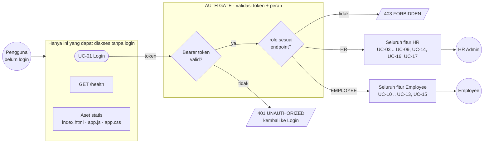
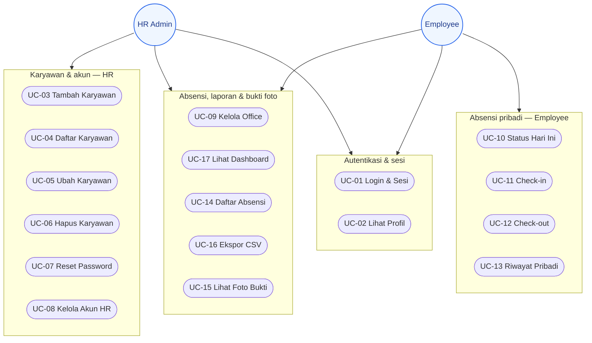
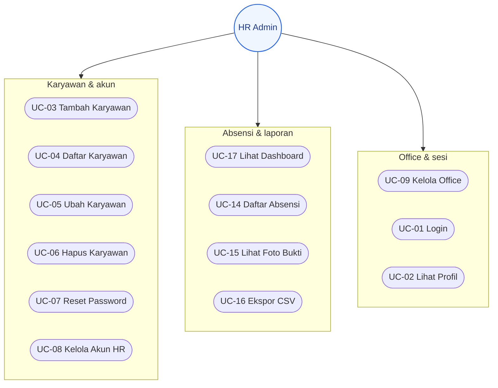
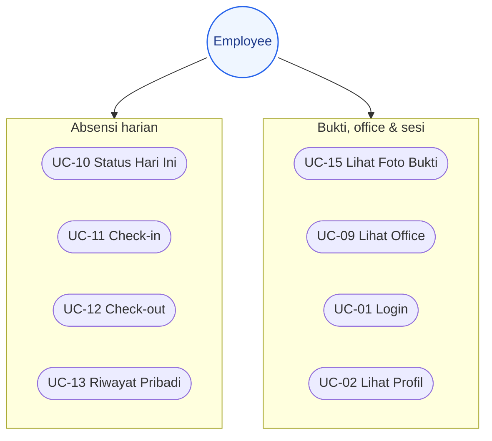

# Use Case Diagram & Spesifikasi Use Case
## Project A — Workforce Attendance System

| Item | Nilai |
|---|---|
| Versi | 2.0 (build) |
| Tanggal | 18 November 2026 |
| Aktor | HR Admin (Web), Employee (Mobile/klien API) |
| Jumlah Use Case | 17 |
| Invarian | **Semua fitur wajib login** (lihat `01-SRS.md` §0 dan `TASK.md` I-01) |

---

## 1. Auth Gate — Semua Fitur di Balik Login

**Baca diagram:** tidak ada jalur dari "Pengguna belum login" menuju fitur mana pun selain UC-01. Setiap fitur berlabel HR/Employee hanya tercapai setelah token lolos `G1` dan peran lolos `G2`.

---

## 2. Diagram Use Case Utama

> **Baca diagram:** dua aktor di atas, empat kotak fungsi di bawahnya. Panah aktor → kotak berarti aktor itu memakai **seluruh** use case dalam kotak tersebut. **UC-01** berada di kotak tengah karena menjadi gerbang bersama: tanpa token dari UC-01, tidak ada panah lain yang dapat dijalankan (lihat diagram Auth Gate §1). Rincian hak per use case ada di matriks §5.

### 2.1 Diagram per Aktor — HR Admin

> HR Admin memiliki akses ke **seluruh use case pada ketiga kolom**. Rincian hak tulis/baca ada di §3 dan §5.

### 2.2 Diagram per Aktor — Employee

> Employee hanya memiliki use case pada kedua kolom ini — **tidak** termasuk kolom "Karyawan & akun" dan "Absensi & laporan" milik HR pada §2.1.

---

## 3. Daftar Use Case

| ID | Use Case | Aktor | Prioritas | FR Terkait |
|---|---|---|---|---|
| UC-01 | Login & Sesi | HR, Employee | M | FR-AUTH-00..08, FR-WEB-05 |
| UC-02 | Lihat Profil | HR, Employee | M | FR-AUTH-06 |
| UC-03 | Tambah Karyawan | HR | M | FR-EMP-01..05, FR-EMP-12 |
| UC-04 | Lihat Daftar Karyawan | HR | M | FR-EMP-06, FR-EMP-07 |
| UC-05 | Ubah Karyawan | HR | M | FR-EMP-08, FR-EMP-09 |
| UC-06 | Hapus Karyawan | HR | S | FR-EMP-10 |
| UC-07 | Reset Password | HR | S | FR-EMP-11 |
| UC-08 | Kelola Akun HR | HR | S | FR-ADM-01..04 |
| UC-09 | Kelola Office | HR (CRUD), Employee (lihat) | M | FR-OFF-01..04 |
| UC-10 | Lihat Status Hari Ini | Employee | M | FR-ATT-01 |
| UC-11 | Check-in | Employee | M | FR-ATT-02, 03, 07..15 |
| UC-12 | Check-out | Employee | M | FR-ATT-04..06, 08..15 |
| UC-13 | Lihat Riwayat Pribadi | Employee | M | FR-HIS-01, 02, 04..07 |
| UC-14 | Daftar & Filter Absensi | HR | M | FR-HIS-03..07 |
| UC-15 | Lihat Foto Bukti | HR, Employee | S | FR-HIS-08 |
| UC-16 | Ekspor CSV | HR | C | FR-HIS-09 |
| UC-17 | Lihat Dashboard | HR | M | FR-DSH-01..05 |

---

## 4. Spesifikasi Use Case

### UC-01 — Login & Sesi

| Atribut | Detail |
|---|---|
| Aktor | HR Admin, Employee |
| Tujuan | Memperoleh token yang menjadi syarat akses seluruh fitur |
| Prakondisi | Pengguna terdaftar; untuk Employee, status karyawan `ACTIVE` |
| Pascakondisi | Token tersimpan di klien; pengguna masuk ke antarmuka sesuai peran |
| Trigger | Membuka aplikasi/web atau menekan "Masuk" |

**Alur Utama**
1. Sistem menampilkan layar Login (Web: `public/app.js:62-104`).
2. Pengguna mengisi email & password.
3. Klien memvalidasi field tidak kosong.
4. Klien memanggil `POST /api/login`.
5. Sistem mencari user berdasarkan email (lowercase) dan membandingkan hash bcrypt.
6. Sistem memeriksa status karyawan (khusus Employee).
7. Sistem menerbitkan JWT (`sub`, `role`, `expiresIn` default 12 jam).
8. Sistem mengembalikan `token`, `role`, `user`.
9. Web memeriksa role harus `HR`; jika bukan → tampilkan pesan "Akun ini bukan HR…".
10. Klien menyimpan token dan memuat antarmuka sesuai peran.

**Alur Alternatif**
- **A1** Field kosong → 400 `VALIDATION`.
- **A2** Email/password salah → 401 `INVALID_CREDENTIALS`.
- **A3** Employee `INACTIVE` → 403 `ACCOUNT_INACTIVE`.
- **A4** Web menerima role non-HR → login dibatalkan di sisi klien, pesan ditampilkan.
- **A5** **Token kedaluwarsa/tidak valid saat memakai fitur** → endpoint membalas 401; klien memanggil `logout()`, menghapus token, kembali ke Login (ATT-07).
- **A6** **Logout manual** → token dihapus dari `localStorage`, timer dihentikan, modal ditutup, layar Login tampil.

**Catatan:** tidak ada fitur yang dapat dicapai tanpa menyelesaikan langkah 1–10.

---

### UC-02 — Lihat Profil

| Atribut | Detail |
|---|---|
| Aktor | HR Admin, Employee |
| **Prakondisi** | **Sudah login** |
| Pascakondisi | Profil ditampilkan |
| FR | FR-AUTH-06 |

**Alur Utama**
1. Klien memanggil `GET /api/me` dengan bearer token.
2. Middleware memvalidasi token.
3. Sistem mengembalikan `id`, `name`, `email`, `role`, `account_code`, `employee{id, employee_code, name, status}`.
4. Klien menampilkan profil.

**Alur Alternatif**
- **A1** Token tidak valid → 401, kembali ke Login.

---

### UC-03 — Tambah Karyawan

| Atribut | Detail |
|---|---|
| Aktor | HR Admin |
| **Prakondisi** | **Sudah login sebagai HR** |
| Pascakondisi | `employees` + `users` terbentuk; password awal tampil sekali |
| FR | FR-EMP-01..05, FR-EMP-12 |

**Alur Utama**
1. HR membuka halaman Karyawan → "Tambah akun" → memilih jenis akun.
2. HR mengisi nama (wajib); kode/email/password opsional.
3. Sistem membuat kode `kyNN`, email `nama.depan@ethes.tech`, password acak 12 karakter.
4. Sistem memvalidasi format email dan panjang password (≥ 8).
5. Sistem memeriksa duplikasi kode & email.
6. Sistem membuka transaksi: `INSERT employees` → `INSERT users` (role `EMPLOYEE`).
7. Commit; respons 201 memuat data + `initial_password`.
8. Web menampilkan dialog kredensial dengan tombol salin.

**Alur Alternatif**
- **A1** Nama kosong → 400 `VALIDATION`.
- **A2** Kode dipakai → 409 `DUPLICATE_CODE`.
- **A3** Email dipakai → 409 `DUPLICATE_EMAIL`.
- **A4** Email otomatis bentrok → sufiks angka (`budi.santoso2@…`).
- **A5** Gagal di tengah → `ROLLBACK`, tidak ada record parsial.
- **A6** Token tidak valid → 401; sesi berakhir.

---

### UC-04 — Lihat Daftar Karyawan

| Atribut | Detail |
|---|---|
| Aktor | HR Admin |
| **Prakondisi** | **Sudah login sebagai HR** |
| Pascakondisi | Daftar karyawan tampil dengan paginasi |
| FR | FR-EMP-06, FR-EMP-07 |

**Alur Utama**
1. HR membuka halaman Karyawan (tab Karyawan).
2. Klien memanggil `GET /api/employees?page=1&limit=20`.
3. HR mengetik kata kunci (nama/kode/email) — pencarian ditunda 350 ms.
4. HR memilih filter status `ACTIVE`/`INACTIVE`.
5. Sistem mengembalikan `data` + `meta`.
6. Web menampilkan tabel + pager.

**Alur Alternatif**
- **A1** Tidak ada hasil → empty state.
- **A2** `status` tidak valid → 400 `VALIDATION`.
- **A3** 401 → kembali ke Login.

---

### UC-05 — Ubah Karyawan

| Atribut | Detail |
|---|---|
| Aktor | HR Admin |
| **Prakondisi** | **Sudah login sebagai HR**; karyawan ada |
| Pascakondisi | Data tersimpan; perubahan status langsung berlaku |
| FR | FR-EMP-08, FR-EMP-09 |

**Alur Utama**
1. HR menekan "Ubah" pada baris karyawan.
2. Form terisi data saat ini (nama, kode, email, status, password opsional).
3. HR mengubah field.
4. Sistem memvalidasi: nama tidak kosong, status ∈ {ACTIVE, INACTIVE}, format email, password ≥ 8.
5. Sistem memeriksa duplikasi terhadap karyawan lain.
6. Sistem memperbarui `employees` + `users` dalam satu transaksi.
7. Respons 200; tabel dimuat ulang.

**Alur Alternatif**
- **A1** Tidak ditemukan → 404 `NOT_FOUND`.
- **A2** Kode/email milik orang lain → 409.
- **A3** Status → `INACTIVE`: login ditolak (`ACCOUNT_INACTIVE`), IN/OUT ditolak.

---

### UC-06 — Hapus Karyawan

| Atribut | Detail |
|---|---|
| Aktor | HR Admin |
| **Prakondisi** | **Sudah login sebagai HR**; HR menyetujui konfirmasi |
| Pascakondisi | Karyawan, akun, riwayat, foto terhapus |
| FR | FR-EMP-10 |

**Alur Utama**
1. HR menekan "Hapus" → dialog konfirmasi menjelaskan dampaknya.
2. Sistem mengumpulkan daftar foto absensi karyawan.
3. Sistem menghapus `employees` (cascade ke `users` dan `attendances`).
4. Sistem menghapus berkas foto.
5. Respons `{ ok: true }`; toast sukses.

**Alur Alternatif**
- **A1** Sebagian foto gagal dihapus → sukses dengan `warning`.
- **A2** Tidak ditemukan → 404.

---

### UC-07 — Reset Password

| Atribut | Detail |
|---|---|
| Aktor | HR Admin |
| **Prakondisi** | **Sudah login sebagai HR**; karyawan punya akun |
| Pascakondisi | Password lama tidak berlaku; password baru tampil sekali |
| FR | FR-EMP-11 |

**Alur Utama**
1. HR menekan "Reset password" → dialog konfirmasi.
2. Sistem membuat password acak 12 karakter dan menyimpan hash.
3. Respons memuat `email` + `new_password`.
4. Web menampilkan dialog kredensial.

**Alur Alternatif**
- **A1** Karyawan tidak ditemukan → 404.

---

### UC-08 — Kelola Akun HR

| Atribut | Detail |
|---|---|
| Aktor | HR Admin |
| **Prakondisi** | **Sudah login sebagai HR** |
| Pascakondisi | Akun HR baru dapat login dengan role `HR` |
| FR | FR-ADM-01..04 |

**Alur Utama**
1. HR membuka halaman Karyawan → tab Admin.
2. Sistem menampilkan `account_code`, `name`, `email` akun HR.
3. HR menekan "Tambah akun" → jenis akun `HR`.
4. Sistem membuat `account_code` `HRNN` secara atomik (`INSERT IGNORE` + `LAST_INSERT_ID(seq + 1)` pada `hr_code_sequence`, di dalam transaksi MySQL).
5. Sistem menyimpan hash password; respons memuat `initial_password`.
6. Akun baru langsung dapat login dan membuka Dashboard.

**Alur Alternatif**
- **A1** Email dipakai → 409 `DUPLICATE_EMAIL`.
- **A2** Nama kosong → 400 `VALIDATION`.

---

### UC-09 — Kelola Office

| Atribut | Detail |
|---|---|
| Aktor | HR Admin (CRUD); Employee (lihat) |
| **Prakondisi** | **Sudah login** (CRUD butuh role HR) |
| Pascakondisi | Office tersimpan & dipakai validasi GPS |
| FR | FR-OFF-01..04 |

**Alur Utama (HR)**
1. HR membuka halaman Office.
2. Sistem menampilkan office aktif + peta tautan (OpenStreetMap).
3. HR menekan "Tambah office" / "Ubah".
4. HR mengisi nama, alamat, latitude, longitude, radius; dapat menekan "Pakai lokasi saya sekarang".
5. Sistem memvalidasi nama wajib, koordinat valid, radius 10–5000.
6. Sistem menyimpan; daftar dimuat ulang.

**Alur Utama (Employee)**
1. Employee memanggil `GET /api/offices`.
2. Sistem mengembalikan office aktif (nama, alamat, koordinat, radius).

**Alur Alternatif**
- **A1** Koordinat tidak valid → 400 `VALIDATION`.
- **A2** Radius di luar rentang → 400 `VALIDATION`.
- **A3** Office dinonaktifkan → hilang dari daftar aktif & tidak dipakai validasi.
- **A4** Employee mencoba POST/PUT → 403 `FORBIDDEN`.

---

### UC-10 — Lihat Status Hari Ini

| Atribut | Detail |
|---|---|
| Aktor | Employee |
| **Prakondisi** | **Sudah login sebagai Employee aktif** |
| Pascakondisi | Status dan tombol aksi yang sesuai tampil |
| FR | FR-ATT-01 |

**Alur Utama**
1. Mobile memanggil `GET /api/attendance/today`.
2. Sistem menghitung `work_date` dari jam server zona `Asia/Jakarta`.
3. Sistem mencari record absensi karyawan pada tanggal itu.
4. Sistem mengembalikan `state`, `can_check_in`, `can_check_out`, data absensi, `rules` (`work_start`, `late_tolerance_min`, `timezone`), `offices`.
5. Mobile menampilkan status + tombol relevan.

**Alur Alternatif**
- **A1** Karyawan `INACTIVE` → 403 `ACCOUNT_INACTIVE`.
- **A2** Token tidak valid → 401 → Login.

---

### UC-11 — Check-in

| Atribut | Detail |
|---|---|
| Aktor | Employee |
| **Prakondisi** | **Sudah login sebagai Employee aktif**; belum ada record absensi hari ini; ada office aktif; berada dalam radius |
| Pascakondisi | Record absensi dibuat dengan jam, status, office, koordinat, jarak, foto |
| FR | FR-ATT-02, 03, 07..15 |

**Alur Utama**
1. Employee menekan "IN".
2. Mobile meminta izin lokasi & kamera; mengambil koordinat dan foto.
3. Mobile mengirim `POST /api/attendance/check-in` (multipart: `photo`, `lat`, `lng`).
4. Sistem memvalidasi token → peran `EMPLOYEE` → status karyawan `ACTIVE`.
5. Sistem memastikan belum ada absensi `(employee_id, work_date)` → ATT-02.
6. Sistem memvalidasi keberadaan foto lalu koordinat.
7. Sistem mengambil office aktif, menghitung jarak Haversine ke office terdekat.
8. Jarak > `radius_m` → 403 `OUTSIDE_RADIUS`.
9. Sistem menentukan `TEPAT_WAKTU` / `TERLAMBAT` dari jam server.
10. Sistem menyimpan record → 201.
11. Mobile menampilkan `SUDAH_IN` + jam masuk.

**Alur Alternatif**
- **A1** Sudah IN → 409 `ALREADY_CHECKED_IN`; foto yang sudah terunggah dihapus.
- **A2** Foto tidak ada → 400 `PHOTO_REQUIRED`.
- **A3** GPS tidak ada/invalid → 400 `GPS_REQUIRED`.
- **A4** Di luar radius → 403 `OUTSIDE_RADIUS` + info jarak.
- **A5** Tidak ada office aktif → 409 `NO_OFFICE`.
- **A6** Karyawan nonaktif → 403 `ACCOUNT_INACTIVE`.
- **A7** Dua request bersamaan → unique constraint: satu 201, sisanya 409.
- **A8** Foto > 5 MB / tipe salah → 400 `INVALID_PHOTO`.
- **A9** Timeout/jaringan gagal → mobile menampilkan error; tidak menandai berhasil (ATT-08).

---

### UC-12 — Check-out

| Atribut | Detail |
|---|---|
| Aktor | Employee |
| **Prakondisi** | **Sudah login sebagai Employee aktif**; sudah IN hari ini; belum OUT |
| Pascakondisi | `check_out_at`, koordinat, jarak, foto OUT tersimpan |
| FR | FR-ATT-04..06, 08..15 |

**Alur Utama**
1. Employee menekan "OUT"; mobile mengambil GPS + foto.
2. Mobile mengirim `POST /api/attendance/check-out`.
3. Sistem memvalidasi token → peran → status karyawan.
4. Sistem mencari record absensi hari ini.
5. Record tidak ada → 409 `NOT_CHECKED_IN` (ATT-03).
6. `check_out_at` sudah terisi → 409 `ALREADY_CHECKED_OUT` (ATT-05).
7. Sistem memvalidasi foto, GPS, dan radius.
8. Sistem `UPDATE … WHERE id = ? AND check_out_at IS NULL` (guard konkurensi).
9. `changes = 0` → 409 `ALREADY_CHECKED_OUT`.
10. Respons 200; mobile menampilkan `SUDAH_OUT`.

**Alur Alternatif**
- **A1** Belum IN → 409 `NOT_CHECKED_IN`.
- **A2** Sudah OUT → 409 `ALREADY_CHECKED_OUT`.
- **A3** Foto/GPS/radius gagal → 400/403.
- **A4** Dua request OUT bersamaan → hanya satu berhasil.

---

### UC-13 — Lihat Riwayat Pribadi

| Atribut | Detail |
|---|---|
| Aktor | Employee |
| **Prakondisi** | **Sudah login sebagai Employee** |
| Pascakondisi | Daftar riwayat milik sendiri tampil |
| FR | FR-HIS-01, 02, 04..07, 08 |

**Alur Utama**
1. Mobile memanggil `GET /api/attendance/history` (default `this_month`).
2. Sistem memaksa `employee_id` = pengguna login.
3. Sistem menerapkan filter tanggal, status, urutan, paginasi.
4. Sistem mengembalikan `data` + `meta`.
5. Mobile menampilkan daftar; kosong → empty state.

**Alur Alternatif**
- **A1** Mengirim `employee_id` orang lain → 403 `FORBIDDEN` (ATT-06).
- **A2** Rentang > 366 hari → 400 `VALIDATION`.
- **A3** `status=BELUM_IN` pada rentang > 1 hari → 400 `VALIDATION`.
- **A4** 401 → Login.

---

### UC-14 — Daftar & Filter Absensi

| Atribut | Detail |
|---|---|
| Aktor | HR Admin |
| **Prakondisi** | **Sudah login sebagai HR** |
| Pascakondisi | Daftar absensi sesuai filter tampil |
| FR | FR-HIS-03..07 |

**Alur Utama**
1. HR membuka halaman Absensi (default `today`).
2. HR memilih periode (preset atau rentang kustom), status, dan/atau mengetik pencarian.
3. Sistem memvalidasi parameter tanggal & status.
4. Sistem menjalankan query `attendances` JOIN `employees`.
5. Sistem mengembalikan `data` + `meta` (`from`, `to`, `page`, `total`).
6. Web menampilkan tabel, thumbnail foto, dan pager.

**Alur Alternatif**
- **A1** `from` > `to` → 400 `VALIDATION`.
- **A2** Rentang > 366 hari → 400 `VALIDATION`.
- **A3** Status tidak dikenal → 400 `VALIDATION`.
- **A4** `BELUM_IN` pada rentang > 1 hari → 400 `VALIDATION`.
- **A5** Tidak ada data → empty state "Tidak ada data untuk filter ini."
- **A6** Employee memanggil endpoint ini → 403 `FORBIDDEN`.

---

### UC-15 — Lihat Foto Bukti

| Atribut | Detail |
|---|---|
| Aktor | HR Admin; Employee (milik sendiri) |
| **Prakondisi** | **Sudah login**; record punya foto |
| Pascakondisi | Berkas gambar ditampilkan |
| FR | FR-HIS-08 |

**Alur Utama**
1. Klien memanggil `GET /api/attendance/:id/photo/:type` dengan token.
2. Middleware memvalidasi token.
3. Sistem memeriksa: role `EMPLOYEE` hanya boleh foto miliknya.
4. Sistem mengirim berkas dari `uploads/attendance/`.

**Alur Alternatif**
- **A1** Record tidak ada → 404 `NOT_FOUND`.
- **A2** Foto tidak ada → 404 `NOT_FOUND`.
- **A3** Employee mengakses foto orang lain → 403 `FORBIDDEN`.
- **A4** Tanpa token → 401 (endpoint **bukan** publik).

---

### UC-16 — Ekspor CSV

| Atribut | Detail |
|---|---|
| Aktor | HR Admin |
| **Prakondisi** | **Sudah login sebagai HR**; filter aktif |
| Pascakondisi | `absensi-<tanggal>.csv` terunduh |
| FR | FR-HIS-09 |

**Alur Utama**
1. HR menekan "Unduh CSV".
2. Web memanggil endpoint absensi berulang (`limit=200`), maksimal 25 halaman.
3. Web menyusun baris CSV: Tanggal, Kode, Nama, IN, OUT, Status, Jarak IN, Jarak OUT.
4. Browser mengunduh; toast menampilkan jumlah baris.

**Alur Alternatif**
- **A1** Data > 5000 baris → hanya 25 halaman pertama.
- **A2** Request gagal → toast error, tidak menghasilkan berkas.

---

### UC-17 — Lihat Dashboard

| Atribut | Detail |
|---|---|
| Aktor | HR Admin |
| **Prakondisi** | **Sudah login sebagai HR** |
| Pascakondisi | Ringkasan, daftar perhatian, dan tren tampil |
| FR | FR-DSH-01..05 |

**Alur Utama**
1. HR membuka Dashboard (default hari ini).
2. Sistem menghitung total karyawan aktif.
3. Sistem mengagregasi absensi tanggal tersebut: sudah IN, tepat waktu, terlambat, belum OUT, sudah OUT.
4. `belum_in = max(0, total_active − sudah_in)`.
5. Sistem menyusun daftar terlambat, belum OUT, belum IN.
6. Sistem menyusun tren 7 hari.
7. Web merender 5 kartu ringkasan, 3 tab daftar, dan grafik tren; refresh otomatis tiap 60 detik.

**Alur Alternatif**
- **A1** Format `date` salah → 400 `VALIDATION`.
- **A2** Tidak ada data → angka 0 + empty state.
- **A3** Refresh otomatis gagal → toast "Gagal memperbarui", data lama dipertahankan.
- **A4** 401 → Login.

---

## 5. Matriks Aktor × Use Case

| Use Case | HR Admin | Employee | Tanpa Login |
|---|---|---|---|
| UC-01 Login & Sesi | ✔ | ✔ | ✔ (satu-satunya) |
| UC-02 Lihat Profil | ✔ | ✔ | ✘ |
| UC-03 Tambah Karyawan | ✔ | ✘ | ✘ |
| UC-04 Lihat Daftar Karyawan | ✔ | ✘ | ✘ |
| UC-05 Ubah Karyawan | ✔ | ✘ | ✘ |
| UC-06 Hapus Karyawan | ✔ | ✘ | ✘ |
| UC-07 Reset Password | ✔ | ✘ | ✘ |
| UC-08 Kelola Akun HR | ✔ | ✘ | ✘ |
| UC-09 Kelola Office | ✔ (CRUD) | ✔ (lihat) | ✘ |
| UC-10 Lihat Status Hari Ini | ✘ | ✔ | ✘ |
| UC-11 Check-in | ✘ | ✔ | ✘ |
| UC-12 Check-out | ✘ | ✔ | ✘ |
| UC-13 Lihat Riwayat Pribadi | ✘ | ✔ | ✘ |
| UC-14 Daftar & Filter Absensi | ✔ | ✘ | ✘ |
| UC-15 Lihat Foto Bukti | ✔ (semua) | ✔ (sendiri) | ✘ |
| UC-16 Ekspor CSV | ✔ | ✘ | ✘ |
| UC-17 Lihat Dashboard | ✔ | ✘ | ✘ |

---

## 6. Ringkasan Prakondisi

| Use Case | Prakondisi |
|---|---|
| UC-01 | — (gerbang login) |
| UC-02, UC-09 (lihat), UC-15 | Sudah login |
| UC-03 .. UC-08, UC-14, UC-16, UC-17 | Sudah login **sebagai HR** |
| UC-10 .. UC-13 | Sudah login **sebagai Employee aktif** |
| UC-11 | + belum IN hari ini + ada office aktif + dalam radius |
| UC-12 | + sudah IN + belum OUT + dalam radius |