# Activity Diagram
## Project A — Workforce Attendance System

| Item | Nilai |
|---|---|
| Versi | 2.2 (tata letak ringkas) |
| Tanggal | 18 November 2026 |
| Jumlah Diagram | 15 (AD-01 … AD-15) |
| Invarian | **Semua alur dimulai dari pemeriksaan sesi/login** (`TASK.md` I-01) |
| Konvensi gambar | Jalur utama satu kolom vertikal; cabang gagal menjadi **node merah di samping** keputusan, tidak ditarik ke bawah |

> **Cara membaca:** setiap diagram dimulai dari `Mulai` lalu pemeriksaan token/peran. Hanya AD-01 yang tidak memeriksa token, karena AD-01 adalah proses **memperoleh** token. Node merah adalah **akhir alur** — pengguna kembali ke Login, bukan melanjutkan proses. Bila satu keputusan memiliki beberapa penyebab gagal, penyebabnya ditulis pada label panah dan hasilnya dipecah menjadi beberapa node merah sejajar.
>
> Warna: **biru** = mulai/selesai · **kuning** = keputusan · **merah** = jalur gagal · **abu-abu** = langkah proses.

---

## AD-01 — Login & Pembentukan Sesi

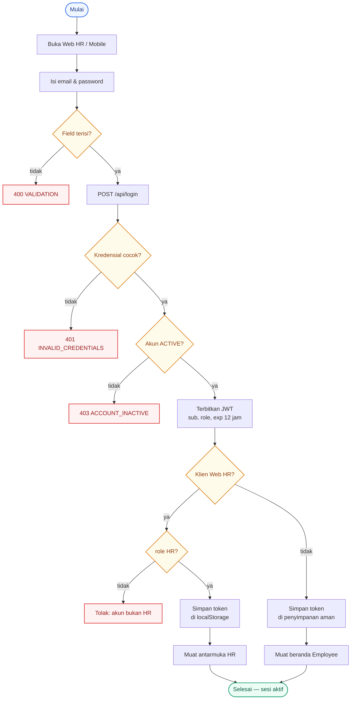

**Rujukan:** `src/routes/auth.js:10-21`, `src/middleware/auth.js:7-19`, `public/app.js:62-111`.

---

## AD-02 — Membuka Aplikasi Web HR (Pemeriksaan Sesi)

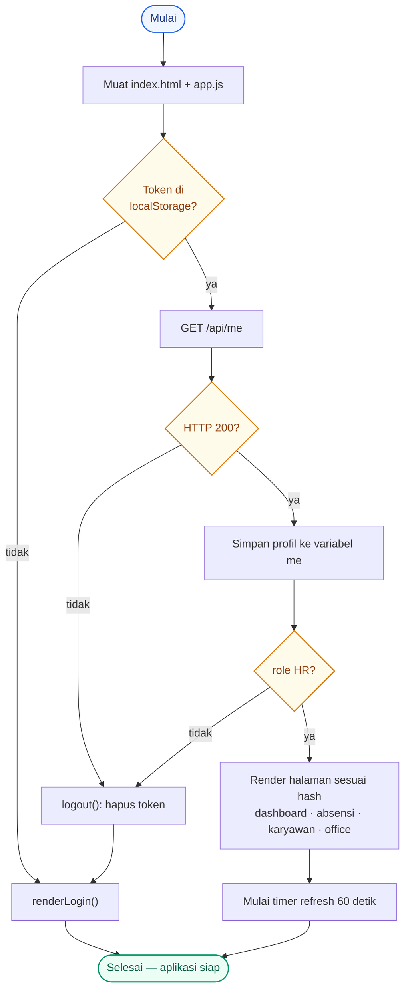

**Rujukan:** `public/app.js:14-31` (api + 401), `:56-60` (logout), `:107-111` (boot), `:126-133` (routing hash).

---

## AD-03 — Lihat Status Absensi Hari Ini

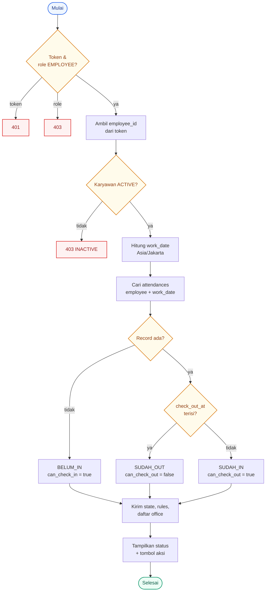

**Rujukan:** `src/routes/attendance.js:61-72`, `src/utils/time.js:7`.

---

## AD-04 — Check-in (IN)

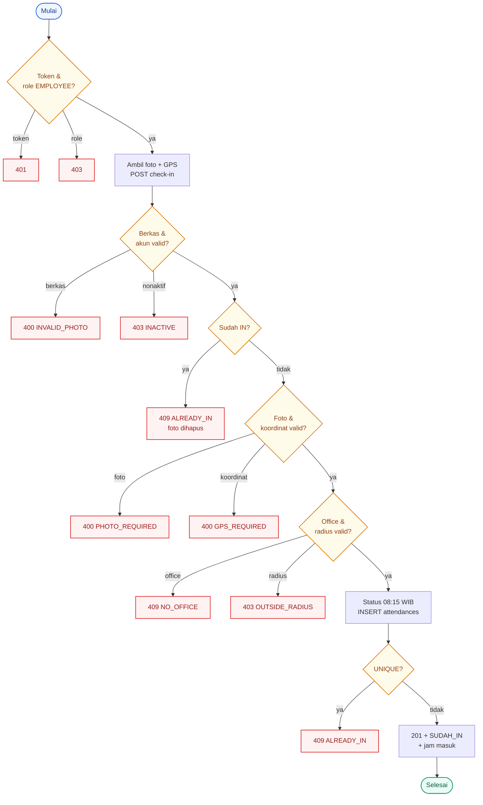

**Rujukan:** `src/routes/attendance.js:32-52,75-90`, `src/utils/geo.js`, `src/utils/time.js:15-20`.

**Catatan:** multer berjalan sebelum cek status karyawan, jadi `INVALID_PHOTO` dapat muncul untuk akun nonaktif. Bila handler gagal setelah foto terunggah, `withUpload` menghapus berkas itu (`attendance.js:46-52`).

---

## AD-05 — Check-out (OUT)

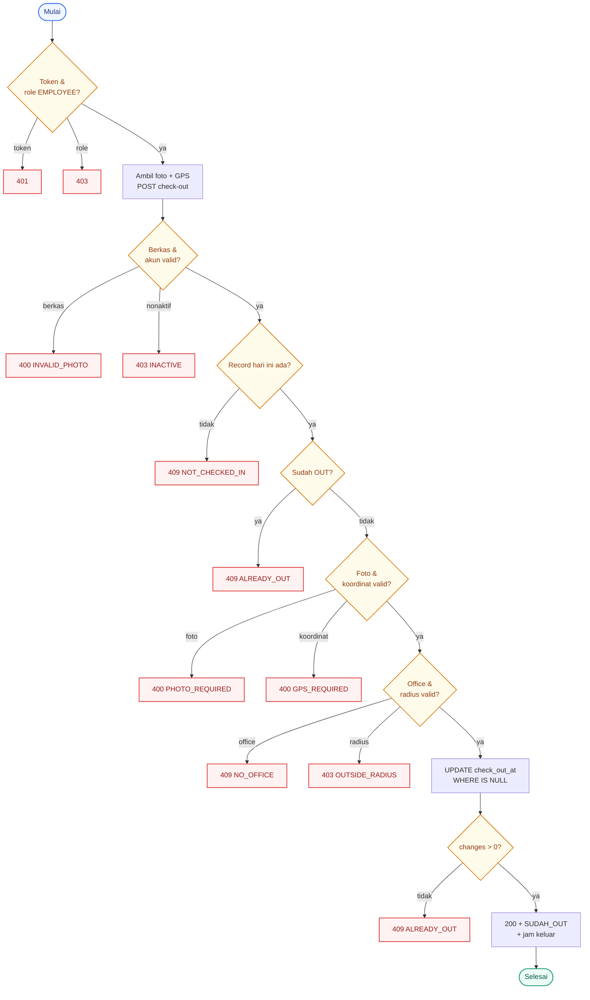

**Rujukan:** `src/routes/attendance.js:93-103`.

**Catatan:** kode error lengkap adalah `ALREADY_CHECKED_OUT`; diringkas menjadi `ALREADY_OUT` hanya pada gambar agar node tetap satu baris. Teks kode penuh dipakai pada `05-Flowchart.md` FC-04 dan matriks keputusan.

---

## AD-06 — Riwayat Kehadiran (Employee & HR)

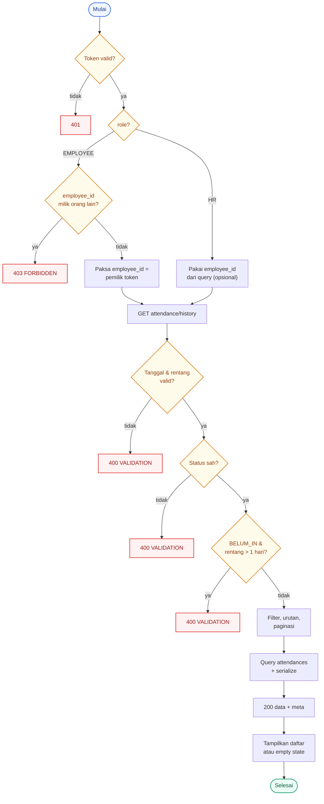

**Rujukan:** `src/routes/attendance.js:109-149`, `src/utils/filters.js`.

---

## AD-07 — Daftar & Filter Absensi (HR)

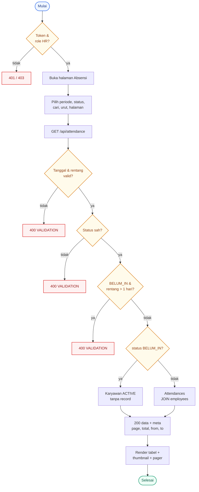

**Rujukan:** `src/routes/attendance.js:109-152`, `public/app.js` halaman absensi.

---

## AD-08 — Dashboard HR

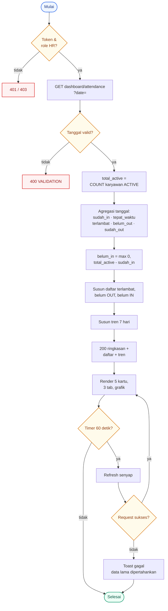

**Rujukan:** `src/routes/dashboard.js:13-38`, `public/app.js` halaman dashboard.

---

## AD-09 — Tambah Karyawan (HR)

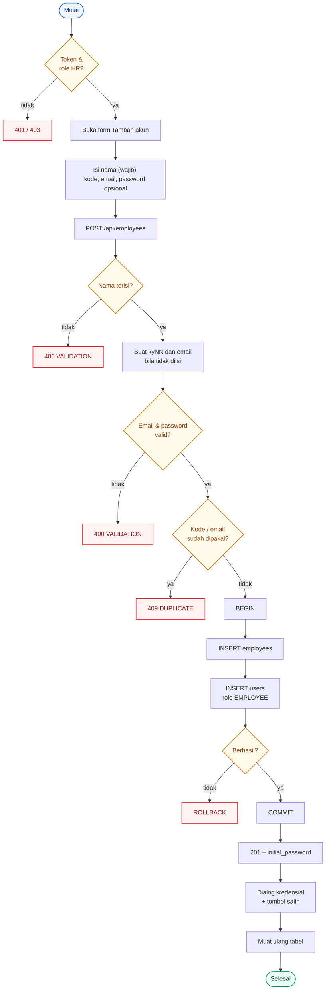

**Rujukan:** `src/routes/employees.js:17-29,54-75`.

---

## AD-10 — Ubah Karyawan (HR)

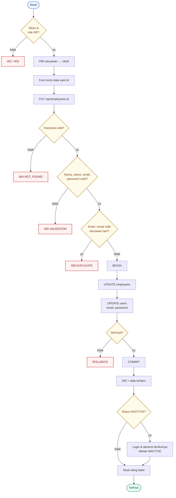

**Rujukan:** `src/routes/employees.js:77-101`, `src/routes/auth.js:17-18`.

---

## AD-11 — Hapus Karyawan (HR)

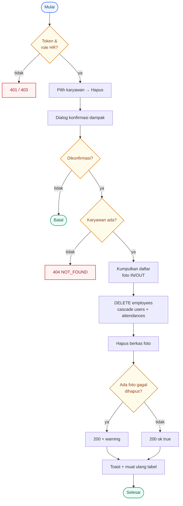

**Rujukan:** `src/routes/employees.js:103-122`, `src/db.js:21,39`.

---

## AD-12 — Kelola Office

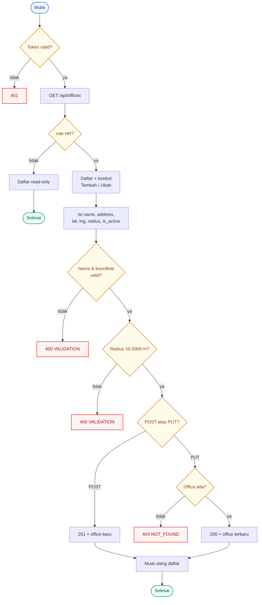

**Rujukan:** `src/routes/offices.js:7-41`.

---

## AD-13 — Kelola Akun HR

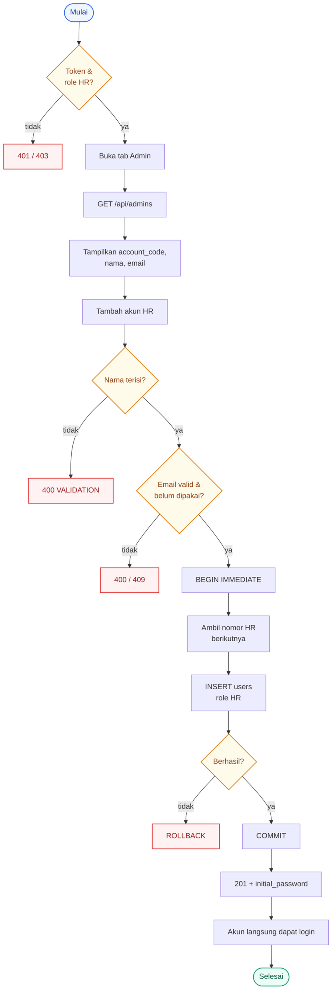

**Rujukan:** `src/routes/admins.js:10-51`, `src/utils/hr-code.js`.

---

## AD-14 — Reset Password Karyawan

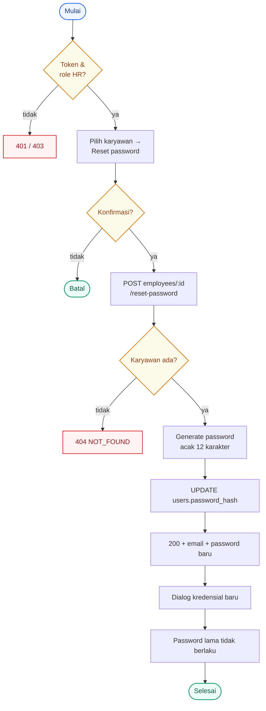

**Rujukan:** `src/routes/employees.js:124-131`.

---

## AD-15 — Lihat Foto Bukti

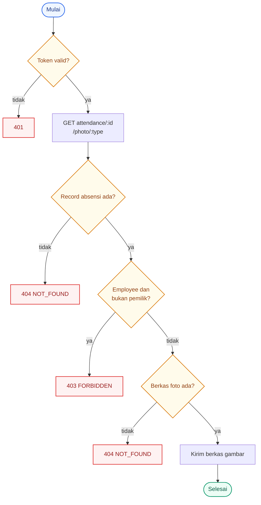

**Rujukan:** `src/routes/attendance.js:154-162`.

---

## Ringkasan Titik Awal & Akhir

| Diagram | Titik awal | Cek token/role | Cabang error utama | Titik akhir |
|---|---|---|---|---|
| AD-01 Login | Buka aplikasi | — (gerbang) | 400, 401, 403 | Sesi aktif |
| AD-02 Boot Web | Muat aset | Token + `/api/me` | 401 → Login | Aplikasi siap |
| AD-03 Status hari ini | Buka beranda | Token + EMPLOYEE | 401, 403 | Status tampil |
| AD-04 Check-in | Tekan IN | Token + EMPLOYEE | 400, 403, 409 | SUDAH_IN |
| AD-05 Check-out | Tekan OUT | Token + EMPLOYEE | 400, 403, 409 | SUDAH_OUT |
| AD-06 Riwayat | Buka riwayat | Token (+ cek pemilik) | 400, 401, 403 | Daftar tampil |
| AD-07 Absensi HR | Buka absensi | Token + HR | 400, 401, 403 | Tabel tampil |
| AD-08 Dashboard | Buka dashboard | Token + HR | 400, 401, 403 | Ringkasan tampil |
| AD-09 Tambah karyawan | Form tambah | Token + HR | 400, 401, 403, 409 | Akun dibuat |
| AD-10 Ubah karyawan | Form ubah | Token + HR | 400, 404, 409 | Data tersimpan |
| AD-11 Hapus karyawan | Tombol hapus | Token + HR | 401, 404 | Data terhapus |
| AD-12 Office | Menu office | Token (+HR untuk tulis) | 400, 403, 404 | Daftar office |
| AD-13 Akun HR | Tab admin | Token + HR | 400, 409 | Akun HR dibuat |
| AD-14 Reset password | Tombol reset | Token + HR | 404 | Password baru |
| AD-15 Foto bukti | Klik thumbnail | Token | 401, 403, 404 | Gambar tampil |
