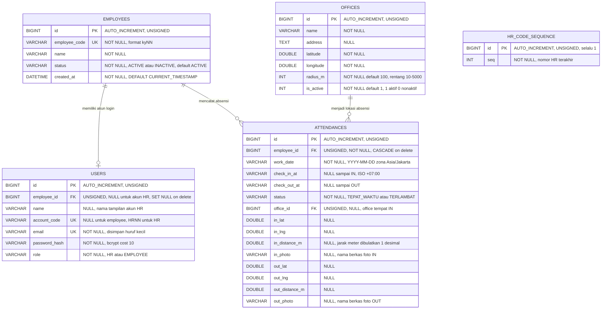
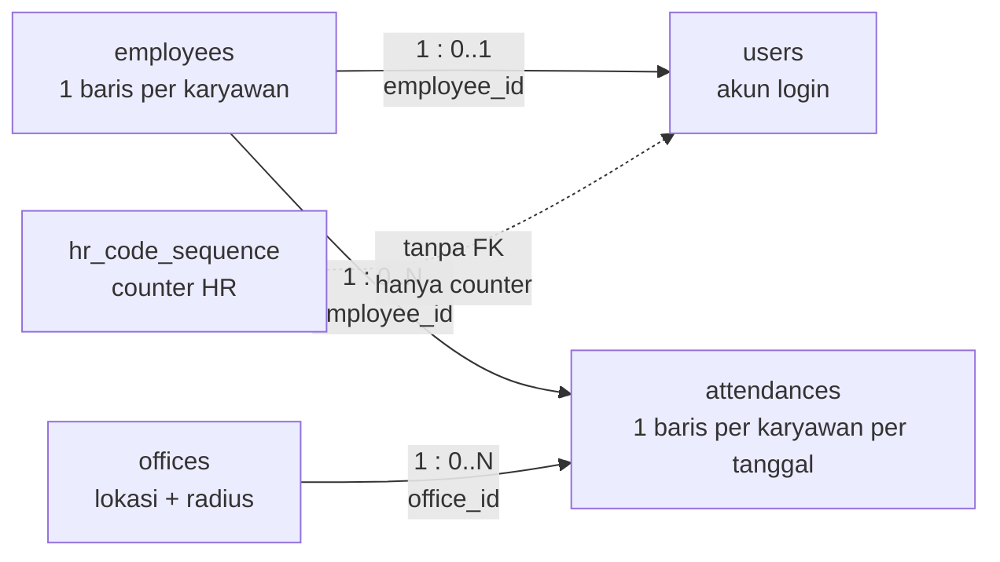
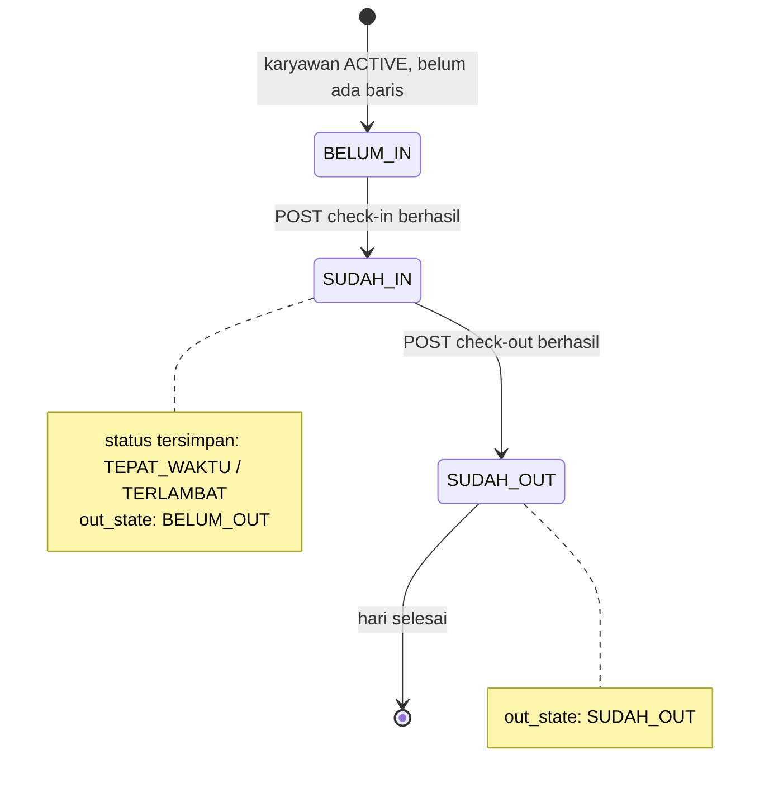

# Entity Relationship Diagram (ERD)
## Project A — Workforce Attendance System

| Item | Nilai |
|---|---|
| Versi | 2.2 (build) |
| Tanggal | 19 November 2026 |
| DBMS | MySQL 8 / MariaDB 10.4+ (`pdo_mysql`, InnoDB, `utf8mb4_unicode_ci`) |
| Sumber skema | `database/migrations/`, seeder `database/seeders/` |
| Tabel | 5 (`employees`, `users`, `offices`, `attendances`, `hr_code_sequence`) |
| Invarian akses | Seluruh data hanya dapat dibaca melalui API yang mensyaratkan login (`TASK.md` I-01) |

---

## 1. Diagram ERD



> **Catatan:** `HR_CODE_SEQUENCE` tidak memiliki relasi FK; ia hanya counter untuk membentuk `account_code` `HRNN` secara atomik (`app/Services/HrCodeService.php`). Karena itu tabel ini berdiri sendiri di diagram.

---

## 2. Diagram Relasi (Kardinalitas)



### 2.1 Penjelasan Kardinalitas

| Relasi | Kardinalitas | Aturan | Bukti |
|---|---|---|---|
| `employees` → `users` | 1 : 0..1 | Satu karyawan punya paling banyak satu akun; akun HR boleh tanpa karyawan (`employee_id` NULL) | `users.employee_id` nullable `REFERENCES employees(id) ON DELETE SET NULL` |
| `employees` → `attendances` | 1 : 0..N | Satu karyawan punya banyak absensi, maksimal **satu per `work_date`** | `UNIQUE (employee_id, work_date)` |
| `offices` → `attendances` | 1 : 0..N | Satu office dipakai banyak absensi; office yang dinonaktifkan tetap tersimpan di record lama | `attendances.office_id` `REFERENCES offices(id) ON DELETE SET NULL`, `offices.is_active` |
| `hr_code_sequence` | — | Satu baris (`id = 1`) menyimpan nomor HR terakhir | Dijaga `app/Services/HrCodeService.php` (`INSERT IGNORE` + `id = 1`) |

### 2.2 Perilaku Penghapusan

| Aksi | Dampak | Bukti |
|---|---|---|
| Hapus karyawan | `users` dan `attendances` ikut terhapus (CASCADE); berkas foto dihapus manual | `app/Http/Controllers/Api/EmployeeController.php:255-294` |
| Hapus office | **Tidak disediakan endpoint hapus**; hanya `is_active = 0` | `app/Http/Controllers/Api/OfficeController.php` tidak punya `DELETE` |
| Nonaktifkan karyawan | Data tetap ada; login & absensi ditolak | `app/Http/Controllers/Api/EmployeeController.php:193-253`, `app/Http/Controllers/Api/AuthController.php:39-41`, `app/Http/Controllers/Api/AttendanceController.php:23-36` |

---

## 3. Kamus Data

### 3.1 `employees`

| Kolom | Tipe | Null | Default | Keterangan |
|---|---|---|---|---|
| `id` | BIGINT | tidak | AUTO_INCREMENT | PK |
| `employee_code` | VARCHAR(255) | tidak | — | UK; `kyNN` (dua digit, melanjutkan nomor terbesar) |
| `name` | VARCHAR(255) | tidak | — | Nama lengkap |
| `status` | VARCHAR(255) | tidak | `ACTIVE` | `ACTIVE`/`INACTIVE` divalidasi di aplikasi, bukan `CHECK` |
| `created_at` | DATETIME | tidak | `CURRENT_TIMESTAMP` | Waktu pembuatan (UTC) |

**Aturan:** kode dibuat `kyNN` dari `max(AUTO_INCREMENT - 1, MAX(kode numerik)) + 1` (`app/Http/Controllers/Api/EmployeeController.php:41-56`). `AUTO_INCREMENT` dipakai agar kode lama tidak dipakai ulang setelah karyawan dihapus.

### 3.2 `users`

| Kolom | Tipe | Null | Default | Keterangan |
|---|---|---|---|---|
| `id` | BIGINT | tidak | AUTO_INCREMENT | PK |
| `employee_id` | BIGINT | ya | — | FK → `employees.id`, `ON DELETE SET NULL` |
| `name` | VARCHAR(255) | ya | — | Nama tampilan; dipakai akun HR |
| `account_code` | VARCHAR(255) | ya | — | UK; `HRNN` untuk HR, NULL untuk employee |
| `email` | VARCHAR(255) | tidak | — | UK; disimpan huruf kecil |
| `password_hash` | VARCHAR(255) | tidak | — | bcrypt `Hash::make(...)` |
| `role` | VARCHAR(255) | tidak | — | `HR`/`EMPLOYEE` divalidasi di aplikasi |

**Catatan migrasi:** skema dibentuk ulang oleh Laravel (`database/migrations/2014_10_12_000001_create_users_table.php`); tidak ada mekanisme `user_version` — versi skema dilacak tabel `migrations`.

### 3.3 `offices`

| Kolom | Tipe | Null | Default | Keterangan |
|---|---|---|---|---|
| `id` | BIGINT | tidak | AUTO_INCREMENT | PK |
| `name` | VARCHAR(255) | tidak | — | Nama lokasi |
| `address` | TEXT | ya | — | Alamat bebas |
| `latitude` | DOUBLE | tidak | — | −90 … 90 |
| `longitude` | DOUBLE | tidak | — | −180 … 180 |
| `radius_m` | INT | tidak | 100 | 10 … 5000 meter |
| `is_active` | INT | tidak | 1 | 1 = aktif, 0 = nonaktif |

**Validasi:** `app/Http/Controllers/Api/OfficeController.php:54-66`; koordinat memakai `validCoord` (`app/Services/GeoService.php:22-25`).

### 3.4 `attendances`

| Kolom | Tipe | Null | Keterangan |
|---|---|---|---|
| `id` | BIGINT | tidak | PK |
| `employee_id` | BIGINT | tidak | FK → `employees.id`, CASCADE |
| `work_date` | VARCHAR(255) | tidak | `YYYY-MM-DD` hasil `T.workDate()` zona `Asia/Jakarta` |
| `check_in_at` | VARCHAR(255) | ya | ISO dengan offset `+07:00` (`T.nowWib`) |
| `check_out_at` | VARCHAR(255) | ya | ISO `+07:00` |
| `status` | VARCHAR(255) | tidak | `TEPAT_WAKTU` atau `TERLAMBAT`, dihitung saat IN |
| `office_id` | BIGINT | ya | Office yang dipakai saat IN, `ON DELETE SET NULL` |
| `in_lat`, `in_lng` | DOUBLE | ya | Koordinat IN |
| `in_distance_m` | DOUBLE | ya | Jarak Haversine, 1 desimal |
| `in_photo` | VARCHAR(255) | ya | Nama berkas di `uploads/attendance/` |
| `out_lat`, `out_lng` | DOUBLE | ya | Koordinat OUT |
| `out_distance_m` | DOUBLE | ya | Jarak Haversine OUT |
| `out_photo` | VARCHAR(255) | ya | Nama berkas foto OUT |

**Unique:** `UNIQUE (employee_id, work_date)` — penjaga utama ATT-02 dan race condition (`database/migrations/2014_10_12_000003_create_attendances_table.php:29`, `app/Http/Controllers/Api/AttendanceController.php:179-181`).

### 3.5 `hr_code_sequence`

| Kolom | Tipe | Null | Keterangan |
|---|---|---|---|
| `id` | BIGINT | tidak | PK, selalu `1` (dijamin `INSERT IGNORE` di service) |
| `seq` | INT | tidak | Nomor HR terakhir yang dipakai |

**Mekanisme:** `INSERT IGNORE` baris `id = 1`, lalu `UPDATE ... SET seq = LAST_INSERT_ID(seq + 1)`, lalu `SELECT LAST_INSERT_ID()`. Nilai dibaca dari koneksi yang sama sehingga dua permintaan bersamaan tidak mendapat nomor kembar (`app/Services/HrCodeService.php`).

---

## 4. Status Turunan (Tidak Disimpan)

Hanya **dua** nilai status yang benar-benar tersimpan di kolom `attendances.status`. Nilai lain dihitung saat query.

| Status | Sumber | Rumus | Bukti |
|---|---|---|---|
| `TEPAT_WAKTU` | Tersimpan | `jam_server <= 08:15` | `app/Services/TimeService.php:38-47` |
| `TERLAMBAT` | Tersimpan | `jam_server > 08:15` | `app/Services/TimeService.php:38-47` |
| `BELUM_IN` | Turunan | Karyawan `ACTIVE` tanpa baris `attendances` pada tanggal itu | `app/Http/Controllers/Api/AttendanceController.php:271-308`, `app/Http/Controllers/Api/DashboardController.php:78-83` |
| `BELUM_OUT` | Turunan | `check_out_at IS NULL` | `app/Http/Controllers/Api/AttendanceController.php:339-340` |
| `SUDAH_OUT` | Turunan | `check_out_at IS NOT NULL` | `app/Http/Controllers/Api/AttendanceController.php:341-342` |
| `out_state` | Turunan | `SUDAH_OUT` / `BELUM_OUT` per baris | `app/Models/Attendance.php:64` |



---

## 5. DDL Aktual

```sql
-- Hasil nyata `php artisan migrate` pada MySQL (skema dibuat oleh database/migrations/)
CREATE TABLE `employees` (
  `id` bigint unsigned NOT NULL AUTO_INCREMENT,
  `employee_code` varchar(255) NOT NULL,
  `name` varchar(255) NOT NULL,
  `status` varchar(255) NOT NULL DEFAULT 'ACTIVE',
  `created_at` datetime NOT NULL DEFAULT CURRENT_TIMESTAMP,
  PRIMARY KEY (`id`),
  UNIQUE KEY `employees_employee_code_unique` (`employee_code`)
) ENGINE=InnoDB DEFAULT CHARSET=utf8mb4 COLLATE=utf8mb4_unicode_ci;

CREATE TABLE `users` (
  `id` bigint unsigned NOT NULL AUTO_INCREMENT,
  `employee_id` bigint unsigned DEFAULT NULL,
  `name` varchar(255) DEFAULT NULL,
  `account_code` varchar(255) DEFAULT NULL,
  `email` varchar(255) NOT NULL,
  `password_hash` varchar(255) NOT NULL,
  `role` varchar(255) NOT NULL,
  PRIMARY KEY (`id`),
  UNIQUE KEY `users_email_unique` (`email`),
  UNIQUE KEY `users_account_code_unique` (`account_code`),
  KEY `users_employee_id_foreign` (`employee_id`),
  CONSTRAINT `users_employee_id_foreign` FOREIGN KEY (`employee_id`) REFERENCES `employees` (`id`) ON DELETE SET NULL
) ENGINE=InnoDB DEFAULT CHARSET=utf8mb4 COLLATE=utf8mb4_unicode_ci;

CREATE TABLE `offices` (
  `id` bigint unsigned NOT NULL AUTO_INCREMENT,
  `name` varchar(255) NOT NULL,
  `address` text DEFAULT NULL,
  `latitude` double NOT NULL,
  `longitude` double NOT NULL,
  `radius_m` int NOT NULL DEFAULT 100,
  `is_active` int NOT NULL DEFAULT 1,
  PRIMARY KEY (`id`)
) ENGINE=InnoDB DEFAULT CHARSET=utf8mb4 COLLATE=utf8mb4_unicode_ci;

CREATE TABLE `attendances` (
  `id` bigint unsigned NOT NULL AUTO_INCREMENT,
  `employee_id` bigint unsigned NOT NULL,
  `work_date` varchar(255) NOT NULL,
  `check_in_at` varchar(255) DEFAULT NULL,
  `check_out_at` varchar(255) DEFAULT NULL,
  `status` varchar(255) NOT NULL,
  `office_id` bigint unsigned DEFAULT NULL,
  `in_lat` double DEFAULT NULL,
  `in_lng` double DEFAULT NULL,
  `in_distance_m` double DEFAULT NULL,
  `in_photo` varchar(255) DEFAULT NULL,
  `out_lat` double DEFAULT NULL,
  `out_lng` double DEFAULT NULL,
  `out_distance_m` double DEFAULT NULL,
  `out_photo` varchar(255) DEFAULT NULL,
  PRIMARY KEY (`id`),
  UNIQUE KEY `attendances_employee_id_work_date_unique` (`employee_id`, `work_date`),
  KEY `attendances_office_id_foreign` (`office_id`),
  KEY `attendances_work_date_index` (`work_date`),
  CONSTRAINT `attendances_employee_id_foreign` FOREIGN KEY (`employee_id`) REFERENCES `employees` (`id`) ON DELETE CASCADE,
  CONSTRAINT `attendances_office_id_foreign` FOREIGN KEY (`office_id`) REFERENCES `offices` (`id`) ON DELETE SET NULL
) ENGINE=InnoDB DEFAULT CHARSET=utf8mb4 COLLATE=utf8mb4_unicode_ci;

CREATE TABLE `hr_code_sequence` (
  `id` bigint unsigned NOT NULL AUTO_INCREMENT,
  `seq` int NOT NULL DEFAULT 0,
  PRIMARY KEY (`id`)
) ENGINE=InnoDB DEFAULT CHARSET=utf8mb4 COLLATE=utf8mb4_unicode_ci;
```

> **Catatan:** tidak ada `CHECK` constraint pada `status`/`role`; validasi nilai dilakukan di lapisan aplikasi (`app/Http/Controllers/Api/*.php`). Integritas relasi dijaga `FOREIGN KEY` InnoDB (`ON DELETE CASCADE` untuk `attendances.employee_id`, `SET NULL` untuk `users.employee_id` dan `attendances.office_id`). Versi skema dilacak tabel `migrations`, bukan `user_version`.

---

## 6. Indeks & Kinerja

| Indeks | Kolom | Tujuan |
|---|---|---|
| `attendances_work_date_index` | `attendances.work_date` | Filter tanggal & agregasi dashboard |
| `attendances_employee_id_work_date_unique` | `(employee_id, work_date)` | UNIQUE, sekaligus jalur baca status hari ini |
| `users_email_unique` | `users.email` | Login |
| `users_account_code_unique` | `users.account_code` | Pencarian akun HR |
| `employees_employee_code_unique` | `employees.employee_code` | Duplikasi kode |

Query utama yang dilayani:

| Query | Dipakai oleh | Indeks |
|---|---|---|
| `WHERE employee_id = ? AND work_date = ?` | status hari ini, IN, OUT | UNIQUE komposit |
| `WHERE work_date BETWEEN ? AND ?` | daftar & riwayat | `attendances_work_date_index` |
| `JOIN employees` + `LIKE` nama/kode | pencarian | scan terbatas, dataset kecil |
| `GROUP BY work_date` (tren) | dashboard | `attendances_work_date_index` |

---

## 7. Normalisasi

| Bentuk | Status | Catatan |
|---|---|---|
| 1NF | Terpenuhi | Semua kolom atomik; tidak ada kolom berulang |
| 2NF | Terpenuhi | Semua tabel memakai PK tunggal; tidak ada dependensi parsial |
| 3NF | Terpenuhi | `office_id` dan `employee_id` disimpan sebagai FK, bukan duplikasi nama |
| Denormalisasi sadar | `in_distance_m`, `out_distance_m` | Jarak dihitung saat transaksi dan disimpan sebagai bukti historis, karena radius office dapat berubah |
| Denormalisasi sadar | `attendances.status` | Status ketepatan waktu dibekukan saat IN agar perubahan aturan jam tidak mengubah riwayat |

**Tidak ada kolom `updated_at`** pada `employees`/`offices`; perubahan tidak dilacak waktu. Ini keterbatasan yang dicatat, bukan fitur.

---

## 8. Konsistensi dengan Dokumen Awal

| Butir | Dokumen Awal | Implementasi | Status |
|---|---|---|---|
| DBMS | MySQL + migrations/seeder | MySQL/MariaDB InnoDB (`pdo_mysql`) | Sesuai; D-01 ditutup |
| Migrasi | Framework migrations | Migrasi Laravel (`database/migrations/`) | Sesuai |
| Tabel | karyawan, absensi, kantor, users | Ditambah `hr_code_sequence` | Tambahan teknis |
| Foto | Tidak dirancang | `in_photo`, `out_photo` + berkas fisik | Deviasi D-02 |
| Koordinat | Tidak dirancang | `in_lat/lng`, `out_lat/lng`, jarak | Deviasi D-02 |

Detail deviasi lain ada di `01-SRS.md` §10.

---

## 9. Catatan Implementasi

1. **Foto disimpan sebagai nama berkas**, bukan BLOB. Direktori `uploads/attendance` (`base_path('uploads/attendance')`, `app/Http/Controllers/Api/AttendanceController.php:101-118`).
2. **Hapus karyawan** menghapus baris lebih dulu, lalu berkas foto; kegagalan hapus berkas tidak membatalkan penghapusan data (`app/Http/Controllers/Api/EmployeeController.php:255-294`).
3. **Tidak ada tabel sesi**; JWT bersifat stateless. Logout hanya menghapus token di klien.
4. **Zona waktu** tidak disimpan per baris. `work_date` dan `check_*_at` sudah dalam WIB, sehingga riwayat tetap terbaca benar meski server berpindah zona.
5. **`attendances.status` NOT NULL** dan hanya menerima dua nilai (`TEPAT_WAKTU`/`TERLAMBAT`) karena diisi `TimeService::attendanceStatus()`; status `BELUM_*` tidak pernah masuk database.