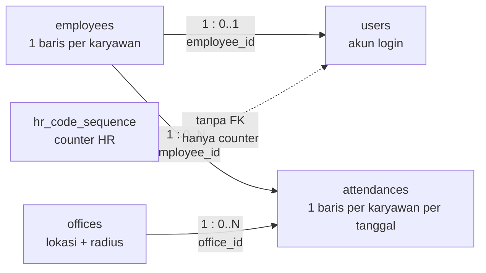
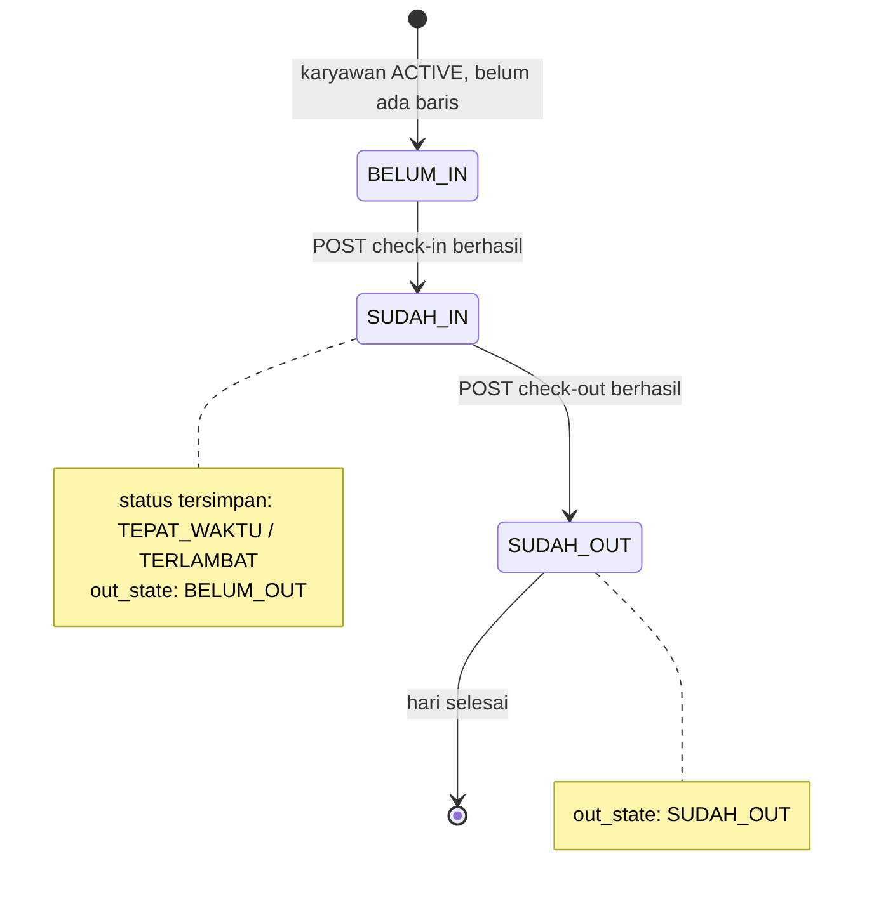

# Entity Relationship Diagram (ERD)
## Project A — Workforce Attendance System

| Item | Nilai |
|---|---|
| Versi | 2.0 (build) |
| Tanggal | 18 November 2026 |
| DBMS | SQLite 3 (`node:sqlite`) |
| Sumber skema | `src/db.js:11-50`, migrasi `:52-96`, seed `src/seed.js` |
| Tabel | 5 (`employees`, `users`, `offices`, `attendances`, `hr_code_sequence`) |
| Invarian akses | Seluruh data hanya dapat dibaca melalui API yang mensyaratkan login (`TASK.md` I-01) |

---

## 1. Diagram ERD


> **Catatan:** `HR_CODE_SEQUENCE` tidak memiliki relasi FK; ia hanya counter untuk membentuk `account_code` `HRNN` secara atomik (`src/utils/hr-code.js`). Karena itu tabel ini berdiri sendiri di diagram.

---

## 2. Diagram Relasi (Kardinalitas)



### 2.1 Penjelasan Kardinalitas

| Relasi | Kardinalitas | Aturan | Bukti |
|---|---|---|---|
| `employees` → `users` | 1 : 0..1 | Satu karyawan punya paling banyak satu akun; akun HR boleh tanpa karyawan (`employee_id` NULL) | `users.employee_id` nullable `REFERENCES employees(id) ON DELETE CASCADE` |
| `employees` → `attendances` | 1 : 0..N | Satu karyawan punya banyak absensi, maksimal **satu per `work_date`** | `UNIQUE (employee_id, work_date)` |
| `offices` → `attendances` | 1 : 0..N | Satu office dipakai banyak absensi; office yang dinonaktifkan tetap tersimpan di record lama | `attendances.office_id` tanpa `ON DELETE`, `offices.is_active` |
| `hr_code_sequence` | — | Satu baris (`id = 1`) menyimpan nomor HR terakhir | `CHECK (id = 1)` |

### 2.2 Perilaku Penghapusan

| Aksi | Dampak | Bukti |
|---|---|---|
| Hapus karyawan | `users` dan `attendances` ikut terhapus (CASCADE); berkas foto dihapus manual | `src/routes/employees.js:103-122` |
| Hapus office | **Tidak disediakan endpoint hapus**; hanya `is_active = 0` | `src/routes/offices.js` tidak punya `DELETE` |
| Nonaktifkan karyawan | Data tetap ada; login & absensi ditolak | `employees.js:78-101`, `auth.js:17`, `attendance.js:54-58` |

---

## 3. Kamus Data

### 3.1 `employees`

| Kolom | Tipe | Null | Default | Keterangan |
|---|---|---|---|---|
| `id` | INTEGER | tidak | AUTOINCREMENT | PK |
| `employee_code` | TEXT | tidak | — | UK; `kyNN` (dua digit, melanjutkan nomor terbesar) |
| `name` | TEXT | tidak | — | Nama lengkap |
| `status` | TEXT | tidak | `ACTIVE` | `CHECK (status IN ('ACTIVE','INACTIVE'))` |
| `created_at` | TEXT | tidak | `datetime('now')` | Waktu pembuatan (UTC SQLite) |

**Aturan:** kode dibuat `kyNN` dari `max(seq, MAX(kode numerik)) + 1` (`employees.js:25-29`).

### 3.2 `users`

| Kolom | Tipe | Null | Default | Keterangan |
|---|---|---|---|---|
| `id` | INTEGER | tidak | AUTOINCREMENT | PK |
| `employee_id` | INTEGER | ya | — | FK → `employees.id`, CASCADE |
| `name` | TEXT | ya | — | Nama tampilan; dipakai akun HR |
| `account_code` | TEXT | ya | — | UK parsial; `HRNN` untuk HR, NULL untuk employee |
| `email` | TEXT | tidak | — | UK; disimpan `toLowerCase()` |
| `password_hash` | TEXT | tidak | — | bcrypt `hashSync(..., 10)` |
| `role` | TEXT | tidak | — | `CHECK (role IN ('HR','EMPLOYEE'))` |

**Catatan migrasi:** `account_code` ditambahkan pada `user_version` 2 dan `name` pada `user_version` 3 (`db.js:66-96`); akun HR lama dinomori ulang `HR01..HRNN`.

### 3.3 `offices`

| Kolom | Tipe | Null | Default | Keterangan |
|---|---|---|---|---|
| `id` | INTEGER | tidak | AUTOINCREMENT | PK |
| `name` | TEXT | tidak | — | Nama lokasi |
| `address` | TEXT | ya | — | Alamat bebas |
| `latitude` | REAL | tidak | — | −90 … 90 |
| `longitude` | REAL | tidak | — | −180 … 180 |
| `radius_m` | INTEGER | tidak | 100 | 10 … 5000 meter |
| `is_active` | INTEGER | tidak | 1 | 1 = aktif, 0 = nonaktif |

**Validasi:** `src/routes/offices.js:22-23`; koordinat memakai `validCoord` (`src/utils/geo.js:8-9`).

### 3.4 `attendances`

| Kolom | Tipe | Null | Keterangan |
|---|---|---|---|
| `id` | INTEGER | tidak | PK |
| `employee_id` | INTEGER | tidak | FK → `employees.id`, CASCADE |
| `work_date` | TEXT | tidak | `YYYY-MM-DD` hasil `T.workDate()` zona `Asia/Jakarta` |
| `check_in_at` | TEXT | ya | ISO dengan offset `+07:00` (`T.nowWib`) |
| `check_out_at` | TEXT | ya | ISO `+07:00` |
| `status` | TEXT | tidak | `TEPAT_WAKTU` atau `TERLAMBAT`, dihitung saat IN |
| `office_id` | INTEGER | ya | Office yang dipakai saat IN |
| `in_lat`, `in_lng` | REAL | ya | Koordinat IN |
| `in_distance_m` | REAL | ya | Jarak Haversine, 1 desimal |
| `in_photo` | TEXT | ya | Nama berkas di `uploads/attendance/` |
| `out_lat`, `out_lng` | REAL | ya | Koordinat OUT |
| `out_distance_m` | REAL | ya | Jarak Haversine OUT |
| `out_photo` | TEXT | ya | Nama berkas foto OUT |

**Unique:** `UNIQUE (employee_id, work_date)` — penjaga utama ATT-02 dan race condition (`db.js:47`, `attendance.js:86-89`).

### 3.5 `hr_code_sequence`

| Kolom | Tipe | Null | Keterangan |
|---|---|---|---|
| `id` | INTEGER | tidak | PK, `CHECK (id = 1)` |
| `seq` | INTEGER | tidak | Nomor HR terakhir yang dipakai |

**Mekanisme:** `UPDATE hr_code_sequence SET seq = seq + 1 WHERE id = 1 RETURNING seq` di dalam `BEGIN IMMEDIATE`, lalu dibentuk `HR%02d` (`src/utils/hr-code.js`).

---

## 4. Status Turunan (Tidak Disimpan)

Hanya **dua** nilai status yang benar-benar tersimpan di kolom `attendances.status`. Nilai lain dihitung saat query.

| Status | Sumber | Rumus | Bukti |
|---|---|---|---|
| `TEPAT_WAKTU` | Tersimpan | `jam_server <= 08:15` | `utils/time.js:16-20` |
| `TERLAMBAT` | Tersimpan | `jam_server > 08:15` | `utils/time.js:16-20` |
| `BELUM_IN` | Turunan | Karyawan `ACTIVE` tanpa baris `attendances` pada tanggal itu | `attendance.js:118-126`, `dashboard.js:34-35` |
| `BELUM_OUT` | Turunan | `check_out_at IS NULL` | `attendance.js:133` |
| `SUDAH_OUT` | Turunan | `check_out_at IS NOT NULL` | `attendance.js:134` |
| `out_state` | Turunan | `SUDAH_OUT` / `BELUM_OUT` per baris | `attendance.js:23` |



---

## 5. DDL Aktual

```sql
PRAGMA journal_mode = WAL;
PRAGMA foreign_keys = ON;

CREATE TABLE employees (
  id INTEGER PRIMARY KEY AUTOINCREMENT,
  employee_code TEXT NOT NULL UNIQUE,
  name TEXT NOT NULL,
  status TEXT NOT NULL DEFAULT 'ACTIVE' CHECK (status IN ('ACTIVE','INACTIVE')),
  created_at TEXT NOT NULL DEFAULT (datetime('now'))
);

CREATE TABLE users (
  id INTEGER PRIMARY KEY AUTOINCREMENT,
  employee_id INTEGER REFERENCES employees(id) ON DELETE CASCADE,
  name TEXT,
  account_code TEXT,
  email TEXT NOT NULL UNIQUE,
  password_hash TEXT NOT NULL,
  role TEXT NOT NULL CHECK (role IN ('HR','EMPLOYEE'))
);

CREATE TABLE offices (
  id INTEGER PRIMARY KEY AUTOINCREMENT,
  name TEXT NOT NULL,
  address TEXT,
  latitude REAL NOT NULL,
  longitude REAL NOT NULL,
  radius_m INTEGER NOT NULL DEFAULT 100,
  is_active INTEGER NOT NULL DEFAULT 1
);

CREATE TABLE attendances (
  id INTEGER PRIMARY KEY AUTOINCREMENT,
  employee_id INTEGER NOT NULL REFERENCES employees(id) ON DELETE CASCADE,
  work_date TEXT NOT NULL,
  check_in_at TEXT,
  check_out_at TEXT,
  status TEXT NOT NULL CHECK (status IN ('TEPAT_WAKTU','TERLAMBAT')),
  office_id INTEGER REFERENCES offices(id),
  in_lat REAL, in_lng REAL, in_distance_m REAL, in_photo TEXT,
  out_lat REAL, out_lng REAL, out_distance_m REAL, out_photo TEXT,
  UNIQUE (employee_id, work_date)
);

CREATE INDEX idx_att_date ON attendances(work_date);

-- dibuat oleh migrasi user_version 2
CREATE UNIQUE INDEX idx_users_account_code ON users(account_code);
CREATE TABLE hr_code_sequence (
  id INTEGER PRIMARY KEY CHECK (id = 1),
  seq INTEGER NOT NULL
);
```

---

## 6. Indeks & Kinerja

| Indeks | Kolom | Tujuan |
|---|---|---|
| `idx_att_date` | `attendances.work_date` | Filter tanggal & agregasi dashboard |
| `sqlite_autoindex_attendances_1` | `(employee_id, work_date)` | UNIQUE, sekaligus jalur baca status hari ini |
| `sqlite_autoindex_users_1` | `users.email` | Login |
| `idx_users_account_code` | `users.account_code` | Pencarian akun HR |
| `sqlite_autoindex_employees_1` | `employees.employee_code` | Duplikasi kode |

Query utama yang dilayani:

| Query | Dipakai oleh | Indeks |
|---|---|---|
| `WHERE employee_id = ? AND work_date = ?` | status hari ini, IN, OUT | UNIQUE komposit |
| `WHERE work_date BETWEEN ? AND ?` | daftar & riwayat | `idx_att_date` |
| `JOIN employees` + `LIKE` nama/kode | pencarian | scan terbatas, dataset kecil |
| `GROUP BY work_date` (tren) | dashboard | `idx_att_date` |

---

## 7. Normalisasi

| Bentuk | Status | Catatan |
|---|---|---|
| 1NF | Terpenuhi | Semua kolom atomik; tidak ada kolom berulang |
| 2NF | Terpenuhi | Semua tabel memakai PK tunggal; tidak ada dependensi parsial |
| 3NF | Terpenuhi | `office_id` dan `employee_id` disimpan sebagai FK, bukan duplikasi nama |
| Denormalisasi sadar | `in_distance_m`, `out_distance_m` | Jarak dihitung saat transaksi dan disimpan sebagai bukti historis, karena radius office dapat berubah |
| Denormalisasi sadar | `attendances.status` | Status ketepatan waktu dibekukan saat IN agar perubahan aturan jam tidak mengubah riwayat |

**Tidak ada kolom `updated_at`** pada `employees`/`offices`; perubahan tidak dilacak waktu. Ini keterbatasan yang dicatat, bukan fitur.

---

## 8. Konsistensi dengan Dokumen Awal

| Butir | Dokumen Awal | Implementasi | Status |
|---|---|---|---|
| DBMS | MySQL | SQLite `node:sqlite` | Deviasi D-01 |
| Migrasi | Framework migrations | `PRAGMA user_version` 1 → 3 | Deviasi D-01 |
| Tabel | karyawan, absensi, kantor, users | Ditambah `hr_code_sequence` | Tambahan teknis |
| Foto | Tidak dirancang | `in_photo`, `out_photo` + berkas fisik | Deviasi D-02 |
| Koordinat | Tidak dirancang | `in_lat/lng`, `out_lat/lng`, jarak | Deviasi D-02 |

Detail deviasi lain ada di `01-SRS.md` §10.

---

## 9. Catatan Implementasi

1. **Foto disimpan sebagai nama berkas**, bukan BLOB. Direktori `UPLOAD_DIR/attendance` (`src/middleware/upload.js:8`).
2. **Hapus karyawan** menghapus baris lebih dulu, lalu berkas foto; kegagalan hapus berkas tidak membatalkan penghapusan data (`employees.js:103-122`).
3. **Tidak ada tabel sesi**; JWT bersifat stateless. Logout hanya menghapus token di klien.
4. **Zona waktu** tidak disimpan per baris. `work_date` dan `check_*_at` sudah dalam WIB, sehingga riwayat tetap terbaca benar meski server berpindah zona.
5. **`attendances.status` NOT NULL** dan hanya menerima dua nilai; status `BELUM_*` tidak pernah masuk database.