# Flowchart Sistem
## Project A — Workforce Attendance System

| Item | Nilai |
|---|---|
| Versi | 2.1 (perbaikan tata letak) |
| Tanggal | 18 November 2026 |
| Jumlah Flowchart | 11 (FC-01 … FC-11) |
| Sumber logika | `src/app.js`, `src/middleware/*`, `src/routes/*`, `src/utils/*`, `public/app.js` |
| Invarian | **Tidak ada jalur sukses tanpa login** (`TASK.md` I-01) dan **tidak ada sukses palsu** (ATT-08) |
| Konvensi gambar | Satu arah baca; cabang gagal berakhir di node merah dan tidak ditarik kembali ke jalur utama |

---

## FC-01 — Peta Alur Sistem (Utama)

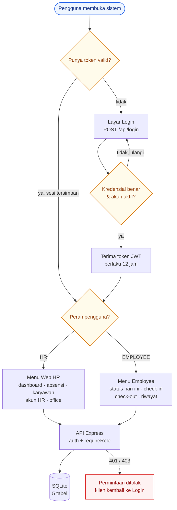

> **Cara baca:** semua jalur bertemu di satu titik — **Peran pengguna** — lalu masuk ke API yang sama. Tidak ada cabang dari "Pengguna membuka sistem" menuju menu tanpa melewati layar Login. Rincian tiap menu beserta endpoint-nya ada di `02-Use-Case-Diagram.md` §2 dan `04-ERD.md`.

---

## FC-02 — Auth Gate (Middleware)

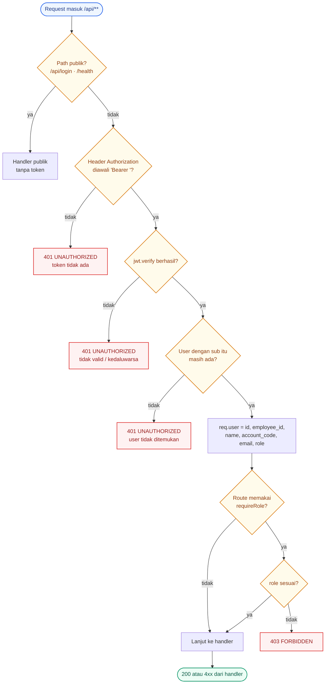

**Rujukan:** `src/middleware/auth.js:7-22`, `src/app.js:13-18`.

---

## FC-03 — State Machine Absensi

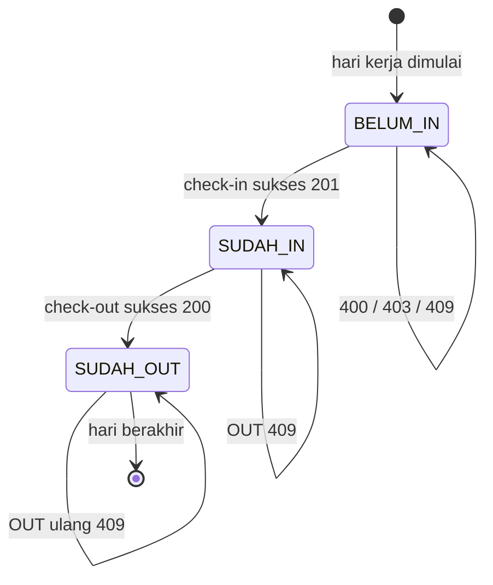

| Dari | Aksi | Hasil | HTTP | Efek data |
|---|---|---|---|---|
| `BELUM_IN` | IN valid | `SUDAH_IN` | 201 | Baris baru |
| `BELUM_IN` | OUT | tetap | 409 | Tidak ada |
| `SUDAH_IN` | IN lagi | tetap | 409 | Tidak ada |
| `SUDAH_IN` | OUT valid | `SUDAH_OUT` | 200 | `check_out_at` terisi |
| `SUDAH_OUT` | OUT lagi | tetap | 409 | Tidak ada |

---

## FC-04 — Pipeline Request Check-in / Check-out

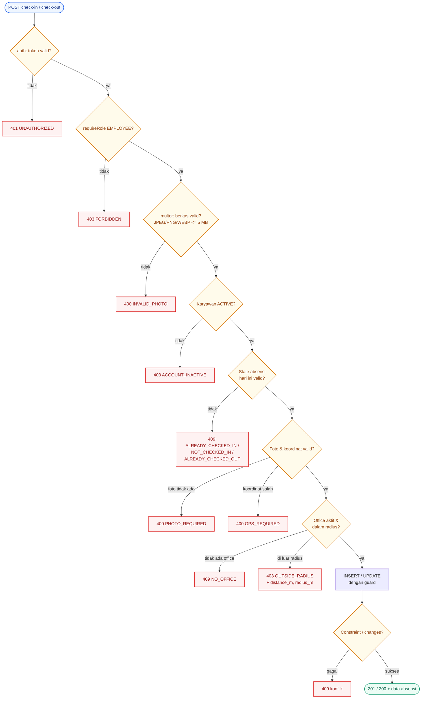

**Catatan:** bila handler melempar error setelah foto terunggah, `withUpload` menghapus berkas tersebut (`attendance.js:46-52`), sehingga tidak ada foto yatim.

---

## FC-05 — Penentuan Status TEPAT_WAKTU / TERLAMBAT

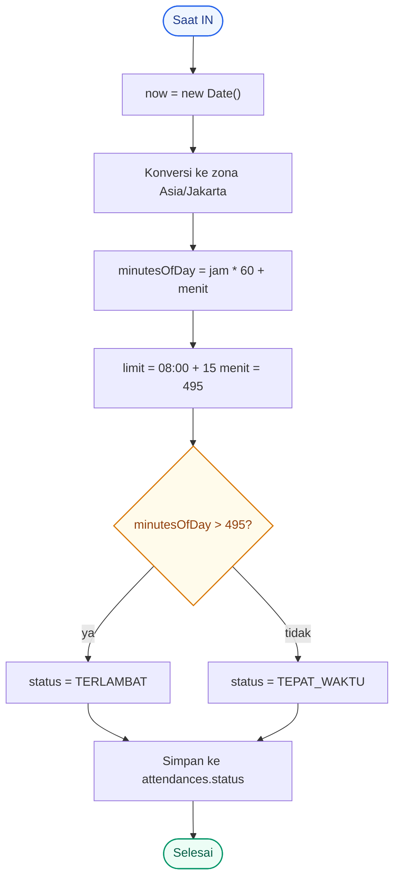

**Tabel batas waktu (WIB):**

| Jam check-in | Hasil |
|---|---|
| 07:59 | `TEPAT_WAKTU` |
| 08:00 | `TEPAT_WAKTU` |
| 08:15 | `TEPAT_WAKTU` |
| 08:16 | `TERLAMBAT` |
| 09:30 | `TERLAMBAT` |

**Rujukan:** `src/config.js:22-23`, `src/utils/time.js:10-20`.

---

## FC-06 — Resolusi Filter Tanggal

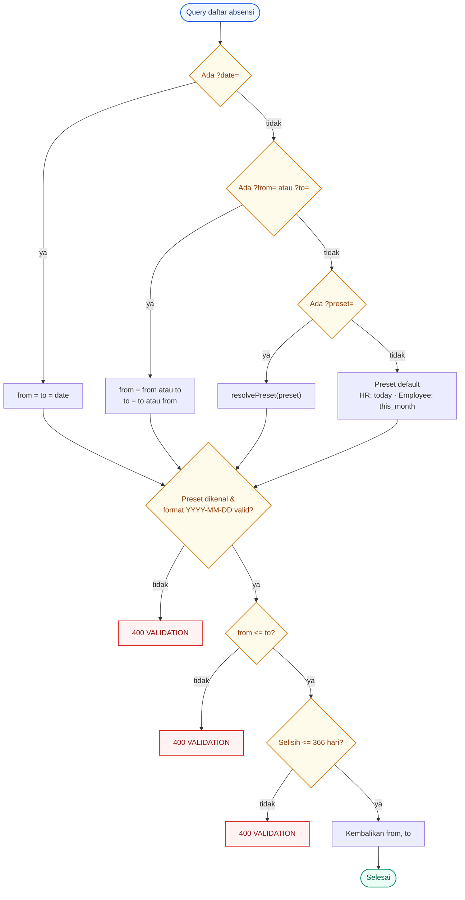

**Preset yang sah:** `today`, `yesterday`, `this_week`, `last7`, `last30`, `this_month`, `last_month` (`src/utils/time.js:31-51`).

---

## FC-07 — Filter Status Daftar Absensi

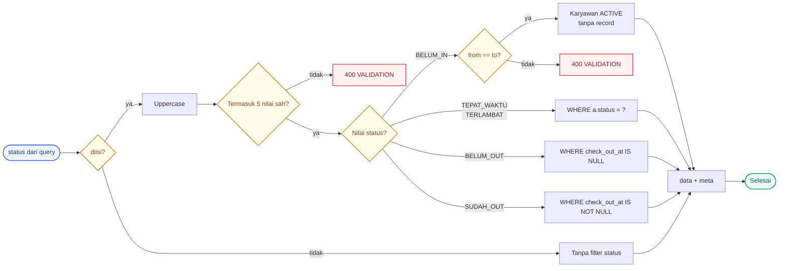

**Rujukan:** `src/routes/attendance.js:112-134`.

---

## FC-08 — Agregasi Dashboard

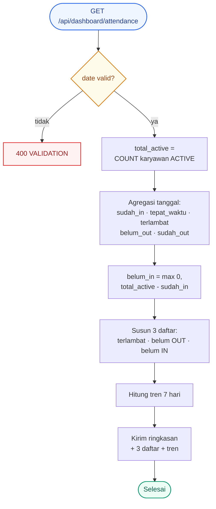

**Rujukan:** `src/routes/dashboard.js:13-38`.

---

## FC-09 — Siklus Hidup Karyawan & Akun

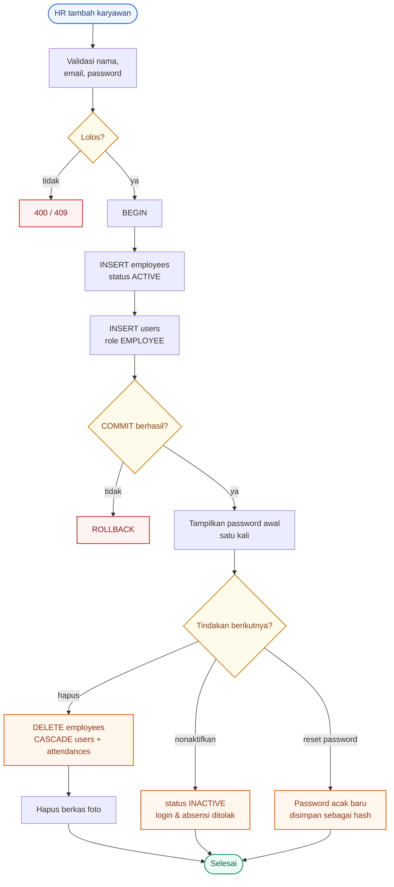

---

## FC-10 — Penanganan Error Terpusat

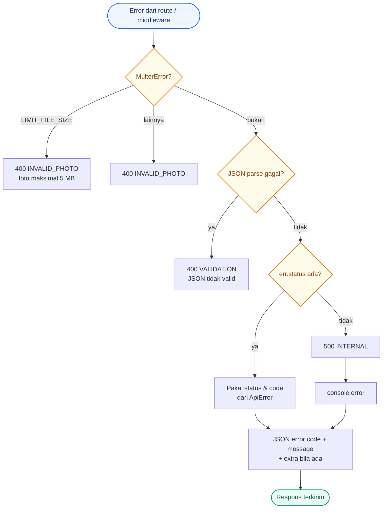

**Bentuk respons error** (`src/app.js:28`):

```json
{ "error": { "code": "OUTSIDE_RADIUS", "message": "Anda di luar radius office ...", "office": "Kantor Pusat", "distance_m": 1200, "radius_m": 100 } }
```

---

## FC-11 — Perilaku Klien Saat Gagal (ATT-08)

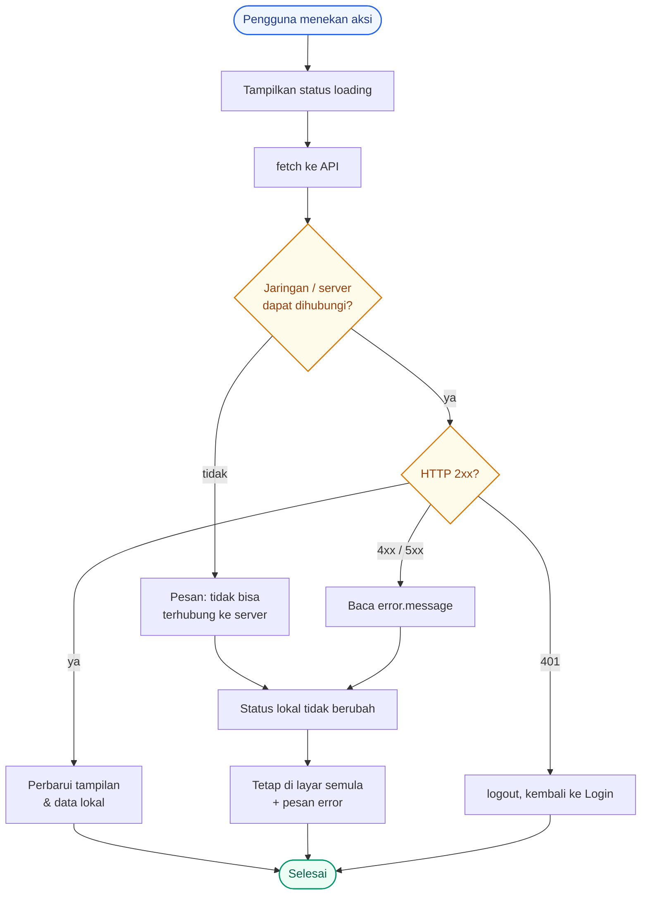

**Prinsip:** status lokal hanya berubah setelah respons 2xx terverifikasi. Timeout, koneksi putus, dan 5xx **tidak** boleh menampilkan "berhasil" (`public/app.js:14-29`).

---

## Matriks Keputusan Lengkap

| # | Kondisi | Endpoint | HTTP | Error code | Data berubah? |
|---|---|---|---|---|---|
| 1 | Tanpa token | semua kecuali login/health | 401 | `UNAUTHORIZED` | Tidak |
| 2 | Token kedaluwarsa | semua terproteksi | 401 | `UNAUTHORIZED` | Tidak |
| 3 | Role Employee akses HR | `/api/employees`, `/api/admins`, `/api/dashboard`, `/api/attendance` | 403 | `FORBIDDEN` | Tidak |
| 4 | Employee lihat data orang lain | `/api/attendance/history?employee_id=` | 403 | `FORBIDDEN` | Tidak |
| 5 | Employee lihat foto orang lain | `/api/attendance/:id/photo/:type` | 403 | `FORBIDDEN` | Tidak |
| 6 | IN tanpa foto | `/api/attendance/check-in` | 400 | `PHOTO_REQUIRED` | Tidak; foto yatim dihapus |
| 7 | Foto > 5 MB / tipe salah | check-in / check-out | 400 | `INVALID_PHOTO` | Tidak |
| 8 | GPS tidak valid | check-in / check-out | 400 | `GPS_REQUIRED` | Tidak |
| 9 | Di luar radius | check-in / check-out | 403 | `OUTSIDE_RADIUS` | Tidak |
| 10 | Tidak ada office aktif | check-in / check-out | 409 | `NO_OFFICE` | Tidak |
| 11 | IN kedua | `/api/attendance/check-in` | 409 | `ALREADY_CHECKED_IN` | Tidak |
| 12 | OUT tanpa IN | `/api/attendance/check-out` | 409 | `NOT_CHECKED_IN` | Tidak |
| 13 | OUT kedua | `/api/attendance/check-out` | 409 | `ALREADY_CHECKED_OUT` | Tidak |
| 14 | Karyawan nonaktif | login, today, IN, OUT | 403 | `ACCOUNT_INACTIVE` | Tidak |
| 15 | Kode karyawan dipakai | `POST/PUT /api/employees` | 409 | `DUPLICATE_CODE` | Tidak |
| 16 | Email dipakai | employees / admins | 409 | `DUPLICATE_EMAIL` | Tidak |
| 17 | Format tanggal salah | daftar & dashboard | 400 | `VALIDATION` | Tidak |
| 18 | `from` > `to` | daftar | 400 | `VALIDATION` | Tidak |
| 19 | Rentang > 366 hari | daftar | 400 | `VALIDATION` | Tidak |
| 20 | `BELUM_IN` pada rentang > 1 hari | daftar | 400 | `VALIDATION` | Tidak |
| 21 | Resource tidak ada | detail/office/foto | 404 | `NOT_FOUND` | Tidak |
| 22 | Server error | semua | 500 | `INTERNAL` | Tidak |

---

## Titik Rawan & Mitigasi

| # | Titik rawan | Mitigasi di kode |
|---|---|---|
| R-01 | Dua IN bersamaan | `UNIQUE (employee_id, work_date)` + tangkap error UNIQUE → 409 |
| R-02 | Dua OUT bersamaan | `UPDATE ... WHERE id = ? AND check_out_at IS NULL` + cek `changes` |
| R-03 | Foto terunggah padahal request ditolak | `withUpload` memanggil `rmFile` saat handler melempar error |
| R-04 | Nomor HR ganda | `BEGIN IMMEDIATE` + `UPDATE ... RETURNING seq` |
| R-05 | Email ganda karena balapan | `UNIQUE` pada `users.email` + cek awal |
| R-06 | Perubahan radius setelah absensi | Jarak disimpan per transaksi (`in_distance_m`, `out_distance_m`) |
| R-07 | Klien tampak sukses padahal gagal | Status lokal hanya berubah pada 2xx (`public/app.js:14-29`) |
| R-08 | Token bocor lewat URL | Token hanya di header `Authorization`, bukan query string |