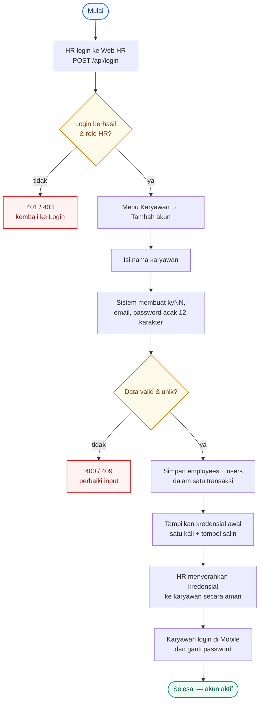
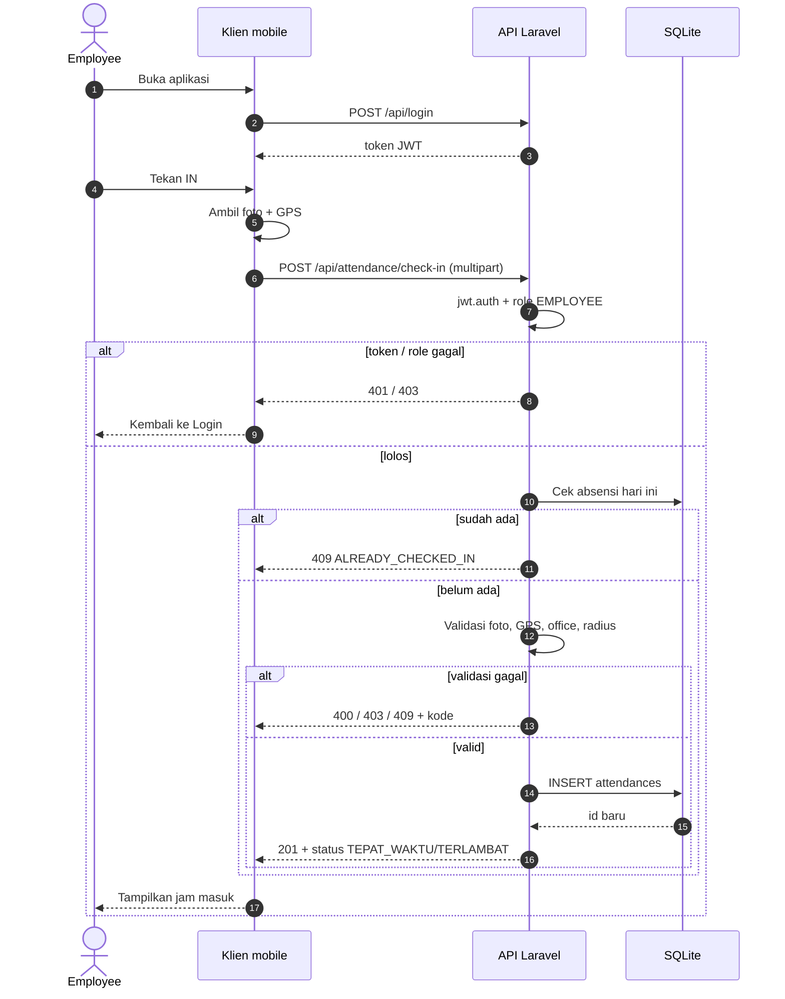
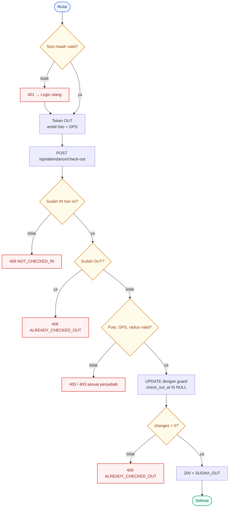
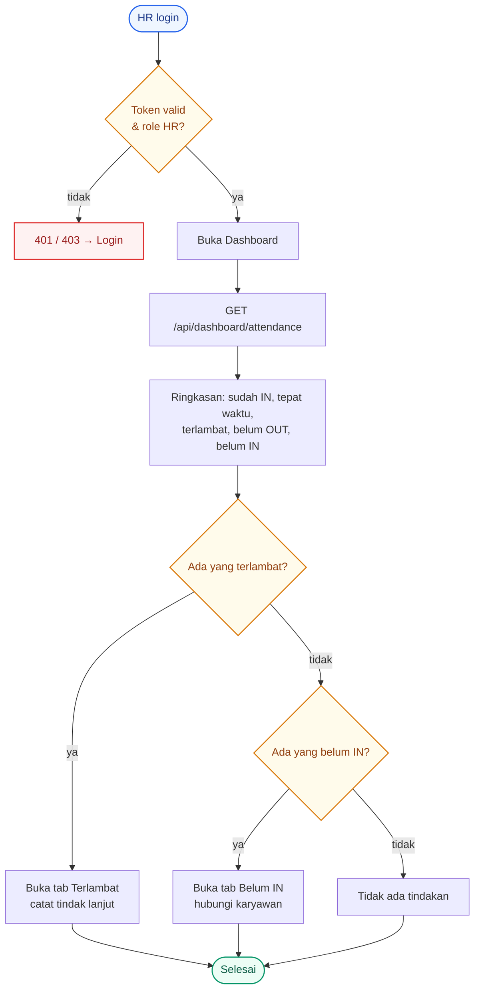
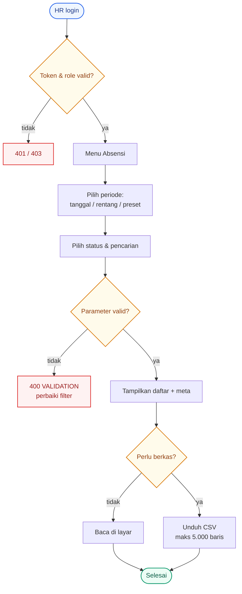
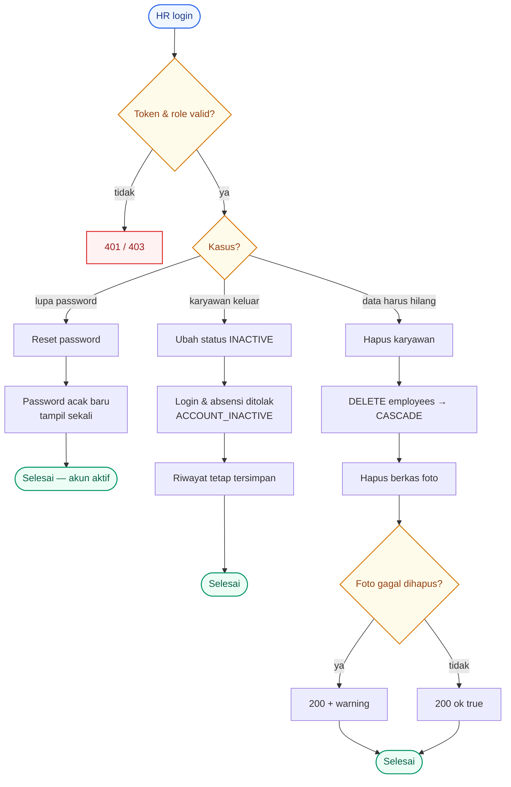
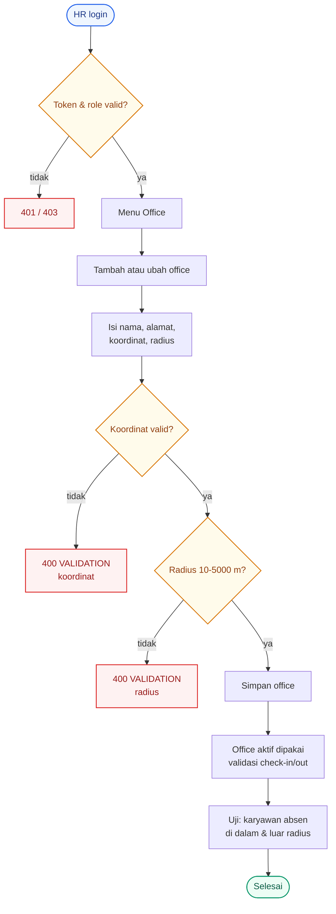

# Business Process Documentation
## Project A — Workforce Attendance System

| Item | Nilai |
|---|---|
| Versi | 2.0 (build) |
| Tanggal | 18 November 2026 |
| Proses | 7 (BP-01 … BP-07) |
| Aktor | HR Admin, Employee, Sistem |
| Invarian | **Login adalah langkah pertama setiap proses**; `401` mengembalikan pengguna ke Login |
| Sumber | `app/`, `routes/`, `database/`, `public/`, `docs/ETHES_TECH Project.docx` (Bab 1) |
| Status angka SLA | **Usulan**, bukan komitmen bisnis yang sudah disepakati |

---

## 1. Ringkasan Proses

| ID | Proses | Aktor utama | Frekuensi | Output |
|---|---|---|---|---|
| BP-01 | Onboarding karyawan baru | HR Admin | Saat ada karyawan masuk | Akun + kredensial awal |
| BP-02 | Absensi masuk (check-in) | Employee | 1× per hari kerja | Record IN + foto + GPS |
| BP-03 | Absensi pulang (check-out) | Employee | 1× per hari kerja | Record OUT + foto + GPS |
| BP-04 | Pemantauan kehadiran harian | HR Admin | Setiap pagi | Daftar terlambat / belum absen |
| BP-05 | Rekap & pelaporan absensi | HR Admin | Harian / akhir bulan | CSV + angka dashboard |
| BP-06 | Penanganan karyawan nonaktif / keluar | HR Admin | Saat ada pergantian | Status INACTIVE atau data terhapus |
| BP-07 | Pengelolaan lokasi & radius kantor | HR Admin | Saat lokasi berubah | Office aktif + radius |

---

## 2. Kondisi Saat Ini (As-Is)

| Aspek | Kondisi | Masalah |
|---|---|---|
| Pencatatan kehadiran | Absen manual / spreadsheet / grup chat | Rawan lupa, mudah dimanipulasi |
| Verifikasi lokasi | Tidak ada | Karyawan dapat absen dari mana saja |
| Bukti kehadiran | Tidak ada | Sengketa sulit dibuktikan |
| Rekap | Dikerjakan manual oleh HR | Memakan waktu, sering salah hitung |
| Keterlambatan | Dihitung manual | Batas 08:15 tidak konsisten diterapkan |
| Keamanan data | File spreadsheet dibagikan bebas | Tidak ada kontrol akses |

---

## 3. Kondisi Target (To-Be)

| Aspek | Kondisi target | Diwujudkan oleh |
|---|---|---|
| Gerbang akses | Semua fitur di balik login; data hanya untuk peran yang berhak | `jwt.auth` + `role` |
| Pencatatan | Satu pasang IN/OUT per hari, tidak dapat digandakan | `UNIQUE (employee_id, work_date)` |
| Verifikasi | Foto kamera + koordinat GPS + radius office | `verifyGpsAndPhoto` |
| Ketepatan waktu | Dihitung dari jam server zona `Asia/Jakarta` | `app/Services/TimeService.php` |
| Rekap | Otomatis, dapat difilter, dapat diekspor | `listQuery`, dashboard, CSV |
| Jejak bukti | Foto tersimpan dan hanya dapat diakses pemilik/HR | endpoint foto terproteksi |
| Audit | Riwayat tidak berubah setelah OUT | status dibekukan saat IN |

---

## 4. Proses Bisnis

### BP-01 — Onboarding Karyawan Baru

**Tujuan:** karyawan baru memperoleh akun dan dapat absen pada hari pertama.
**Pemicu:** HR menerima data karyawan baru.



| Langkah | Aktor | Sistem | Bukti |
|---|---|---|---|
| 1 | HR login | Terbitkan JWT | `app/Http/Controllers/Api/AuthController.php:22-58` |
| 2 | HR isi nama | Buat kode/email/password | `app/Http/Controllers/Api/EmployeeController.php:18-51`, `app/Http/Controllers/Api/EmployeeController.php:130-186` |
| 3 | HR salin kredensial | Tampilkan `initial_password` sekali | `app/Http/Controllers/Api/EmployeeController.php:182-185` |
| 4 | Karyawan login | Verifikasi status ACTIVE | `app/Http/Controllers/Api/AuthController.php:39-41` |

**Aturan:** password awal hanya muncul pada respons pembuatan; bila hilang, HR melakukan reset (BP-06).
**Risiko:** kredensial dikirim lewat kanal tidak aman → sampaikan langsung atau lewat kanal terenkripsi.

---

### BP-02 — Absensi Masuk (Check-in)

**Tujuan:** mencatat kedatangan yang sah secara waktu dan lokasi.
**Pemicu:** karyawan tiba di kantor sebelum/sesudah 08:00.



| Langkah | Aktor | Aturan | Error |
|---|---|---|---|
| 1 | Employee | Wajib login | `401 UNAUTHORIZED` |
| 2 | Employee | Ambil foto & GPS | `400 PHOTO_REQUIRED`, `400 GPS_REQUIRED` |
| 3 | Sistem | Cek duplikasi | `409 ALREADY_CHECKED_IN` |
| 4 | Sistem | Cek office aktif | `409 NO_OFFICE` |
| 5 | Sistem | Cek radius | `403 OUTSIDE_RADIUS` |
| 6 | Sistem | Hitung status dari jam server | — |
| 7 | Sistem | Simpan record | — |

**SLA usulan:** respons IN ≤ 2 detik p95 pada koneksi 3G.
**Ukuran keberhasilan:** ≥ 95% karyawan berhasil IN pada percobaan pertama.

---

### BP-03 — Absensi Pulang (Check-out)

**Tujuan:** mencatat kepulangan pada hari kerja yang sama.
**Pemicu:** karyawan selesai bekerja.



**Aturan:** OUT tidak mengubah `status` (tetap nilai saat IN); OUT hanya mengisi `check_out_at` dan bukti OUT.
**Catatan:** OUT setelah tengah malam jatuh ke `work_date` berikutnya dan ditolak — sesuai BR-01 (tanpa shift malam).

---

### BP-04 — Pemantauan Kehadiran Harian

**Tujuan:** HR mengetahui kondisi kehadiran pagi ini dan menindaklanjuti.
**Pemicu:** awal jam kerja.



| Peran | Tanggung jawab |
|---|---|
| HR Admin | Memeriksa dashboard setiap pagi; menghubungi yang belum IN |
| Sistem | Menghitung `belum_in` dari karyawan ACTIVE dikurangi yang sudah IN |

**SLA usulan:** dashboard dimuat ≤ 1 detik untuk 100 karyawan; refresh otomatis 60 detik.

---

### BP-05 — Rekap & Pelaporan Absensi

**Tujuan:** menghasilkan rekap absensi untuk kebutuhan internal.
**Pemicu:** permintaan laporan harian/bulanan.



| Filter | Nilai sah | Catatan |
|---|---|---|
| `date` | `YYYY-MM-DD` | Prioritas tertinggi |
| `from` + `to` | rentang ≤ 366 hari | `from ≤ to` |
| `preset` | `today`, `yesterday`, `this_week`, `last7`, `last30`, `this_month`, `last_month` | Default HR `today` |
| `status` | `TEPAT_WAKTU`, `TERLAMBAT`, `BELUM_OUT`, `SUDAH_OUT`, `BELUM_IN` | `BELUM_IN` hanya 1 tanggal |
| `search` | nama/kode | — |

**Batas ekspor:** 25 halaman × 200 baris = 5.000 baris per unduhan. Bila data melebihi, persempit filter.
**Retensi:** belum ada kebijakan otomatis; data bertahan sampai karyawan dihapus.

---

### BP-06 — Karyawan Nonaktif, Reset Password, dan Penghapusan

**Tujuan:** mengelola siklus hidup akun tanpa merusak riwayat yang masih dibutuhkan.



| Kasus | Tindakan | Dampak | Dapat dibatalkan? |
|---|---|---|---|
| Lupa password | Reset password | Password lama tidak berlaku | Tidak (password lama hilang) |
| Karyawan keluar sementara | Status INACTIVE | Tidak bisa login/absen | Ya, ubah kembali ACTIVE |
| Karyawan berhenti permanen | Hapus | Akun, riwayat, foto hilang | Tidak |
| Salah input office | Nonaktifkan office | Tidak dipakai validasi | Ya |

**Rekomendasi tata kelola:** gunakan INACTIVE sebagai default saat karyawan keluar; hapus hanya bila ada kewajiban penghapusan data.

---

### BP-07 — Pengelolaan Lokasi & Radius Kantor

**Tujuan:** memastikan radius absensi sesuai lokasi fisik sebenarnya.



| Parameter | Nilai | Konsekuensi bila salah |
|---|---|---|
| Koordinat | −90…90 / −180…180 | Absensi sah di lokasi salah |
| Radius | 10–5000 m | Terlalu kecil: absensi sah ditolak; terlalu besar: geofence tidak berarti |
| `is_active` | 0/1 | Office nonaktif tidak dipakai validasi |

**Prosedur uji:** lakukan satu check-in percobaan di dalam radius dan satu di luar radius setelah setiap perubahan.

---

## 5. RACI

| Aktivitas | HR Admin | Employee | Sistem | Mentor |
|---|---|---|---|---|
| Login & sesi | R | R | A | I |
| Onboarding karyawan | R/A | C | C | I |
| Check-in | I | R | A | I |
| Check-out | I | R | A | I |
| Pemantauan harian | R/A | I | C | I |
| Rekap & ekspor | R/A | I | C | I |
| Reset password | R/A | I | C | I |
| Nonaktifkan karyawan | R/A | I | C | I |
| Hapus karyawan | R/A | I | C | I |
| Kelola office | R/A | I | C | I |
| Verifikasi UAT | C | C | C | R/A |

Keterangan: **R** = Responsible, **A** = Accountable, **C** = Consulted, **I** = Informed.

---

## 6. SLA & KPI

> Seluruh angka pada bagian ini adalah **usulan** untuk disepakati, bukan hasil pengukuran.

### 6.1 SLA Operasional

| Layanan | Target usulan | Cara ukur |
|---|---|---|
| Respons check-in/out (termasuk foto) | ≤ 2 s p95 | Log waktu respons |
| Respons baca daftar (100 karyawan) | ≤ 500 ms p95 | Log waktu respons |
| Ketersediaan jam kerja (08:00–17:00) | ≥ 99% | Monitoring uptime |
| Waktu pulih setelah gangguan | ≤ 30 menit | Catatan insiden |
| Dashboard segar | ≤ 60 s | Timer refresh klien |

### 6.2 KPI Proses

| KPI | Rumus | Target usulan |
|---|---|---|
| Tingkat kehadiran tercatat | `sudah_in / total_active × 100%` | ≥ 95% |
| Ketepatan waktu | `tepat_waktu / sudah_in × 100%` | ≥ 90% |
| Keterlambatan | `terlambat / sudah_in × 100%` | ≤ 10% |
| Kelengkapan OUT | `sudah_out / sudah_in × 100%` | ≥ 95% |
| Keberhasilan IN percobaan pertama | `IN sukses / total percobaan IN` | ≥ 95% |
| Akurasi data absensi | `1 − koreksi manual / total record` | ≥ 99% |
| Waktu onboarding karyawan | dari input sampai akun aktif | ≤ 5 menit |

### 6.3 Contoh Perhitungan

```
Tanggal 2026-11-18
total_active_employees = 20
sudah_in               = 18
tepat_waktu            = 15
terlambat              = 3
sudah_out              = 16

tingkat kehadiran  = 18 / 20 × 100% = 90%
ketepatan waktu    = 15 / 18 × 100% = 83,3%
kelengkapan OUT    = 16 / 18 × 100% = 88,9%
```

---

## 7. Exception Handling

| # | Kejadian | Terdeteksi di | Perilaku sistem | Tindakan pengguna | Data |
|---|---|---|---|---|---|
| EX-01 | Token tidak ada | `jwt.auth` | 401 `UNAUTHORIZED` | Login | Tidak berubah |
| EX-02 | Token kedaluwarsa | `jwt.auth` | 401, klien logout | Login ulang | Tidak berubah |
| EX-03 | Role tidak sesuai | `role` | 403 `FORBIDDEN` | Pakai akun yang benar | Tidak berubah |
| EX-04 | Foto tidak dilampirkan | `verifyGpsAndPhoto` | 400 `PHOTO_REQUIRED` | Ulangi dengan foto | Tidak ada berkas ditulis |
| EX-05 | Foto > 5 MB / tipe salah | `verifyGpsAndPhoto` | 400 `INVALID_PHOTO` | Kompres / ganti format | Tidak ada berkas ditulis |
| EX-06 | GPS tidak valid | `validCoord` | 400 `GPS_REQUIRED` | Aktifkan lokasi | Tidak ada |
| EX-07 | Di luar radius | `verifyGpsAndPhoto` | 403 `OUTSIDE_RADIUS` + jarak | Mendekat ke office | Tidak ada |
| EX-08 | Tidak ada office aktif | `verifyGpsAndPhoto` | 409 `NO_OFFICE` | Hubungi HR | Tidak ada |
| EX-09 | Sudah IN | handler IN | 409 `ALREADY_CHECKED_IN` | Lanjut bekerja | Tidak ada duplikasi |
| EX-10 | OUT tanpa IN | handler OUT | 409 `NOT_CHECKED_IN` | Lakukan IN (bila memungkinkan) | Tidak ada |
| EX-11 | Sudah OUT | handler OUT | 409 `ALREADY_CHECKED_OUT` | Tidak perlu tindakan | Tidak berubah |
| EX-12 | Karyawan nonaktif | `getActiveEmployee` | 403 `ACCOUNT_INACTIVE` | Hubungi HR | Tidak ada |
| EX-13 | Koneksi putus / timeout | klien | Pesan error, status lokal tetap | Coba lagi | Tidak ada |
| EX-14 | Kalkulasi batas waktu berbeda | `app/Services/TimeService.php` | Memakai jam server, bukan perangkat | — | Konsisten |

---

## 8. Kebijakan Data

| Aspek | Kebijakan saat ini | Catatan |
|---|---|---|
| Penyimpanan | SQLite lokal (`database/database.sqlite`) | Backup manual |
| Foto | Disk lokal `uploads/attendance/` | Nama berkas acak, bukan nama karyawan |
| Akses foto | Wajib token; Employee hanya miliknya | `app/Http/Controllers/Api/AttendanceController.php:384-407` |
| Retensi absensi | Sampai karyawan dihapus | Tidak ada arsip otomatis |
| Retensi akun | Sampai dihapus | Nonaktif tetap menyimpan data |
| Penghapusan | Cascade ke `users`, `attendances`, berkas foto | Tidak dapat dibatalkan |
| Kredensial | Hash bcrypt; password awal tampil sekali | Tidak ada log password |
| Token | Stateless, berlaku 12 jam | Logout menghapus token di klien |

**Usulan tata kelola:** tetapkan masa retensi (mis. 24 bulan), jadwalkan backup harian, dan catat setiap permintaan hapus data.

---

## 9. Risiko Proses

| # | Risiko | Dampak | Kemungkinan | Mitigasi |
|---|---|---|---|---|
| R-01 | Karyawan menitipkan absen (foto orang lain) | Data tidak sah | Sedang | Foto kamera + GPS; pertimbangkan verifikasi wajah |
| R-02 | GPS dipalsukan (mock location) | Geofence bocor | Sedang | Deteksi mock location di klien mobile |
| R-03 | Karyawan lupa OUT | Rekap tidak lengkap | Tinggi | Pengingat; tab "Belum OUT" di dashboard |
| R-04 | Kredensial awal bocor | Akun disalahgunakan | Sedang | Tampil sekali; wajib ganti saat login pertama |
| R-05 | Office salah koordinat | Absensi sah ditolak | Sedang | Prosedur uji radius setelah perubahan |
| R-06 | Server mati pada jam absen | Karyawan tidak dapat IN | Rendah | Monitoring + prosedur pencatatan manual sementara |
| R-07 | Penghapusan karyawan tidak sengaja | Riwayat hilang permanen | Sedang | Default nonaktifkan; konfirmasi berlapis |
| R-08 | Data absensi diubah manual di database | Audit rusak | Rendah | Batasi akses berkas DB; usulkan audit log |

---

## 10. Backlog Perbaikan Proses

| ID | Usulan | Manfaat | Perkiraan usaha |
|---|---|---|---|
| BL-01 | Pengingat otomatis sebelum 08:00 dan sebelum pulang | Mengurangi lupa IN/OUT | Sedang |
| BL-02 | Koreksi absensi oleh HR dengan jejak audit | Menangani kasus lupa OUT | Besar |
| BL-03 | Rate limit login | Mengurangi brute force | Kecil |
| BL-04 | Backup otomatis harian | Melindungi data | Kecil |
| BL-05 | Kebijakan retensi & arsip | Kepatuhan data | Sedang |
| BL-06 | Verifikasi wajah saat IN | Mengurangi titip absen | Besar |
| BL-07 | Deteksi mock location di klien | Memperkuat geofence | Sedang |
| BL-08 | Laporan PDF bulanan | Kebutuhan manajemen | Kecil |
| BL-09 | Notifikasi ke HR saat ada anomali | Respons lebih cepat | Sedang |
| BL-10 | Dashboard per departemen | Analisis lebih tajam | Besar (butuh data departemen) |

---

## 11. Keterkaitan dengan Dokumen Lain

| Dokumen | Kaitan |
|---|---|
| `01-SRS.md` §0 | Auth gate sebagai dasar seluruh proses |
| `01-SRS.md` §5 | Aturan bisnis ATT-01..ATT-08 |
| `02-Use-Case-Diagram.md` | Setiap proses dipetakan ke UC-01..UC-17 |
| `03-Activity-Diagram.md` | Rincian langkah teknis tiap proses |
| `05-Flowchart.md` | Titik keputusan dan penanganan error |
| `06-Functional-Requirement.md` | FR yang mewujudkan tiap langkah |
| `07-User-Story.md` | Kebutuhan pengguna di balik proses |