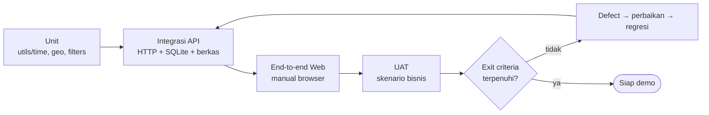

# Test Plan
## Project A — Workforce Attendance System

| Item | Nilai |
|---|---|
| Versi | 1.0 |
| Tanggal | 18 November 2026 |
| Dokumen induk | `01-SRS.md`, `06-Functional-Requirement.md`, `TASK.md` |
| Dokumen turunan | `10-Test-Case.md`, `11-UAT.md`, `12-Traceability-Matrix.md`, `13-Defect-Management.md` |
| Lingkup | Seluruh 63 FR dan 17 UC pada rilis branch `main` commit `1c819f5` (kode yang diuji; `main` kini `47adb6b` dengan berkas uji yang sama) |
| Status | **Sudah dieksekusi** 18 November 2026 — 61/61 TC Lulus, 193 pemeriksaan otomasi, 3 defect tercatat (`18-Test-Summary-Report.md`) |

> **Penting:** dokumen ini menetapkan strategi, lingkungan, dan exit criteria. Hasil eksekusinya dicatat di `10-Test-Case.md`, `docs/Project A - QA Test Cases.xlsx`, dan `18-Test-Summary-Report.md`; tidak ada status "lulus" yang diklaim tanpa bukti pada berkas tersebut.

---

## 1. Tujuan

1. Membuktikan bahwa seluruh fitur **hanya dapat diakses setelah login** dan pembatasan peran bekerja.
2. Membuktikan aturan bisnis ATT-01..ATT-08 berjalan sesuai SRS.
3. Membuktikan perhitungan waktu (08:00 + toleransi 15 menit) dan geofence bekerja benar.
4. Menemukan defect sebelum demo/penilaian, dengan bukti yang dapat direproduksi.
5. Menyediakan dasar keputusan "layak demo" bagi mentor.

---

## 2. Lingkup Pengujian

### 2.1 Yang diuji

| Area | Cakupan | FR |
|---|---|---|
| Autentikasi & sesi | Login, token, logout, 401 | FR-AUTH-00..08 |
| Otorisasi | Role HR vs EMPLOYEE pada setiap endpoint | FR-AUTH-00, 05 |
| Karyawan | CRUD, kode/email otomatis, aktif/nonaktif, reset password | FR-EMP-01..12 |
| Akun HR | Daftar & tambah, penomoran HRNN | FR-ADM-01..04 |
| Office | CRUD, validasi koordinat & radius, aktif/nonaktif | FR-OFF-01..04 |
| Absensi | Status hari ini, IN, OUT, duplikasi, foto, GPS, radius | FR-ATT-01..15 |
| Riwayat & daftar | Filter tanggal/status, privasi, foto, CSV | FR-HIS-01..09 |
| Dashboard | Ringkasan, daftar perhatian, tren, konsistensi | FR-DSH-01..05 |
| Web HR | Routing, login khusus HR, dialog kredensial, toast | FR-WEB-01..05 |

### 2.2 Yang **tidak** diuji

| Hal | Alasan |
|---|---|
| Aplikasi mobile native | Tidak ada di repo (`01-SRS.md` D-05); alur Employee diuji lewat API |
| Shift malam, lembur, cuti, payroll | Di luar ruang lingkup (`01-SRS.md` §1.2) |
| Beban & stres 1.000 pengguna | Di luar kapasitas lingkungan lokal; hanya target NFR |
| Uji penetrasi formal | Di luar cakupan; hanya pemeriksaan kontrol akses dasar |
| Kualitas isi foto (wajah terlihat) | Tidak ada verifikasi wajah di sistem |
| Ekspor PDF | Tidak ada fitur |

---

## 3. Strategi & Level Pengujian



| Level | Apa yang diuji | Cara | Perkakas |
|---|---|---|---|
| **Unit** | `attendanceStatus`, `isDate`, `resolvePreset`, `distanceM`, `validCoord`, `dateRange` | Panggil fungsi langsung | `node --test`, `node -e` |
| **Integrasi API** | Endpoint + middleware + DB + berkas | Request HTTP nyata | `npm test`, curl, Postman/Insomnia |
| **End-to-end Web** | Login, navigasi, CRUD, filter, tampilan | Manual di browser | Chrome/Edge |
| **UAT** | Skenario bisnis end-to-end | Manual bersama mentor | `11-UAT.md` |

**Pendekatan:** risk-based. Prioritas eksekusi: (1) Auth Gate, (2) aturan absensi, (3) integritas data, (4) kenyamanan UI.

---

## 4. Lingkungan Pengujian

### 4.1 Matriks Lingkungan

| Komponen | Nilai | Catatan |
|---|---|---|
| OS | Windows 10/11 | Lingkungan pengembang saat ini |
| Runtime | Node.js **≥ 22.13** | Wajib; `node:sqlite` butuh versi ini |
| DB | SQLite via `node:sqlite` | `DB_PATH` terpisah untuk tes |
| Port | `3000` (default) | Dapat diubah lewat `PORT` |
| Browser | Chrome/Edge terbaru | Web HR tanpa build |
| Klien API | curl / Postman / Insomnia | Untuk alur Employee |
| Perangkat GPS | Ponsel atau mock location | Untuk uji radius |
| Berkas uji | PNG 1×1, JPEG, berkas 6 MB, berkas `.txt` | Lihat `10-Test-Case.md` §11 |

### 4.2 Konfigurasi Terisolasi

> **Status blocker (18 Nov 2026):** Node v20.18.0 memang gagal (`ERR_UNKNOWN_BUILTIN_MODULE`), sehingga mesin tes memakai **Node v22.23.2**. Dengan versi itu server berjalan dan seluruh 61 TC selesai dieksekusi. Bila mengulang siklus, pakai Node 22.13+ dan arahkan `DB_PATH`/`UPLOAD_DIR` ke folder terpisah (lihat langkah di bawah). Rincian: `14-Risk-Register.md` RISK-01.

```bash
# 0. Pastikan runtime memenuhi syarat (harus >= 22.13)
node --version
node -e "require('node:sqlite'); console.log('sqlite siap')"

# 1. Siapkan environment
cp .env.example .env
#    ubah JWT_SECRET menjadi nilai acak panjang
#    ganti HR_PASSWORD; JANGAN memakai kredensial contoh untuk demo publik

# 2. Jalankan dengan DB & folder upload khusus tes
DB_PATH=./data/qa.db UPLOAD_DIR=./uploads-qa PORT=3100 npm start

# 3. Bersihkan sebelum siklus baru (Windows PowerShell)
Remove-Item -Force .\data\qa.db* -ErrorAction SilentlyContinue
Remove-Item -Recurse -Force .\uploads-qa -ErrorAction SilentlyContinue
```

**Aturan:** setiap siklus tes dimulai dari database bersih agar hitungan `belum_in`, `sudah_in`, dan penomoran `kyNN`/`HRNN` dapat diprediksi.

**Catatan titik masuk:** repo memuat dua implementasi (D-10/D-12) — Node `src/` yang diuji di sini, dan Laravel `app/` + `routes/api.php` (commit `3ee2b7a`) yang belum diuji. Untuk Project A gunakan `npm start` (`src/server.js`); `php artisan serve` memerlukan `vendor/` yang tidak tersedia.

### 4.3 Data Awal (Seed)

| Data | Nilai | Sumber |
|---|---|---|
| Akun HR | `HR_EMAIL` / `HR_PASSWORD` dari `.env` | `src/seed.js:6-11` |
| Office | `Kantor Pusat`, koordinat seed, radius 100 m | `src/seed.js:12-17` |
| Karyawan | Dibuat selama tes | `POST /api/employees` |

> Kredensial tidak ditulis di dokumen ini. Nilainya diambil dari `.env` lokal penguji.

---

## 5. Data Uji

| ID | Data | Kegunaan | Cara membuat |
|---|---|---|---|
| TD-01 | Foto PNG 1×1 valid | IN/OUT sukses | Berkas contoh di `10-Test-Case.md` §11 |
| TD-02 | Foto JPEG valid | Variasi tipe | Konversi dari TD-01 |
| TD-03 | Berkas 6 MB | Uji batas ukuran | Buat file acak 6 MB |
| TD-04 | Berkas `.txt` | Uji tipe tidak didukung | Buat file teks |
| TD-05 | Koordinat dalam radius | IN sukses | Samakan dengan office seed |
| TD-06 | Koordinat luar radius | `OUTSIDE_RADIUS` | Geser ±0,02° (≈ 2 km) |
| TD-07 | Karyawan A & B | Uji privasi & duplikasi | `POST /api/employees` 2× |
| TD-08 | Tanggal kemarin | Uji filter | Turunan dari `work_date` hari ini |
| TD-09 | Teks pencarian `%' OR 1=1--` | Uji parameterisasi query | Input manual |

---

## 6. Entry & Exit Criteria

### 6.1 Entry Criteria

- [ ] `node --version` ≥ **22.13** dan `require('node:sqlite')` berhasil.
- [ ] `.env` dibuat dari `.env.example`; `JWT_SECRET` acak, `HR_PASSWORD` sudah diganti.
- [ ] `npm install` selesai tanpa error.
- [ ] Server berjalan dan `GET /health` mengembalikan `{ "ok": true }`.
- [ ] Database bersih; seed HR + office terbentuk.
- [ ] Dokumen `01-SRS.md` dan `06-Functional-Requirement.md` tersedia sebagai acuan.
- [ ] Data uji §5 siap.

### 6.2 Exit Criteria

| Kriteria | Ambang |
|---|---|
| Test case dieksekusi | ≥ 95% dari 61 TC |
| Lulus | ≥ 90% dari yang dieksekusi |
| Defect kritis (S1) terbuka | **0** |
| Defect tinggi (S2) terbuka | ≤ 1 dengan workaround terdokumentasi |
| Seluruh UAT prioritas tinggi | Lulus |
| Bukti (log/screenshot) tersimpan | 100% untuk TC yang dieksekusi |

Bila ambang tidak terpenuhi, status rilis: **Tidak siap demo** dan defect dipindahkan ke backlog.

---

## 7. Jadwal

| Tanggal | Aktivitas | Keluaran |
|---|---|---|
| 17 Nov | Siapkan environment, eksekusi TC-01..TC-18 (auth & karyawan) | Hasil + defect awal |
| 18 Nov | Eksekusi TC-19..TC-45 (office, absensi, batas waktu) | Hasil + regresi |
| 19 Nov | Eksekusi TC-46..TC-61 (riwayat, dashboard, Web), UAT, rekap | Laporan hasil + sign-off |

**Siklus regresi:** setiap perbaikan defect S1/S2 wajib menjalankan ulang TC terkait + TC-01..TC-13 (smoke).

---

## 8. Peran & Tanggung Jawab

| Peran | Orang | Tugas |
|---|---|---|
| System Analyst | Penyusun dokumen 01–08 | Menjaga FR/UC, memutuskan perilaku yang benar |
| QA Engineer | Pelaksana tes | Menyusun TC, eksekusi, mencatat defect, menjaga bukti |
| Developer | Pengembang repo | Memperbaiki defect, memberi build baru |
| Mentor/Penguji | Reviewer | Menjalankan UAT, memberi keputusan akhir |

---

## 9. Risiko Pengujian

| # | Risiko | Dampak | Mitigasi |
|---|---|---|---|
| TR-01 | Mobile belum ada | Alur Employee hanya lewat API | Siapkan koleksi request siap pakai; dokumentasikan di UAT |
| TR-02 | Uji 08:15/08:16 bergantung jam | Tidak dapat diulang kapan saja | Uji unit `attendanceStatus(d)` dengan tanggal tetap |
| TR-03 | GPS perangkat tidak akurat | Hasil radius tidak konsisten | Gunakan koordinat manual di klien API |
| TR-04 | Database tidak bersih antar siklus | Angka `belum_in` salah | Wajib reset DB tiap siklus (§4.2) |
| TR-05 | Berkas foto menumpuk | Sulit memverifikasi unggahan | Bandingkan jumlah berkas sebelum/sesudah |
| TR-06 | Waktu eksekusi terbatas (3 hari) | Cakupan tidak penuh | Prioritas risk-based (§3) |

---

## 10. Metrik & Pelaporan

| Metrik | Rumus | Target |
|---|---|---|
| Test execution rate | `dieksekusi / 61 × 100%` | ≥ 95% |
| Pass rate | `lulus / dieksekusi × 100%` | ≥ 90% |
| Defect density | `defect / 63 FR` | ≤ 0,2 |
| Cakupan FR | `FR punya minimal 1 TC / 63` | 100% |
| Cakupan UAT | `UAT lulus / UAT dijalankan` | 100% untuk prioritas tinggi |

**Format laporan harian:**

```
Tanggal : 2026-11-18
Build   : <commit / waktu build>
Dijalankan : 28 TC
Lulus      : 25
Gagal      : 2  -> BUG-001 (S2), BUG-002 (S3)
Blocked    : 1  -> TC-57 (butuh data > 5.000 baris)
Catatan    : ...
```

---

## 11. Bukti & Penamaan

| Jenis bukti | Format nama | Contoh |
|---|---|---|
| Screenshot | `TC-<id>-<ringkas>.png` | `TC-08-radius.png` |
| Log/response | `TC-<id>.json` | `TC-02-401.json` |
| Rekaman layar | `UAT-<id>.mp4` | `UAT-03-checkin.mp4` |
| Laporan siklus | `QA-REPORT-<tanggal>.md` | `QA-REPORT-2026-11-19.md` |

**Aturan bukti:** setiap defect wajib menyertakan langkah reproduksi, hasil yang diharapkan, hasil aktual, dan tangkapan layar/log. Tanpa itu, defect dikembalikan ke pelapor.

---

## 12. Checklist Kesiapan Demo (Release Gate)

### 12.1 Fungsional

- [ ] Login berhasil untuk HR dan Employee.
- [ ] Akses tanpa token → 401 di semua endpoint terproteksi.
- [ ] Role Employee ditolak di endpoint HR (403).
- [ ] Web HR tidak menampilkan data tanpa token.
- [ ] Tambah karyawan menghasilkan kode/email/password otomatis.
- [ ] IN pertama berhasil; IN kedua ditolak.
- [ ] OUT berhasil; OUT tanpa IN dan OUT kedua ditolak.
- [ ] Foto/GPS wajib; di luar radius ditolak dengan info jarak.
- [ ] Batas 08:15 = `TEPAT_WAKTU`; 08:16 = `TERLAMBAT`.
- [ ] Dashboard konsisten dengan daftar absensi.
- [ ] Employee tidak dapat melihat data/foto karyawan lain.
- [ ] CSV terunduh sesuai filter.

### 12.2 Non-fungsional

- [ ] `npm test` dijalankan dan hasilnya dicatat.
- [ ] Tidak ada kredensial asli tertulis di dokumen/laporan.
- [ ] Tidak ada error 500 yang tidak terjelaskan selama pengujian.
- [ ] Data uji tidak bercampur dengan data demo.
- [ ] Waktu respons IN ≤ 2 detik pada jaringan yang dipakai demo.

### 12.3 Dokumentasi

- [ ] Dokumen 01–08 versi terbaru.
- [ ] Hasil TC terisi (bukan kosong).
- [ ] UAT ditandatangani penguji.
- [ ] Daftar defect terbuka disepakati (diterima/ditunda).

---

## 13. Keterkaitan Dokumen

| Dokumen | Peran dalam pengujian |
|---|---|
| `01-SRS.md` | Sumber kebenaran requirement & aturan bisnis |
| `06-Functional-Requirement.md` | Daftar FR + acceptance criteria |
| `02`–`05` | Alur yang menjadi dasar langkah tes |
| `07-User-Story.md` | Skenario Gherkin untuk UAT |
| `10-Test-Case.md` | Langkah eksekusi rinci |
| `11-UAT.md` | Lembar UAT & tanda tangan |
| `12-Traceability-Matrix.md` | Bukti cakupan FR → TC → UAT |
| `13-Defect-Management.md` | Cara mencatat & menindaklanjuti defect |
| `14-Risk-Register.md` | Risiko yang memengaruhi jadwal & lingkungan |
| `15-Change-Request-Log.md` | Bila cakupan tes berubah |
| `16-Security-Test-Checklist.md` | Pemeriksaan keamanan pendamping tes fungsional |
| `17-Test-Automation.md` | Cara mengotomasi TC |
| `18-Test-Summary-Report.md` | Laporan hasil siklus |