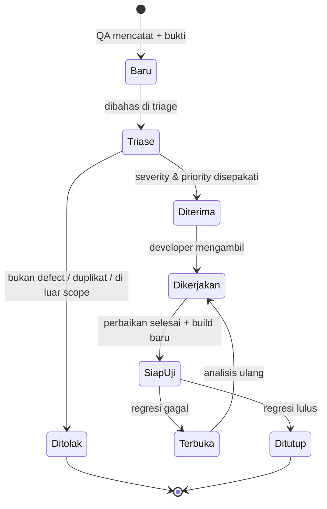

# Defect Management
## Project A — Workforce Attendance System

| Item | Nilai |
|---|---|
| Versi | 1.0 |
| Tanggal | 18 November 2026 |
| Berlaku untuk | Siklus tes `09-Test-Plan.md`, eksekusi `10-Test-Case.md`, UAT `11-UAT.md` |
| Status | Panduan + **3 defect tercatat** dari eksekusi 18 November 2026 (§8A) |

---

## 1. Tujuan

Menjamin setiap penyimpangan dari `01-SRS.md`:

1. tercatat dengan bukti yang dapat direproduksi,
2. diklasifikasi dengan tingkat keparahan yang konsisten,
3. ditindaklanjuti dengan tenggat yang disepakati,
4. diuji ulang (regresi) sebelum ditutup,
5. tidak hilang di percakapan.

---

## 2. Definisi Defect

**Defect** = perilaku sistem berbeda dari yang dinyatakan pada `01-SRS.md` / `06-Functional-Requirement.md`, **atau** menyebabkan data tidak konsisten, **atau** melanggar invarian akses.

Bukan defect (lihat §9):

- fitur yang memang tidak ada karena di luar ruang lingkup,
- keterbatasan yang sudah dinyatakan sebagai gap,
- permintaan fitur baru,
- perbedaan selera tampilan yang tidak memengaruhi fungsi.

---

## 3. Severity (Tingkat Keparahan)

| Severity | Nama | Definisi | Contoh pada sistem ini |
|---|---|---|---|
| **S1** | Kritis | Kehilangan data, kebocoran akses, atau sistem tidak dapat dipakai; tidak ada workaround | Endpoint HR dapat diakses tanpa token; Employee dapat membaca foto karyawan lain; IN menghapus record yang ada; dua IN menghasilkan dua baris |
| **S2** | Tinggi | Fungsi utama gagal atau hasil salah, workaround tidak wajar | IN selalu `TERLAMBAT` meski sebelum 08:15; OUT tidak menyimpan `check_out_at`; dashboard menampilkan angka berbeda dari daftar; radius diabaikan |
| **S3** | Sedang | Fungsi berjalan tetapi sebagian perilaku salah; workaround tersedia | Pesan error salah kode; paginasi melewati satu baris; filter `preset` salah rentang; email otomatis tidak memberi sufiks |
| **S4** | Rendah | Kosmetik, teks, atau kenyamanan | Salah ejaan pesan; tombol tidak sejajar; toast terlalu cepat hilang |

**Aturan penilaian:** bila ragu antara dua tingkat, pilih yang **lebih tinggi** untuk hal yang menyangkut **akses atau integritas data**, dan yang **lebih rendah** untuk tampilan.

---

## 4. Priority (Prioritas Perbaikan)

| Priority | Definisi | Tenggat usulan |
|---|---|---|
| **P1** | Harus diperbaiki sebelum demo | ≤ 1 hari kerja |
| **P2** | Harus diperbaiki dalam siklus ini | ≤ 2 hari kerja |
| **P3** | Dapat ditunda ke siklus berikut | ≤ 1 minggu |
| **P4** | Backlog, tidak dijadwalkan | — |

### 4.1 Matriks Severity × Priority

| Severity \ Priority | P1 | P2 | P3 | P4 |
|---|---|---|---|---|
| **S1** | Wajib | — | — | — |
| **S2** | Wajib | Umum | — | — |
| **S3** | — | Umum | Umum | Boleh |
| **S4** | — | — | Umum | Boleh |

Priority **tidak selalu sama** dengan severity: defect S2 pada fitur yang tidak dipakai demo bisa menjadi P3, asalkan keputusan itu dicatat dan disetujui.

---

## 5. Siklus Hidup Defect



| Status | Arti | Pemilik |
|---|---|---|
| `Baru` | Dicatat, belum ditriase | QA |
| `Triase` | Sedang dinilai | SA + QA + Dev |
| `Ditolak` | Bukan defect / duplikat / di luar scope | SA |
| `Diterima` | Sah, disetujui diperbaiki | SA |
| `Dikerjakan` | Sedang diperbaiki | Dev |
| `SiapUji` | Menunggu verifikasi | Dev |
| `Terbuka` | Regresi gagal, dikembalikan | QA |
| `Ditutup` | Regresi lulus | QA |

**Aturan:** defect hanya boleh ditutup oleh QA yang memverifikasi, bukan oleh yang memperbaiki.

---

## 6. Identitas & Format

**Format ID:** `BUG-<YYYYMMDD>-<nomor urut 2 digit>`
Contoh: `BUG-20261118-01`

**Judul:** ringkas, menyebut perilaku dan lokasi.
- Baik: `IN kedua mengembalikan 201 dan membuat baris baru`
- Buruk: `absensi error`

---

## 7. Template Laporan

```markdown
## BUG-YYYYMMDD-NN — <judul singkat>

| Atribut | Nilai |
|---|---|
| Tanggal | YYYY-MM-DD |
| Pelapor | |
| Build | commit / waktu build |
| Lingkungan | OS, runtime (PHP/Laravel + Node bila menyangkut siklus lama), browser/klien |
| Modul | AUTH / EMP / ADM / OFF / ATT / HIS / DSH / WEB |
| FR terkait | FR-xxx-NN |
| Test case | TC-<MOD>-<NN> |
| Severity | S1 / S2 / S3 / S4 |
| Priority | P1 / P2 / P3 / P4 |
| Status | Baru |

### Langkah reproduksi
1.
2.
3.

### Hasil yang diharapkan


### Hasil aktual


### Bukti
- `TC-<MOD>-<NN>-*.png`
- respons JSON / log

### Dampak
<siapa terdampak, seberapa sering, apakah ada workaround>

### Catatan triase
- Keputusan:
- Alasan:
- Ditugaskan ke:
- Target perbaikan:
```

---

## 8. Contoh Terisi (Fiktif — Bukan Defect Nyata)

> Contoh berikut hanya menunjukkan cara mengisi. **Tidak boleh** dikutip sebagai temuan.

```markdown
## BUG-20261118-01 — IN kedua mengembalikan 201 dan membuat baris baru

| Atribut | Nilai |
|---|---|
| Tanggal | 2026-11-18 |
| Pelapor | QA |
| Build | lokal, 18 Nov 2026 09:10 |
| Lingkungan | Windows 11, PHP 8.5 + Laravel 10, curl |
| Modul | ATT |
| FR terkait | FR-ATT-03 |
| Test case | TC-ATT-02 |
| Severity | S1 |
| Priority | P1 |
| Status | Baru |

### Langkah reproduksi
1. Login karyawan, lakukan IN valid → 201.
2. Kirim IN lagi dengan foto lain.

### Hasil yang diharapkan
409 ALREADY_CHECKED_IN, jumlah baris tetap 1.

### Hasil aktual
201 dan jumlah baris menjadi 2.

### Bukti
- TC-ATT-02-second-in.json
- TC-ATT-02-db-count.png

### Dampak
Kehadiran ganda; dashboard dan rekap menjadi salah. Tidak ada workaround.

### Catatan triase
- Keputusan: diterima
- Alasan: melanggar ATT-02 dan unique constraint
- Ditugaskan ke: Dev backend
- Target perbaikan: 18 Nov 2026
```

---

> **Status per 19 November 2026 (implementasi Laravel):** dari tiga temuan di atas, **BUG-03 sudah tertutup** — `HrSeeder` hanya mencetak email, bukan password (`database/seeders/HrSeeder.php:36-37`). **BUG-01 tetap terbuka** dan sudah diverifikasi ulang pada Laravel (header tetap tidak ada). **BUG-02** hanya relevan pada `public/app.js` (masih dipakai Laravel lewat `routes/web.php:13-19`) dan belum diperbaiki. Rincian perubahan lain ada di `16-Security-Test-Checklist.md` §13.

---

## 8A. Defect Tercatat (Hasil Eksekusi 18 November 2026)

Tiga temuan berikut berasal dari eksekusi nyata terhadap server lokal (Node v22.23.2, database QA terpisah), bukan dari perkiraan. Ketiganya direproduksi pada commit `1c819f5`; berkas yang terlibat (`database/seeders/`, `public/app.js`, `app/Http/Kernel.php` + `routes/api.php`) tidak berubah di `47adb6b`. **Semuanya di luar 61 test case** — tidak satu pun menggagalkan alur bisnis, sehingga seluruh TC tetap `Lulus`. Temuan yang sama juga tercatat sebagai blok `BUG-…` pada sheet `AUTH` dan `EMP` di `docs/Project A - QA Test Cases.xlsx`.

### 8A.1 Ringkasan

| ID | Judul | Modul | Severity | Priority | Status |
|---|---|---|---|---|---|
| BUG-01 | Respons web tidak memuat header keamanan HTTP | WEB | S3 (Medium) | P3 | `Baru` (terverifikasi ulang di Laravel 19 Nov) |
| BUG-02 | `TypeError` saat sesi berakhir ketika daftar sedang dimuat | WEB | S4 (Low) | P3 | `Baru` |
| BUG-03 | Kredensial HR tercetak pada log saat seeding | AUTH | S2 (High) | P2 | `Tertutup` 19 Nov 2026 |

Tidak ada defect **S1**. BUG-01 dan BUG-02 bersifat konfigurasi/kenyamanan; BUG-03 sudah diperbaiki di seeder Laravel (`database/seeders/HrSeeder.php:36-37`).

### 8A.2 BUG-01 — Respons web tidak memuat header keamanan HTTP

| Atribut | Nilai |
|---|---|
| Tanggal | 2026-11-18 |
| Pelapor | QA (suite keamanan) |
| Build | commit `1c819f5`, lokal |
| Lingkungan | Windows 11, Node v22.23.2, Chrome headless 1440×900 |
| Modul | WEB |
| FR terkait | Tidak ada FR khusus; terkait OBS-03/OBS-07 (`16-Security-Test-Checklist.md` §10) |
| Test case | Di luar TC; pemeriksaan ST-44 |
| Severity | S3 |
| Priority | P3 |
| Status | `Baru` (terverifikasi ulang pada Laravel, 19 Nov 2026) |

**Langkah reproduksi**
1. Jalankan server (`php artisan serve`).
2. Minta `GET /` beserta endpoint API mana pun.
3. Periksa header respons: `X-Content-Type-Options`, `X-Frame-Options`, `Content-Security-Policy`, `Referrer-Policy`.

**Hasil yang diharapkan** — Header keamanan standar tersedia (middleware header sendiri, karena Laravel tidak menyediakannya secara bawaan) untuk mencegah clickjacking, MIME sniffing, dan pembatasan sumber daya.

**Hasil aktual** — `x-content-type-options=null`, `x-frame-options=null`, `content-security-policy` tidak ada, `referrer-policy=null`. Tidak ada perlindungan clickjacking, MIME sniffing, maupun CSP. Diverifikasi ulang pada server Laravel 19 Nov 2026: hasil identik.

**Bukti** — `hasil-extra.json#AUTH-18`, `hasil-sec.json#ST-44` (siklus Node); verifikasi ulang Laravel tercatat di `16-Security-Test-Checklist.md` §13.

**Dampak** — Halaman Web HR dapat dirender dalam iframe pihak lain dan berkas unggahan diperlakukan longgar oleh browser lama. Tidak ada data lintas pengguna yang terbuka; invarian login (§0 `01-SRS.md`) tetap utuh karena seluruh endpoint sudah menolak tanpa token.

**Catatan triase**
- Keputusan: diterima, ditunda setelah demo
- Alasan: perbaikan terpusat sebagai middleware header di `app/Http/Kernel.php` (grup `api`/`web`)
- Ditugaskan ke: Dev backend
- Target perbaikan: sebelum produksi

### 8A.3 BUG-02 — `TypeError` saat sesi berakhir ketika daftar sedang dimuat

| Atribut | Nilai |
|---|---|
| Tanggal | 2026-11-18 |
| Pelapor | QA (uji UI) |
| Build | commit `1c819f5`, lokal |
| Lingkungan | Windows 11, Node v22.23.2, Chrome headless 1440×900 |
| Modul | WEB |
| FR terkait | NFR-10 (loading/error/empty state) |
| Test case | `hasil-ui2.json#WEBX-15` (di luar 61 TC) |
| Severity | S4 |
| Priority | P3 |
| Status | `Baru` |

**Langkah reproduksi**
1. Login HR dan buka `#/karyawan` sampai daftar tampil.
2. Ganti `localStorage.hr_token` menjadi nilai rusak (`token.rusak`).
3. Picu permintaan berikutnya (mis. ketik di kolom Cari).

**Hasil yang diharapkan** — Kembali ke layar Login tanpa error JavaScript; tidak ada penulisan ke elemen yang sudah tidak ada.

**Hasil aktual** — `TypeError: Cannot set properties of null (setting 'innerHTML')` di `public/app.js:374`. Penyebab: `api()` memanggil `logout()` saat menerima `401`, `logout()` merender ulang `#app`, lalu blok `catch` yang masih berjalan menulis ke elemen hasil render lama. UX tetap benar — pengguna kembali ke Login.

**Bukti** — `hasil-ui2.json#WEBX-15`, `qa/shots/`.

**Dampak** — Hanya pesan error pada konsol; tidak ada data salah atau akses bocor. Reproduksi deterministik, sehingga layak diperbaiki agar konsol bersih saat demo.

**Catatan triase**
- Keputusan: diterima
- Alasan: guard `null` pada empat blok `catch` (`:165`, `:260`, `:374`, `:482`) atau hentikan render setelah `logout()`
- Ditugaskan ke: Dev frontend
- Target perbaikan: siklus ini (P3)

### 8A.4 BUG-03 — Kredensial HR tercetak pada log saat seeding

| Atribut | Nilai |
|---|---|
| Tanggal | 2026-11-18 |
| Pelapor | QA (pemindaian seluruh berkas sumber saat siklus Node) |
| Build | commit `1c819f5`, lokal |
| Lingkungan | Windows 11, Node v22.23.2 |
| Modul | AUTH |
| FR terkait | NFR-04 (tidak ada plaintext di DB/log) |
| Test case | Di luar TC; pemeriksaan ST-25 |
| Severity | S2 |
| Priority | P2 |
| Status | `Tertutup` — 19 Nov 2026 (seeder Laravel tidak mencetak password) |

**Langkah reproduksi**
1. Jalankan `php artisan db:seed` pada database tanpa akun HR.
2. Periksa stdout proses.

**Hasil yang diharapkan** — Log hanya menyebutkan bahwa akun HR dibuat, tanpa email dan password.

**Hasil aktual (siklus Node, 18 Nov)** — Seeder Node mencetak `[seed] HR admin: <email> / <password>` sehingga password HR muncul utuh di konsol. **Perbaikan Laravel (19 Nov):** `database/seeders/HrSeeder.php:36-37` hanya menulis `Akun HR dibuat: <email> (password dari HR_PASSWORD / .env)`; password tidak lagi muncul. Diverifikasi dengan menjalankan `php artisan db:seed --force` dua kali: baris log tidak memuat password.

**Bukti** — `hasil-sec2.json#ST-25` (siklus Node); verifikasi ulang Laravel di `16-Security-Test-Checklist.md` §13.

**Dampak** — Tidak bocor ke klien, tetapi terbaca oleh siapa pun yang dapat melihat log konsol/CI. Kini hanya email yang tampil, sehingga risiko kebocoran kredensial hilang.

**Catatan triase**
- Keputusan: **ditutup** setelah cleanup
- Alasan: melanggar NFR-04; diperbaiki di seeder Laravel (tidak mencetak password)
- Ditugaskan ke: Dev backend
- Target perbaikan: selesai 19 Nov 2026

---

## 9. Daftar "Bukan Defect" (Known Limitations)

Agar QA tidak salah mencatat, hal berikut **sudah dinyatakan** di dokumen dan **bukan defect**:

| Hal | Alasan | Rujukan |
|---|---|---|
| Aplikasi mobile tidak ada | Belum ada di repo; Employee diuji via API | `01-SRS.md` D-05, GAP-02 |
| Kode karyawan `kyNN`, bukan `EMP001` | Implementasi aktual; README yang perlu diperbaiki | D-08, GAP-04 |
| OUT setelah tengah malam ditolak | Tidak ada shift malam (BR-01) | `01-SRS.md` §2.4 |
| Tidak ada koreksi absensi | Di luar scope | §1.2 |
| Tidak ada `DELETE /api/offices` | Hanya nonaktifkan | GAP-08 |
| Ekspor CSV maksimum 5.000 baris | Batas 25 halaman × 200 | `07-User-Story.md` US-27 |
| Tidak ada `updated_at` | Belum dirancang | GAP-05 |
| Tidak ada rate limit khusus login | Limiter `api` 60/menit berlaku, tetapi tidak ada batas percobaan kredensial tersendiri | GAP-06 |
| Password awal hanya tampil sekali | Keputusan keamanan | FR-EMP-03 |
| Foto disimpan di disk lokal | Keterbatasan lingkungan | GAP-07 |
| Dashboard tidak real-time (60 detik) | Keputusan desain | FR-DSH-03 |
| Status `BELUM_*` tidak tersimpan di DB | Status turunan, bukan kolom | `04-ERD.md` §4 |
| ~~Dua implementasi (Node + Laravel) dalam satu repo~~ | **Ditutup 19 Nov 2026**: Node dihapus, repo hanya Laravel | D-10, D-12, GAP-09 |
| `README` menyebut 9 tes, aktual 5 metode/27 assertion | Dokumentasi sudah disinkronkan 19 Nov 2026 | D-09, GAP-10 |
| Server gagal jalan di Node < 22.13 | Batasan runtime siklus lama; tidak berlaku di Laravel | RISK-01 (historis) |

**Namun:** bila salah satu hal di atas **berubah perilaku** tanpa keputusan (mis. endpoint office tiba-tiba menghapus data, atau foto tampil tanpa token), itu **defect baru**.

---

## 10. Triage

### 10.1 Kapan

| Waktu | Aktivitas |
|---|---|
| Setiap akhir sesi tes | QA memilah defect baru |
| Harian 16:00 | Triage 15 menit: SA + QA + Dev |
| Sebelum UAT | Pastikan tidak ada S1 terbuka |

### 10.2 Pertanyaan triage

1. Apakah perilaku ini berbeda dari FR/UC yang tertulis? (bila tidak → tolak)
2. Sudah pernah dilaporkan? (bila ya → duplikat, tautkan)
3. Apakah termasuk §9? (bila ya → tolak dengan rujukan)
4. Apa dampaknya bagi demo/pengguna?
5. Ada workaround?
6. Siapa yang memperbaiki dan kapan?

### 10.3 Keputusan

| Keputusan | Kapan dipakai |
|---|---|
| `Diterima` | Perilaku menyimpang dan layak diperbaiki |
| `Ditolak — bukan defect` | Sesuai desain / di luar scope |
| `Ditolak — duplikat` | Sudah ada ID lain |
| `Ditunda` | Sah, tetapi setelah demo (tetap tercatat) |

---

## 11. SLA Penanganan (Usulan)

| Severity | Respons awal | Perbaikan | Verifikasi ulang |
|---|---|---|---|
| S1 | ≤ 2 jam | ≤ 1 hari kerja | ≤ 2 jam setelah build |
| S2 | ≤ 4 jam | ≤ 2 hari kerja | ≤ 4 jam |
| S3 | ≤ 1 hari | ≤ 5 hari kerja | ≤ 1 hari |
| S4 | ≤ 2 hari | Sesuai backlog | Saat regresi berikutnya |

Angka ini **usulan** untuk proyek magang 3 hari; sesuaikan dengan kesepakatan mentor.

---

## 12. Regresi

### 12.1 Aturan

| Perubahan | Wajib menjalankan ulang |
|---|---|
| Perbaikan S1/S2 | TC terkait + **smoke pack 13 TC** (`10-Test-Case.md` §2) |
| Perubahan `jwt.auth`/`role` | TC-AUTH-01, TC-AUTH-06, TC-AUTH-09 + seluruh endpoint yang terpengaruh |
| Perubahan `app/Http/Controllers/Api/AttendanceController.php` | `TC-ATT-01` … `TC-ATT-14` |
| Perubahan `database/migrations/` | TC-EMP-01, TC-ATT-02, TC-ATT-14 + pemeriksaan migrasi |
| Perubahan `public/app.js` | TC-AUTH-09, TC-WEB-01, TC-WEB-02 |
| Perubahan `app/Services/TimeService.php` | TC-ATT-01, TC-ATT-13 + TC-HIS-10 (status di dashboard) |

### 12.2 Bukti regresi

Setiap penutupan defect wajib memuat:

- ID defect,
- TC yang dijalankan,
- hasil (`Lulus`),
- tautan bukti,
- build yang diuji.

---

## 13. Metrik Defect

| Metrik | Rumus | Target |
|---|---|---|
| Defect density | `jumlah defect / 63 FR` | ≤ 0,2 |
| Defect leakage | `defect ditemukan di UAT / total defect` | ≤ 20% |
| Reopen rate | `defect dibuka ulang / defect ditutup` | ≤ 10% |
| Waktu perbaikan S1 | rata-rata jam | ≤ 1 hari |
| Defect terbuka saat demo | jumlah S1 + S2 | S1 = 0, S2 ≤ 1 |

**Aktual (18 November 2026, diperbarui 19 November 2026):** defect density = 3 / 63 = **0,05** (target ≤ 0,2 → terpenuhi); defect terbuka saat demo = **0** defect S2 (BUG-03 ditutup 19 Nov 2026), menyisakan BUG-01 (S3) dan BUG-02 (S4) yang diterima sebagai catatan. Seluruh defect berasal dari eksekusi internal, bukan dari UAT, sehingga *defect leakage* belum dapat dihitung.

---

## 14. Komunikasi

| Kanal | Digunakan untuk |
|---|---|
| Catatan triage harian | Ringkasan status defect |
| Issue tracker repo (bila tersedia) | Penyimpanan definitif |
| Spreadsheet `defect-log` | Alternatif bila tracker belum dipakai |
| Pesan langsung | Hanya untuk S1; tetap wajib dicatat di tracker |

**Aturan:** keputusan lisan tidak berlaku sampai dicatat. Bila terjadi perbedaan ingatan, dokumen yang menang.

---

## 15. Penutupan Siklus

Sebelum menyatakan siklus selesai:

- [ ] Semua defect S1 berstatus `Ditutup`. — **tidak ada defect S1**
- [x] Semua defect S2 `Ditutup` atau `Ditunda` dengan persetujuan mentor. — **BUG-03 ditutup 19 Nov 2026**
- [ ] Seluruh penutupan memiliki bukti regresi. — belum ada penutupan
- [ ] Daftar §9 ditinjau: tidak ada yang berubah menjadi defect tanpa catatan. — ditinjau 18 Nov 2026, tidak ada perubahan
- [ ] Rekap dimasukkan ke laporan QA (`QA-REPORT-<tanggal>.md`). — lihat `18-Test-Summary-Report.md`
- [ ] Lembar UAT ditandatangani (`11-UAT.md`). — tanda tangan menunggu sesi UAT resmi