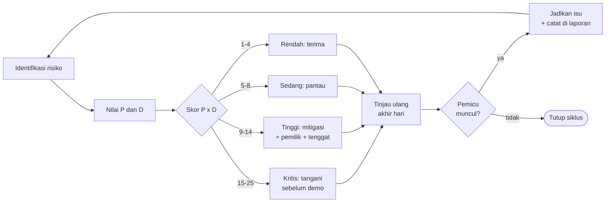
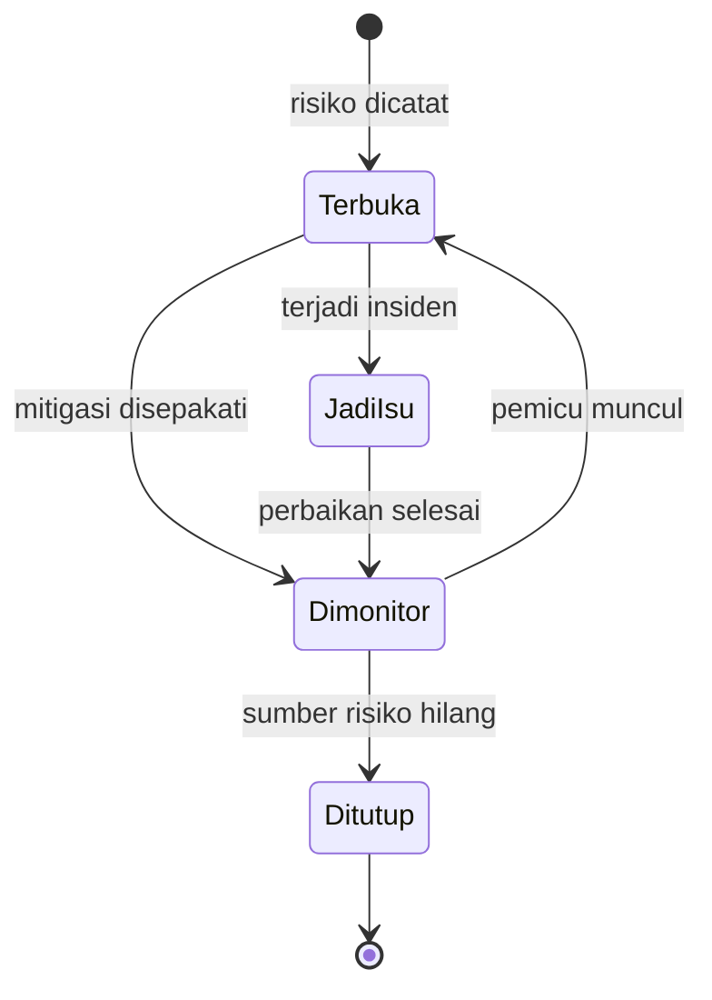

# Risk Register
## Project A — Workforce Attendance System

| Item | Nilai |
|---|---|
| Versi | 1.0 |
| Tanggal | 18 November 2026 |
| Jumlah risiko | 22 (RISK-01 … RISK-22) |
| Sumber | `08-Business-Process-Documentation.md` §9 (R-01..R-08), `09-Test-Plan.md` §9 (TR-01..TR-06), pemeriksaan repo |
| Pemilik register | System Analyst |
| Peninjau | QA Engineer, Developer, Mentor |
| Status | Aktif; ditinjau setiap akhir hari kerja |

> Register ini **menggabungkan** risiko proses dan risiko pengujian menjadi satu daftar bernomor agar tidak ada risiko yang hanya hidup di catatan rapat. Setiap risiko punya pemicu (trigger) sehingga dapat dikenali sebelum menjadi insiden.

---

## 1. Skala Penilaian

### 1.1 Probabilitas (P)

| Nilai | Arti | Penanda |
|---|---|---|
| 5 | Hampir pasti | Sudah terjadi / terbukti di lingkungan saat ini |
| 4 | Sangat mungkin | Terjadi bila tidak ada tindakan |
| 3 | Mungkin | Dapat terjadi dalam 3 hari kerja |
| 2 | Kecil | Terjadi pada kondisi tertentu |
| 1 | Sangat kecil | Perlu kondisi ekstrem |

### 1.2 Dampak (D)

| Nilai | Arti | Contoh |
|---|---|---|
| 5 | Katastrofik | Data absensi hilang / bocor; demo gagal total |
| 4 | Besar | Fitur utama tidak dapat dipakai; hasil rekap salah |
| 3 | Sedang | Sebagian alur terganggu; ada workaround |
| 2 | Kecil | Kenyamanan terganggu |
| 1 | Sangat kecil | Kosmetik |

### 1.3 Skor & Tingkat

| Skor (P×D) | Tingkat | Tindakan wajib |
|---|---|---|
| 15–25 | **Kritis** | Tangani sebelum demo; eskalasi ke mentor |
| 9–14 | **Tinggi** | Rencana mitigasi tertulis + pemilik |
| 5–8 | **Sedang** | Pantau; mitigasi bila waktu memungkinkan |
| 1–4 | **Rendah** | Catat; terima |

---

## 2. Register Risiko

### 2.1 Kategori A — Lingkungan & Kesiapan (paling mendesak)

| ID | Risiko | Bukti / penyebab | Dampak bila terjadi | P | D | Skor | Tingkat | Mitigasi | Pemicu |
|---|---|---|---|---|---|---|---|---|---|
| RISK-01 | Runtime tidak memenuhi syarat minimum sehingga server tidak dapat dijalankan | `package.json` `engines: node >=22.13`; mesin saat ini Node **v20.18.0**; `require('node:sqlite')` gagal `ERR_UNKNOWN_BUILTIN_MODULE` | Seluruh 61 TC dan UAT terblokir; tidak ada demo | 5 | 5 | **25** | **Kritis** | Pasang Node 22.13+ (LTS 22) sebelum sesi tes; catat versi di laporan | `npm start` / `npm test` gagal saat memuat `node:sqlite` |
| RISK-02 | Tidak ada berkas `.env`, sehingga server memakai nilai bawaan | `Test-Path .env` = *false*; `src/config.js:13` (`jwtSecret` cadangan) dan `:19` (`hrPassword` cadangan) | Token dapat dipalsukan bila cadangan dipakai; kredensial HR bawaan diketahui publik | 4 | 5 | **20** | **Kritis** | Buat `.env` dari `.env.example`, isi `JWT_SECRET` acak ≥ 32 karakter, ganti `HR_PASSWORD`; jangan pernah pakai cadangan untuk demo | Login demo memakai password bawaan; token diterima setelah `JWT_SECRET` diganti |
| RISK-03 | Dua tumpukan teknologi dalam satu repo membingungkan titik masuk | Root berisi skeleton **Laravel 10** (`artisan`, `composer.json`, `app/`, `routes/api.php` masih default, `vendor/` tidak ada) **dan** implementasi Node di `src/` | Penguji/dev menjalankan perintah salah; waktu habis | 4 | 3 | 12 | Tinggi | Nyatakan tegas: Project A dijalankan lewat `npm start` (`src/server.js`); Laravel skeleton tidak dipakai | Ada yang menjalankan `php artisan serve` |
| RISK-04 | Jumlah tes di README berbeda dengan kode | `README.md` menulis "9 tes"; `test/attendance.test.js` berisi **10** `test(...)` | Laporan QA salah mengutip cakupan | 3 | 2 | 6 | Sedang | Catat 10 tes; jadikan D-09 pada SRS | Pembandingan hasil `npm test` |
| RISK-05 | Data uji bercampur data demo | Satu DB default `./data/attendance.db`; tes memakai `./data/test.db` (`test/attendance.test.js:1`) | Angka dashboard salah; kode `kyNN` melompat | 3 | 4 | 12 | Tinggi | Wajib `DB_PATH`/`UPLOAD_DIR` terpisah tiap siklus (`09-Test-Plan.md` §4.2) | `belum_in` tidak sesuai perkiraan |

### 2.2 Kategori B — Keamanan & Akses

| ID | Risiko | Bukti / penyebab | Dampak | P | D | Skor | Tingkat | Mitigasi | Pemicu |
|---|---|---|---|---|---|---|---|---|---|
| RISK-06 | Kebocoran data antar karyawan | Isolasi bergantung pada pengecekan `employee_id` di handler | Kepercayaan pengguna rusak | 2 | 5 | 10 | Tinggi | TC-09, TC-56, ST-15..ST-18 dijalankan setiap regresi | Ada respons 200 untuk data milik orang lain |
| RISK-07 | Foto absensi diambil dari disk tanpa token | Foto hanya disajikan lewat endpoint ber-`auth` (`attendance.js`), bukan `express.static` | Bukti kehadiran bocor | 2 | 4 | 8 | Sedang | Pastikan `uploads/` **tidak** berada di bawah `public/`; uji ST-21 | `GET /uploads/attendance/<berkas>` mengembalikan gambar |
| RISK-08 | Brute force login | Tidak ada rate limit pada `POST /api/login` (GAP-06) | Akun diambil alih | 3 | 4 | 12 | Tinggi | Batasi percobaan di lapisan depan (reverse proxy) untuk demo; usulkan rate limit (BL-03) | Lonjakan 401 `INVALID_CREDENTIALS` |
| RISK-09 | Token 12 jam tanpa pencabutan | Stateless JWT; logout hanya menghapus token di klien (`api.js:13-17`) | Token bocor tetap berlaku | 2 | 4 | 8 | Sedang | Perlakukan token seperti password; jangan tampilkan di tangkapan layar/laporan | Ada token di log/screenshot |
| RISK-10 | Secret/kredensial tertulis di dokumen | Kebiasaan menyalin nilai `.env` ke laporan | Kebocoran permanen | 3 | 4 | 12 | Tinggi | Aturan: dokumen hanya menulis nama variabel; sudah diverifikasi tidak ada nilai rahasia di `docs/project-a/` | Ditemukan string menyerupai password di dokumen |

### 2.3 Kategori C — Akurasi Data & Aturan Bisnis

| ID | Risiko | Bukti / penyebab | Dampak | P | D | Skor | Tingkat | Mitigasi | Pemicu |
|---|---|---|---|---|---|---|---|---|---|
| RISK-11 | Titip absen (foto orang lain) | Tidak ada verifikasi wajah; hanya foto + GPS | Data tidak sah | 3 | 4 | 12 | Tinggi | Terima sebagai risiko; usulkan verifikasi wajah (BL-06) | Foto identik berulang antar karyawan |
| RISK-12 | Lokasi palsu (mock location) | Klien mengirim `lat`/`lng` apa adanya | Geofence tidak bermakna | 3 | 3 | 9 | Tinggi | Usulkan deteksi mock location (BL-07); catat sebagai keterbatasan | Koordinat sama persis antar pengguna |
| RISK-13 | Karyawan lupa check-out | Tidak ada pengingat | Rekap tidak lengkap; `BELUM_OUT` menumpuk | 4 | 3 | 12 | Tinggi | Pantau tab "Belum OUT" (BP-04); usulkan pengingat (BL-01) | `sudah_out` < `sudah_in` |
| RISK-14 | Batas 08:15 salah dihitung | Kesalahan zona waktu bila memakai jam perangkat | Status salah, sengketa | 2 | 4 | 8 | Sedang | Uji unit TC-47 (08:15 vs 08:16) setiap perubahan `utils/time.js` | Status `TEPAT_WAKTU` muncul setelah 08:16 |
| RISK-15 | Radius office salah | Koordinat/radius keliru saat input | Absensi sah ditolak atau geofence longgar | 3 | 3 | 9 | Tinggi | Prosedur uji radius setelah setiap perubahan (BP-07) | Banyak `OUTSIDE_RADIUS` padahal di kantor |
| RISK-16 | OUT setelah tengah malam ditolak | `work_date` mengikuti tanggal saat ini (BR-01) | Karyawan shift malam tidak tercatat | 2 | 3 | 6 | Sedang | Nyatakan sebagai keputusan: tanpa shift malam | Keluhan OUT gagal pukul 00:xx |
| RISK-17 | Penghapusan karyawan menghapus riwayat | `ON DELETE CASCADE` + hapus berkas foto | Data hilang permanen | 2 | 5 | 10 | Tinggi | Default nonaktifkan (INACTIVE), bukan hapus; konfirmasi berlapis | Ada permintaan "hilangkan data" |

### 2.4 Kategori D — Pengujian & Dokumentasi

| ID | Risiko | Bukti / penyebab | Dampak | P | D | Skor | Tingkat | Mitigasi | Pemicu |
|---|---|---|---|---|---|---|---|---|---|
| RISK-18 | Mobile tidak ada sehingga alur karyawan tidak teruji di perangkat nyata | Tidak ada folder mobile (D-05) | Demo alur Employee bergantung curl/Postman | 5 | 3 | **15** | **Kritis** | Siapkan koleksi request siap pakai; jelaskan sebelum UAT (`11-UAT.md` §3) | Penguji meminta aplikasi |
| RISK-19 | Waktu eksekusi hanya 3 hari | Jadwal `09-Test-Plan.md` §7 | Cakupan tidak penuh | 4 | 3 | 12 | Tinggi | Prioritaskan smoke pack TC-01..TC-13 lalu risiko tertinggi | Sisa TC belum dieksekusi pada 19 Nov |
| RISK-20 | Hasil tes tidak berbukti | Tidak ada kebiasaan menyimpan log | Klaim tidak dapat dipertanggungjawabkan | 3 | 4 | 12 | Tinggi | Aturan `09-Test-Plan.md` §11: tanpa bukti = belum dijalankan | Laporan tanpa berkas pendukung |
| RISK-21 | Dokumen dan kode menyimpang tanpa catatan | Perubahan kode tanpa memperbarui D1/D6/RTM | Keputusan salah berbasis dokumen lama | 3 | 3 | 9 | Tinggi | Protokol `TASK.md` §7 + `15-Change-Request-Log.md` | Ada FR yang tidak lagi sesuai kode |
| RISK-22 | UAT tidak dihadiri pengguna sebenarnya | Jadwal padat; penguji hanya internal | Penerimaan tidak sah | 3 | 4 | 12 | Tinggi | Tetapkan penguji & tanggal sebelum 19 Nov; bila tidak bisa, nyatakan UAT internal | Lembar UAT ditandatangani tanpa perwakilan HR/karyawan |

---

## 3. Peta Panas (Heat Map)

| D \\ P | 1 | 2 | 3 | 4 | 5 |
|---|---|---|---|---|---|
| **5** | — | — | — | RISK-02, RISK-17 | **RISK-01** |
| **4** | — | RISK-09 | RISK-08, RISK-10, RISK-20, RISK-22 | RISK-05, RISK-19 | — |
| **3** | — | RISK-04, RISK-16 | RISK-12, RISK-15, RISK-21 | RISK-03, RISK-11, RISK-13 | RISK-18 |
| **2** | — | RISK-07 | RISK-14 | RISK-06, RISK-06 | — |
| **1** | — | — | — | — | — |

**Jumlah per tingkat:** Kritis **3** · Tinggi **11** · Sedang **6** · Rendah **0** · **Total 22**.

---

## 4. Lima Risiko Teratas & Rencana

| Peringkat | Risiko | Skor | Tindakan | Pemilik | Tenggat |
|---|---|---|---|---|---|
| 1 | RISK-01 Runtime Node 20.18 | 25 | Naikkan ke Node 22.13+ lalu jalankan `npm test` | Developer | Sebelum TC pertama |
| 2 | RISK-02 Tanpa `.env` | 20 | Buat `.env`; isi secret acak; jangan pakai cadangan | Developer | Sebelum demo |
| 3 | RISK-18 Mobile tidak ada | 15 | Siapkan koleksi request + penjelasan di UAT | QA | Sebelum UAT |
| 4 | RISK-05 Data uji bercampur | 12 | Selalu `DB_PATH` + `UPLOAD_DIR` terpisah | QA | Setiap siklus |
| 5 | RISK-08 Brute force | 12 | Batasi percobaan di lapisan depan; usulkan rate limit | Developer | Sebelum demo publik |

---

## 5. Risiko yang Diterima (Accepted)

| ID | Alasan diterima | Syarat |
|---|---|---|
| RISK-11 Titip absen | Perbaikan butuh verifikasi wajah (usaha besar, di luar 3 hari) | Dinyatakan sebagai keterbatasan di UAT |
| RISK-12 Mock location | Perbaikan butuh kode klien mobile yang belum ada | Dinyatakan sebagai keterbatasan |
| RISK-16 OUT lewat tengah malam | Keputusan bisnis: tanpa shift malam | Dinyatakan di SRS BR-01 |
| RISK-04 Selisih jumlah tes | Kosmetik dokumentasi | Dicatat sebagai D-09 |

Risiko yang diterima **tetap dipantau**; bila pemicunya muncul, status berubah menjadi isu.

---

## 6. Siklus Peninjauan

| Waktu | Aktivitas | Keluaran |
|---|---|---|
| Awal hari | Periksa risiko Kritis & Tinggi | Daftar fokus hari ini |
| Setiap defect S1/S2 | Periksa apakah terkait risiko tercatat | Risiko diperbarui |
| Akhir hari | Perbarui skor & status | Snapshot register |
| Sebelum UAT | Pastikan tidak ada Kritis terbuka | Keputusan lanjut/tunda |
| Akhir proyek | Tandai Ditutup / diserahkan | Register final |

---

## 7. Keterkaitan Dokumen

| Dokumen | Peran |
|---|---|
| `01-SRS.md` §10 | Deviasi D-01..D-10 yang menjadi sumber sebagian risiko |
| `08-Business-Process-Documentation.md` §9 | Risiko proses R-01..R-08 (asal RISK-06..RISK-17) |
| `09-Test-Plan.md` §9 | Risiko pengujian TR-01..TR-06 (asal RISK-05, RISK-18..RISK-20) |
| `13-Defect-Management.md` | Jalur ketika risiko menjadi defect |
| `16-Security-Test-Checklist.md` | Verifikasi risiko keamanan |
| `18-Test-Summary-Report.md` | Pelaporan status risiko saat penutupan siklus |