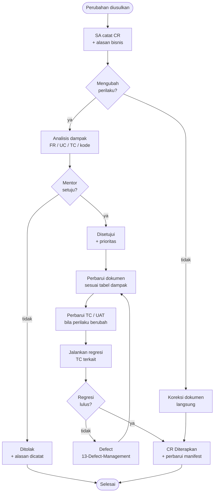

# Change Request Log
## Project A — Workforce Attendance System

| Item | Nilai |
|---|---|
| Versi | 1.0 |
| Tanggal | 18 November 2026 |
| Baseline | Dokumen v2.0 + paket QA v1.0 (`_sources.json`) |
| Jumlah CR tercatat | 0 (belum ada permintaan perubahan formal) |
| Pemilik proses | System Analyst |
| Penyetuju | Mentor / pemilik produk |

---

## 1. Mengapa Dokumen Ini Ada

Setelah baseline dibekukan, setiap perubahan berpotensi membuat dokumen lain tidak lagi benar. Contoh nyata pada proyek ini:

- Endpoint `DELETE /api/employees` **ada** di kode, padahal dokumen awal hanya menyebut `GET/POST/PUT` → melahirkan D-03 dan tiga user story tambahan.
- Format respons berbeda dari dokumen awal → melahirkan D-04 dan **seluruh** contoh di test case harus mengikuti format aktual.

Tanpa catatan perubahan, orang berikutnya akan menganggap dokumen lama masih sah. Dokumen ini memastikan setiap perubahan punya **jejak, alasan, dan dampak yang sudah diperiksa**.

---

## 2. Definisi Baseline

| Hal | Nilai |
|---|---|
| Versi dokumen analisis | 2.0 (build 18 November 2026) |
| Versi paket QA | 1.0 |
| Kode acuan | `src/`, `public/`, `test/` pada kondisi build |
| Bukti integritas | `_sources.json` (75 sumber + 21 output, sha256 + mtime) |
| Sifat | **Beku** — perubahan hanya lewat CR |

Bila hash sumber berubah, baseline dianggap **kadaluarsa** dan wajib dijalankan protokol `update` (`TASK.md` §7) sebelum CR baru dinilai.

---

### 2.1 Perubahan Upstream selama Siklus (tanpa CR)

| Tanggal | Commit | Isi | Dampak pada dokumen |
|---|---|---|---|
| 18 Nov 2026 | `ee94e48` | Perubahan tombol CSS (`public/app.css`, kelas `table-actions`) | Tidak ada — tidak ada klaim dokumen yang bergantung pada CSS itu |
| 18 Nov 2026 | `3ee2b7a` | "migrasi ke laravel": implementasi paralel Laravel (`app/`, `routes/api.php`, 5 tes fitur, migrasi DB) | Ditambahkan sebagai D-10/D-12 + GAP-09; `src/`, `public/app.js`, dan `test/` **tidak berubah**, sehingga seluruh hasil uji tetap sah untuk baseline |
| 18 Nov 2026 | `47adb6b` | Merge PR #5 (`final` → `main`) | `main` di-fast-forward ke commit ini; baseline dokumen tetap `1c819f5` untuk kode yang diuji |

**Mengapa tidak ada CR:** ketiga commit tidak mengubah perilaku implementasi Node yang diuji (`src/**` identik). Yang berubah adalah *isi repo* (tumpukan kedua). Sesuai §3, hal ini dikategorikan **koreksi faktual**, bukan perubahan perilaku.

---

## 3. Klasifikasi Perubahan

| Jenis | Contoh | Perlu CR? | Perlu perbarui dokumen? |
|---|---|---|---|
| **Koreksi faktual** | D-08: kode karyawan `EMP001` → `kyNN` | Tidak (cukup catat deviasi) | Ya, di bagian deviasi |
| **Klarifikasi** | Menambah contoh request tanpa mengubah aturan | Tidak | Tidak wajib |
| **Perubahan perilaku** | Menambah rate limit login | **Ya** | Ya, seluruh rantai dampak |
| **Fitur baru** | Laporan PDF bulanan | **Ya** | Ya, FR + UC + AD + story + TC |
| **Penghapusan fitur** | Menghapus `GET /api/offices` untuk Employee | **Ya** | Ya, termasuk TC yang tidak berlaku |
| **Perubahan NFR** | Target respons 2 s → 1 s | **Ya** | Ya, NFR + test plan |
| **Perbaikan bug** | 409 salah menjadi 201 | Tidak (jalur defect) | Ya, bila mengubah FR |

**Aturan:** bila ragu, anggap **perlu CR**. Biaya mencatat CR jauh lebih kecil daripada dokumen yang saling bertentangan.

---

## 4. Format CR

**ID:** `CR-<YYYYMMDD>-<NN>` — contoh `CR-20261119-01`

```markdown
## CR-YYYYMMDD-NN — <judul singkat>

| Atribut | Nilai |
|---|---|
| Tanggal | |
| Pengusul | |
| Jenis | Koreksi / Klarifikasi / Perubahan perilaku / Fitur / Penghapusan / NFR |
| Alasan bisnis | |
| Alternatif yang dipertimbangkan | |
| Dampak bila tidak dilakukan | |
| Prioritas | P1 / P2 / P3 / P4 |
| Status | Diajukan / Dianalisis / Disetujui / Ditolak / Diterapkan |

### Deskripsi perubahan


### Analisis dampak

| Dokumen | Perlu diubah? | Bagian |
|---|---|---|
| `01-SRS.md` | | |
| `02-Use-Case-Diagram.md` | | |
| `03-Activity-Diagram.md` | | |
| `04-ERD.md` | | |
| `05-Flowchart.md` | | |
| `06-Functional-Requirement.md` | | |
| `07-User-Story.md` | | |
| `08-Business-Process-Documentation.md` | | |
| `09`–`13` (QA) | | |
| `14`–`19` (register) | | |
| Kode / tes | | |

### Estimasi usaha

### Keputusan
- Disetujui oleh:
- Tanggal:
- Catatan:
```

---

## 5. Alur Persetujuan



**Aturan penting:** CR tidak boleh diterapkan hanya di kode. Bila perilaku berubah, dokumen dan test case wajib berubah pada hari yang sama, dan manifest diregenerasi.

---

## 6. Register Perubahan

### 6.1 Perubahan Formal

*Belum ada.* Tabel ini diisi hanya bila CR disetujui.

| ID | Tanggal | Judul | Jenis | Status | Dampak dokumen | Pemilik |
|---|---|---|---|---|---|---|
| — | — | Belum ada CR | — | — | — | — |

### 6.2 Deviasi yang Sudah Tercatat pada Baseline

Perbedaan berikut **sudah diketahui saat baseline** dan tidak memerlukan CR baru. Dicantumkan agar tidak dilaporkan ulang sebagai temuan.

| No | Deviasi | Keputusan baseline | Rujukan |
|---|---|---|---|
| D-01 | SQLite, bukan MySQL | Diterima; constraint setara | `01-SRS.md` §10 |
| D-02 | GPS/kamera/geofence diimplementasikan | Diterima; fitur tambahan | `01-SRS.md` §10 |
| D-03 | Ada `DELETE`, `reset-password`, `/api/admins` | Diterima; masuk FR-EMP-10, FR-EMP-11, FR-ADM | `01-SRS.md` §10 |
| D-04 | Format respons `{data, meta}` / `{error}` | Diterima; kontrak aktual | `01-SRS.md` §6 |
| D-05 | Tanpa folder `mobile/` | Diterima; diuji via API | `01-SRS.md` §10, GAP-02 |
| D-06 | CSV ada | Diterima; FR-HIS-09 | `01-SRS.md` §10 |
| D-07 | Login penuh, bukan "demo" | Diterima; menjadi Auth Gate | `01-SRS.md` §0 |
| D-08 | README `EMP001` vs `kyNN` | Dicatat; README tidak diubah | GAP-04 |
| D-09 | README menyebut 9 tes, aktual 10 | Dicatat; acuan = kode | `test/attendance.test.js` |
| D-10 | Dua implementasi: Node `src/` (diuji) + Laravel `app/` (belum diuji) | Dicatat; baseline titik masuk = `npm start` | `composer.json`, `app/`, `routes/api.php` |
| D-11 | `422` untuk input tidak valid di docx, implementasi `400` | Dicatat; acuan = kode, kontrak di `01-SRS.md` §7.3 | `01-SRS.md` §10 |
| D-12 | Implementasi Laravel paralel (20 endpoint sama + `/health`, 5 tes fitur) | Dicatat; kontrak API berlaku untuk keduanya, angka QA hanya untuk Node | `app/`, `routes/api.php`, `tests/Feature/` |

### 6.3 Usulan yang **Bukan** CR

Hal berikut sering disebut "perubahan", padahal sudah masuk backlog dan belum disetujui untuk dikerjakan:

| Usulan | Status | Rujukan |
|---|---|---|
| Rate limit login | Backlog BL-03 | `08` §10 |
| Verifikasi wajah | Backlog BL-06 | `08` §10 |
| Laporan PDF bulanan | Backlog BL-08 | `08` §10 |
| Endpoint hapus office | Gap GAP-08 | `06` §Gap |
| Kolom `updated_at` | Gap GAP-05 | `06` §Gap |
| Endpoint koreksi absensi | Backlog BL-02 | `08` §10 |

Mengerjakan salah satu di atas **wajib** membuka CR terlebih dahulu.

---

## 7. Tabel Dampak Cepat

Disalin dari `TASK.md` §7.1 agar dapat dipakai tanpa berpindah dokumen.

| Bila berubah | Wajib diperbarui | Wajib diuji ulang |
|---|---|---|
| Endpoint / peran | `01` §6, `02`, `12` | TC endpoint terkait + TC-02, TC-16 |
| Aturan waktu | `01` §5, `05` FC-04, `06` ATT-07 | TC-04, TC-47, TC-10 |
| Skema tabel | `04`, `01` §7 | TC-01, TC-05, TC-48 |
| Status absensi | `01` §5, `04` §4, `05` FC-03 | TC-41, TC-42, TC-48 |
| Filter tanggal | `01` §5, `05` FC-05, `06` HIS-04..06 | TC-10, TC-49..TC-53 |
| Dashboard | `01` §3 DSH, `05` FC-06, `06` DSH | TC-58, TC-59 |
| Tampilan Web | `07` story WEB, `10` TC-60/61 | TC-17, TC-60, TC-61 |
| Middleware auth | `01` §0, `05` FC-02 | TC-02, TC-16, TC-17 |

---

## 8. Aturan Penutupan CR

Sebuah CR baru boleh berstatus **Diterapkan** bila:

- [ ] Disetujui penyetuju yang berwenang.
- [ ] Seluruh dokumen pada tabel dampak sudah diperbarui.
- [ ] Test case baru/diubah sudah ditambahkan dan dirujuk di `12-Traceability-Matrix.md`.
- [ ] Regresi dijalankan dan hasilnya dicatat.
- [ ] `_sources.json` diregenerasi.
- [ ] Nomor versi dokumen dinaikkan (mis. 2.0 → 2.1) dan dicatat di riwayat.

---

## 9. Riwayat Dokumen

| Versi | Tanggal | Perubahan |
|---|---|---|
| 1.0 | 2026-11-18 | Dibuat; baseline v2.0 dibekukan; deviasi D-01..D-12 dicatat |