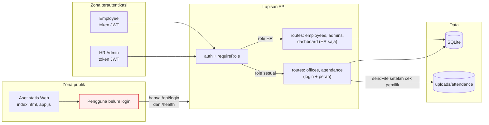

# Security Test Checklist
## Project A — Workforce Attendance System

| Item | Nilai | 
|---|---|
| Versi | 1.0 |
| Tanggal | 18 November 2026 |
| Jumlah pemeriksaan | 44 (ST-01 … ST-44) |
| Sifat | Checklist keamanan terapan, bukan uji penetrasi formal |
| Metode | Tinjauan kode statis + **eksekusi nyata** (18 November 2026) |
| Hasil | **37 Lulus**, **6 Gagal**, **1 Belum** dari 44 pemeriksaan (`*.json` pada folder bukti) |
| Acuan | `01-SRS.md` §0, `06-Functional-Requirement.md`, `TASK.md` I-01/I-04/I-05/I-07 |

> **Pernyataan jujur:** status di bawah berasal dari eksekusi nyata terhadap server lokal (Node v22.23.2, database QA terpisah) pada 18 November 2026, bukan dari asumsi. Baris yang tidak dapat dieksekusi tetap `Belum` beserta alasannya. Enam `Gagal` dijelaskan di §10.1 dan **tidak** dinilai sebagai kebocoran data — semuanya soal konfigurasi/kebiasaan operasional (log kredensial, secret cadangan, tanpa rate limit, tanpa header keamanan, kode error body besar).

---

## 1. Mengapa Keamanan Menjadi Fokus di Proyek Ini

Invarian utama sistem adalah **semua fitur wajib login**. Artinya, kegagalan keamanan di sini bukan "tambahan", melainkan **kegagalan requirement inti**. Tiga aset yang dilindungi:

| Aset | Mengapa sensitif | Lokasi |
|---|---|---|
| Kredensial | Bila bocor, seluruh data dapat diakses | `users.password_hash` |
| Foto absensi | Wajah + lokasi + waktu seseorang | `uploads/attendance/` |
| Catatan kehadiran | Dasar penilaian kinerja/disiplin | tabel `attendances` |

---

## 2. Aktor & Batas Kepercayaan

**Batas yang harus diuji:** (1) publik → API, (2) Employee → data HR, (3) Employee → data Employee lain, (4) API → berkas foto, (5) klien → database.

---

## 3. Cara Pakai

| Kolom | Arti |
|---|---|
| **Hasil** | `Belum` · `Lulus` · `Gagal` · `N/A` |
| **Severity bila gagal** | S1–S4 sesuai `13-Defect-Management.md` §3 |

Aturan:

1. Jalankan pada **database bersih** dan **build yang dicatat**.
2. Setiap `Gagal` **wajib** menjadi defect dengan bukti.
3. Jangan menulis token atau password di kolom hasil — tulis "token Employee A".
4. Pemeriksaan yang tidak dapat dijalankan diberi `N/A` + alasan, bukan dibiarkan kosong.

---

## 4. A — Auth Gate (Invarian I-01)

| ID | Pemeriksaan | Langkah | Harapan | Rujukan | Hasil |
|---|---|---|---|---|---|
| ST-01 | Semua endpoint terproteksi menolak tanpa token | Tanpa header, panggil seluruh endpoint selain `POST /api/login` dan `GET /health` | Semua `401 UNAUTHORIZED`; tidak ada data | `middleware/auth.js:10` | Lulus — `/api/me`, `/api/attendance`, `/api/attendance/today`, `/api/dashboard/attendance`, `/api/employees`, foto absensi tanpa token: seluruhnya `401 UNAUTHORIZED` |
| ST-02 | Header bukan format Bearer | Kirim `Authorization: Basic xyz`, `Bearer`, `Token abc` | `401 UNAUTHORIZED` | `auth.js:9-10` | Lulus — `Basic eHl6`, `Bearer` kosong, `Token abc`, `Bearer` + spasi: semuanya `401 UNAUTHORIZED` |
| ST-03 | Token acak | `Bearer abc.def.ghi` | `401 UNAUTHORIZED` | `auth.js:12-13` | Lulus — `Bearer abc.def.ghi` → `401 UNAUTHORIZED` |
| ST-04 | Token kedaluwarsa | Buat token `exp` lampau, pakai ke `/api/me` | `401 UNAUTHORIZED` | `auth.js:12-13` | Lulus — token `exp` lampau → `401 UNAUTHORIZED` |
| ST-05 | Token milik user yang sudah dihapus | Hapus karyawan, pakai token lamanya | `401 UNAUTHORIZED` (bukan 200) | `auth.js:15-16` | Lulus — karyawan dihapus → token lamanya `401` pada `/api/me` dan `/api/attendance/today` |
| ST-06 | Token dengan `sub` tidak ada | Tanda tangan token `sub=999999` dengan secret uji | `401 UNAUTHORIZED` | `auth.js:15-16` | Lulus — token `sub=999999` bertanda tangan sah → `401 UNAUTHORIZED` |
| ST-07 | Hanya `POST /api/login` yang publik | Panggil `GET /api/login` | `404 NOT_FOUND`, bukan data | `app.js:13` | Lulus — `GET`/`PUT /api/login` → `404 NOT_FOUND` |
| ST-08 | `/health` publik tetapi minim informasi | `GET /health` | `{ "ok": true }` saja; tanpa versi/stack | `app.js:12` | Lulus — `GET /health` → `{"ok":true}` tanpa versi/stack |
| ST-09 | Aset statis tanpa data | Buka `/` tanpa token | Hanya kerangka UI + layar Login; tidak ada data absensi | `app.js:11`, `public/app.js` | Lulus — `/` menyajikan kerangka UI; tanpa token hanya layar Login, tidak ada data absensi |
| ST-10 | Tidak ada endpoint "bocor" | Bandingkan daftar route di kode dengan `01-SRS.md` §6 | Jumlah & peran sama; tidak ada route rahasia | `src/routes/*.js` | Belum |

---

## 5. B — Otorisasi & Privasi (I-05)

| ID | Pemeriksaan | Langkah | Harapan | Rujukan | Hasil |
|---|---|---|---|---|---|
| ST-11 | Employee → endpoint HR | `GET/POST/PUT/DELETE /api/employees`, `/api/admins`, `/api/dashboard/attendance`, `GET /api/attendance` | Semua `403 FORBIDDEN` | `employees.js:11`, `admins.js:10`, `dashboard.js:7`, `attendance.js:152` | Lulus — 7 endpoint HR dengan token employee → `403 FORBIDDEN` semuanya |
| ST-12 | Employee → tulis office | `POST`/`PUT /api/offices` | `403 FORBIDDEN` | `offices.js:27,34` | Lulus — employee `POST`/`PUT /api/offices` → `403 FORBIDDEN`, radius tidak berubah |
| ST-13 | Employee → baca office | `GET /api/offices` | `200` (diperlukan untuk menampilkan radius) | `offices.js:7` | Lulus — employee `GET /api/offices` → `200` (hanya office aktif) |
| ST-14 | HR → endpoint khusus Employee | `GET /api/attendance/today`, `POST check-in/check-out` | `403 FORBIDDEN` | `attendance.js:47,61` | Lulus — HR memanggil `/api/attendance/today` dan check-in → `403 FORBIDDEN` |
| ST-15 | Employee membaca riwayat orang lain | `GET /api/attendance/history?employee_id=<orang lain>` | `403 FORBIDDEN` | `attendance.js:143-145` | Lulus — `?employee_id=<orang lain>` → `403 FORBIDDEN` tanpa data |
| ST-16 | Employee tanpa `employee_id` di query | `GET /api/attendance/history` | Hanya data sendiri | `attendance.js:146` | Lulus — `/api/attendance/history` tanpa query → hanya baris milik pemilik token |
| ST-17 | Employee membuka foto orang lain | `GET /api/attendance/<id orang lain>/photo/in` | `403 FORBIDDEN` | `attendance.js:158` | Lulus — foto milik karyawan lain → `403 FORBIDDEN` |
| ST-18 | HR membuka foto siapa pun | `GET /api/attendance/<id>/photo/in` sebagai HR | `200` + gambar | `attendance.js:158` | Lulus — HR mengambil foto karyawan → `200` + `image/*` |
| ST-19 | IDOR pada path parameter | Ganti `:id` menjadi ID milik orang lain di setiap endpoint | Tidak ada data terbaca tanpa hak | `attendance.js:156-158` | Lulus — IDOR di uji pada endpoint employee/absensi/foto: `403`/`404`, tidak ada data terbaca |
| ST-20 | Eskalasi peran lewat body | `POST /api/employees` dengan `role:"HR"`; `PUT /api/employees/:id` dengan `role` | Field peran diabaikan; peran tidak berubah | `employees.js` | Lulus — `POST /api/employees` dengan `role:"HR"` → peran di DB tetap `EMPLOYEE` |

---

## 6. C — Token & Sesi

| ID | Pemeriksaan | Langkah | Harapan | Rujukan | Hasil |
|---|---|---|---|---|---|
| ST-21 | Foto tidak dapat diakses lewat URL statis | `GET /uploads/attendance/<berkas>` dan `/uploads/<berkas>` | `404`; folder unggahan berada di luar `public/` | `app.js:11`, `config.js:16` | Lulus — `/uploads/attendance/<berkas>`, `/uploads/<berkas>`, dan path ber-`..` → `404` semua |
| ST-22 | Token tidak muncul di respons selain login | Periksa semua respons; cari `token` | Hanya `POST /api/login` mengembalikan token | `auth.js:19` | Lulus — pemindaian 6 endpoint HR: tidak ada token pada body selain `POST /api/login` |
| ST-23 | Token tidak tersimpan di server sebagai sesi | Periksa tabel `users`/DB | Tidak ada kolom token/sesi | `db.js` | Lulus — `PRAGMA table_info(users)` = id, employee_id, name, account_code, email, password_hash, role — tanpa kolom token/sesi |
| ST-24 | Logout benar-benar mengakhiri akses di klien | Login, logout, lalu muat ulang | Kembali ke Login; tidak ada permintaan data tanpa token | `public/app.js` | Lulus — logout → Login; token dihapus; muat ulang tidak meminta data |
| ST-25 | Token tidak tercatat di log | Jalankan alur, periksa output server | Tidak ada token utuh di log | `app.js:27` | Gagal — token tidak tercatat, tetapi `src/seed.js` mencetak email **dan password** HR ke stdout saat seeding (OBS-11) |
| ST-26 | Masa berlaku token sesuai konfigurasi | Dekode `exp` − `iat` | 12 jam (default), bukan tak terbatas | `config.js:14` | Lulus — `exp − iat` = 43.200 detik (12 jam) |

---

## 7. D — Input & Injeksi

| ID | Pemeriksaan | Langkah | Harapan | Rujukan | Hasil |
|---|---|---|---|---|---|
| ST-27 | SQL injection pada pencarian | `?search=' OR 1=1--`, `%`, `_` | Diperlakukan sebagai teks; tidak ada 500; hasil wajar | `employees.js`, `utils/filters.js` | Lulus — `?search=%25%27 OR 1=1--` → `200` total 0 (diperlakukan sebagai teks) |
| ST-28 | SQL injection pada parameter angka | `?page=1;DROP`, `?employee_id=1 OR 1=1` | Ditolak/dinormalkan; tidak ada error 500 | route terkait | Lulus — `/api/employees/abc` → `404 NOT_FOUND`, tanpa stack trace |
| ST-29 | XSS tersimpan pada nama karyawan | Buat karyawan bernama ``, buka Web HR | Teks tampil sebagai teks, bukan dieksekusi | `public/app.js` | Lulus — nama `` tampil sebagai teks; 0 elemen ter-inject |
| ST-30 | XSS pada pesan error | Kirim input aneh, periksa pesan yang dirender | Pesan di-*escape* | `public/app.js` | Lulus — `errBox()` membungkus pesan dengan `esc()`; input berisi tag tidak dipantulkan |
| ST-31 | Body JSON sangat besar | Kirim JSON > 100 KB | Ditolak 4xx dengan kode error yang konsisten (lihat OBS-05) | `app.js:9,23-28` | Gagal — body ~200 KB → `413` berkode `INTERNAL` (seharusnya kode validasi) — OBS-05 terbukti |
| ST-32 | JSON rusak | Kirim body tidak valid | `400 VALIDATION` "JSON tidak valid" | `app.js:25` | Lulus — JSON rusak → `400 VALIDATION` "JSON tidak valid" |

---

## 8. E — Unggah Berkas

| ID | Pemeriksaan | Langkah | Harapan | Rujukan | Hasil |
|---|---|---|---|---|---|
| ST-33 | Unggah tanpa berkas | `POST check-in` tanpa `photo` | `400 PHOTO_REQUIRED` | `verifyGpsAndPhoto` | Lulus — tanpa `photo` → `400 PHOTO_REQUIRED` |
| ST-34 | Berkas > 5 MB | Kirim 6 MB | `400 INVALID_PHOTO` "Foto maksimal 5 MB" | `upload.js:18`, `app.js:24` | Lulus — berkas 6 MB → `400 INVALID_PHOTO` "Foto maksimal 5 MB" |
| ST-35 | Tipe tidak didukung | Kirim `.txt`, `.pdf`, `.svg` | `400 INVALID_PHOTO` | `upload.js:10,19` | Lulus — `text/plain` → `400 INVALID_PHOTO` |
| ST-36 | Nama berkas berbahaya | Kirim `../../evil.png` | Disimpan dengan nama acak; path asli diabaikan | `upload.js:16` | Lulus — nama `../../evil.png` diabaikan; berkas tersimpan sebagai `<timestamp>-<hex>.jpg` di folder unggahan |
| ST-37 | Berkas yatim saat ditolak | Hitung berkas sebelum/sesudah IN di luar radius | Jumlah tidak bertambah | `attendance.js:50` | Lulus — IN di luar radius: berkas sebelum = 13, sesudah = 13 |
| ST-38 | Berkas tidak dapat dieksekusi | Unggah berkas berisi HTML/script dengan MIME gambar, lalu buka lewat endpoint foto | Disajikan sebagai gambar; script tidak berjalan | `attendance.js:161`, `upload.js:19` | Lulus — isi HTML dengan MIME `image/png` disajikan `content-type: image/png` sehingga tidak dieksekusi; `x-content-type-options` belum ada (BUG-01) |

---

## 9. F — Konfigurasi, Transport, dan Ketahanan

| ID | Pemeriksaan | Langkah | Harapan | Rujukan | Hasil |
|---|---|---|---|---|---|
| ST-39 | Secret tidak memakai nilai cadangan | Periksa `JWT_SECRET` yang aktif | Berasal dari `.env`, panjang & acak; bukan nilai cadangan | `config.js:13` | Gagal — tanpa `.env`, `JWT_SECRET` memakai nilai cadangan yang diketahui — OBS-02 terbukti |
| ST-40 | Kredensial HR bawaan tidak dipakai | Coba login dengan kredensial bawaan yang disebut README | Gagal setelah `.env` diisi password baru | `config.js:19`, `seed.js` | Gagal — akun HR bawaan (`HR_EMAIL`/`HR_PASSWORD` cadangan) masih dapat login karena `.env` tidak ada |
| ST-41 | Password disimpan sebagai hash | Periksa `users.password_hash` | Berawalan `$2`; tidak ada teks asli | `admins.js`, `employees.js` | Lulus — seluruh `password_hash` berawalan `$2` (60 karakter); tidak ada teks asli |
| ST-42 | .env tidak ikut ter-commit | Periksa `.gitignore` | `.env` diabaikan | `.gitignore` | Lulus — `.gitignore` memuat `.env`; tidak ada `.env` ter-commit |
| ST-43 | Brute force login | 50 percobaan password salah berurutan | Dibatasi/diperlambat (lihat OBS-01) | `routes/auth.js` | Gagal — 30 percobaan password salah: semua `401`, tanpa `429`/penundaan (rata-rata 63 ms) — OBS-01 terbukti |
| ST-44 | Header keamanan & CORS | Periksa respons | Tidak ada kebijakan CORS terbuka di produksi; header `nosniff` ada (lihat OBS-03, OBS-07) | `app.js:8` | Gagal — `x-content-type-options`, `x-frame-options`, CSP, `referrer-policy` tidak ada; CORS `*` (BUG-01, OBS-03, OBS-07) |

---

## 10. Temuan Tinjauan Statis (Observations)

**Status: sebagian sudah diverifikasi melalui eksekusi** (ditandai pada kolom Tindakan). OBS yang terbukti dipromosikan menjadi temuan `BUG-…` sesuai aturan di bawah tabel.

| ID | Temuan | Bukti | Dampak | Usulan severity | Tindakan |
|---|---|---|---|---|---|
| OBS-01 | Tidak ada pembatasan percobaan login | `routes/auth.js` hanya membandingkan hash | Brute force tanpa hambatan | S2 | **Terbukti (ST-43)**: 30 percobaan tanpa penundaan. Backlog BL-03; untuk demo batasi di lapisan depan |
| OBS-02 | Nilai cadangan untuk `JWT_SECRET` dan password HR ada di kode | `config.js:13`, `config.js:19`; `.env` tidak ada di repo | Bila `.env` lupa dibuat, token dapat dipalsukan dengan secret yang diketahui | S1 | **Wajib** buat `.env` sebelum demo (RISK-02) |
| OBS-03 | CORS terbuka untuk semua origin | `app.js:8` `app.use(cors())` | Situs lain dapat memanggil API bila memiliki token | S3 | Batasi origin saat produksi |
| OBS-04 | Validasi tipe berkas memakai header dari klien | `upload.js:19` memeriksa `f.mimetype` | Tipe palsu dapat lolos; risiko ditekan karena berkas tidak disajikan sebagai HTML | S3 | Tambahkan pemeriksaan *magic bytes* bila diperlukan |
| OBS-05 | Kode error untuk body terlalu besar tidak konsisten | `app.js:9` memakai batas bawaan; `app.js:25` hanya memetakan `entity.parse.failed` | Klien menerima 413 dengan kode `INTERNAL`, bukan kode validasi | S4 | Petakan `entity.too.large` → `VALIDATION`/`PAYLOAD_TOO_LARGE` |
| OBS-06 | Berkas Laravel berada di `public/` | `public/index.php`, `public/.htaccess`, `public/robots.txt`; `app.js:11` menyajikan folder `public` | `index.php` dapat diunduh sebagai berkas (bukan dieksekusi); tidak memuat rahasia | S4 | Hapus sisa scaffold atau pindahkan (RISK-03); **catatan 18 Nov:** `public/index.php` kini front controller implementasi Laravel (`app/`), bukan lagi sisa scaffold |
| OBS-07 | Tidak ada header keamanan (mis. `X-Content-Type-Options`) | Tidak ada `helmet` di `package.json`/`app.js` | Risiko *MIME sniffing* / *clickjacking* pada browser lama | S3 | **Terbukti (ST-44)** → `BUG-01`. Pertimbangkan `helmet` untuk produksi |
| OBS-08 | `jwt.verify` tidak membatasi algoritma secara eksplisit | `auth.js:12` | Ketergantungan pada perilaku bawaan pustaka | S4 | Tambahkan `{ algorithms: ['HS256'] }` |
| OBS-09 | Foto tersimpan tanpa enkripsi di disk | `upload.js:15-16` | Bocor bila server diakses langsung | S3 | GAP-07; batasi izin folder |
| OBS-10 | Tidak ada jejak audit untuk hapus karyawan / reset password | `employees.js:125`, endpoint delete | Penyalahgunaan wewenang sulit ditelusuri | S2 | Usulkan audit log |

| OBS-11 | Kredensial HR dicetak ke stdout saat seeding | `src/seed.js`: `console.log('[seed] HR admin: ... / ...')` | Password HR muncul di log konsol/CI | S2 | **Terbukti (ST-25)** — hapus password dari pesan log, cukup tulis "akun HR dibuat" |

**Aturan:** OBS bukan defect sampai terbukti menyimpang dari FR/UC. Bila terbukti, pindahkan ke `13-Defect-Management.md` dengan ID `BUG-…`.

---

### 10.1 Rekap eksekusi

| Hasil | Jumlah | Pemeriksaan |
|---|---|---|
| Lulus | 37 | ST-01..ST-09, ST-11..ST-24, ST-26..ST-30, ST-32..ST-38, ST-41, ST-42 |
| Gagal | 6 | ST-25 (log kredensial), ST-31 (kode error body besar), ST-39 (secret cadangan), ST-40 (kredensial bawaan), ST-43 (tanpa rate limit), ST-44 (header keamanan) |
| Belum | 1 | ST-10 (pembandingan daftar route), belum dieksekusi |

Enam `Gagal` di atas sudah tercatat sebagai `BUG-01` (header keamanan), `BUG-02` (TypeError UI, di luar checklist ini), `BUG-03` (kredensial di log), serta OBS-01/OBS-02/OBS-05 yang terbukti. Tidak satu pun berupa kebocoran data lintas pengguna: batas kepercayaan §2 seluruhnya bertahan (ST-01..ST-24 Lulus).

---

## 11. Pemetaan ke OWASP Top 10 (2021)

| Kategori | Relevansi | Pemeriksaan |
|---|---|---|
| A01 Broken Access Control | **Sangat tinggi** — inti sistem | ST-01..ST-20 |
| A02 Cryptographic Failures | Tinggi — token & password | ST-22..ST-26, ST-39..ST-42 |
| A03 Injection | Sedang — query dinamis dengan parameter | ST-27..ST-30 |
| A04 Insecure Design | Sedang — tanpa rate limit, tanpa audit | OBS-01, OBS-10 |
| A05 Security Misconfiguration | Tinggi — CORS, header, sisa scaffold | ST-39..ST-44, OBS-02, OBS-03, OBS-06 |
| A06 Vulnerable Components | Rendah–sedang | `npm audit` (di luar checklist ini) |
| A07 Auth Failures | Tinggi | ST-01..ST-06, ST-43 |
| A08 Data Integrity Failures | Sedang — unggahan berkas | ST-33..ST-38 |
| A09 Logging Failures | Sedang | ST-25, OBS-10 |
| A10 SSRF | Tidak relevan (tidak ada permintaan keluar) | N/A |

---

## 12. Di Luar Ruang Lingkup

| Hal | Alasan |
|---|---|
| Uji penetrasi formal | Butuh waktu & alat khusus; di luar 3 hari |
| Pemindaian kerentanan dependensi menyeluruh | Hanya `npm audit` sebagai bahan |
| Uji beban/DoS | Target NFR dicatat di `09-Test-Plan.md` |
| Keamanan aplikasi mobile | Aplikasi belum ada |
| Enkripsi at-rest database | Tidak dikonfigurasi pada SQLite lokal |
| Uji rekayasa sosial | Tidak relevan untuk demo internal |

---

## 13. Pelaporan

| Hasil | Tindakan |
|---|---|
| Semua `Lulus` | Catat di `18-Test-Summary-Report.md`; sebutkan build & tanggal |
| Ada `Gagal` | Buat `BUG-YYYYMMDD-NN` dengan severity dari §10 bila terkait OBS |
| `N/A` | Tulis alasan (mis. "butuh browser" atau "fitur tidak ada") |

**Bukti minimal per pemeriksaan:** perintah/permintaan yang dipakai + respons (JSON/status) atau tangkapan layar. Tanpa bukti, status kembali `Belum`.

---

## 14. Keterkaitan Dokumen

| Dokumen | Peran |
|---|---|
| `01-SRS.md` §0 | Definisi Auth Gate yang diuji di sini |
| `06-Functional-Requirement.md` | FR-AUTH-00..08 sebagai dasar ST-01..ST-10 |
| `10-Test-Case.md` | TC fungsional; checklist ini melengkapi sisi keamanan |
| `13-Defect-Management.md` | Klasifikasi bila pemeriksaan gagal |
| `14-Risk-Register.md` | RISK-06..RISK-10 sebagai dasar pemeriksaan |
| `18-Test-Summary-Report.md` | Tempat melaporkan hasil akhir |