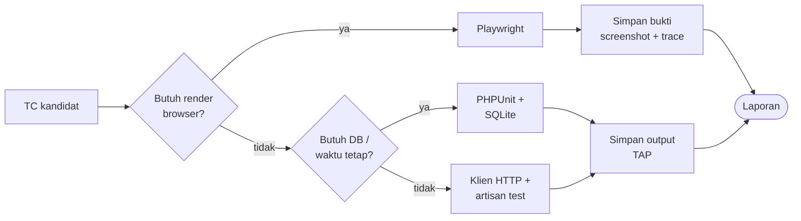
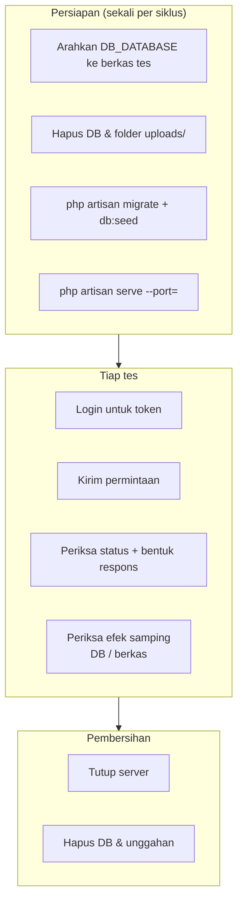

# Test Automation Plan
## Project A — Workforce Attendance System

| Item | Nilai |
|---|---|
| Versi | 1.1 |
| Tanggal | 18 November 2026 (diperbarui 19 November 2026) |
| Cakupan otomasi | 61 test case (`10-Test-Case.md`) |
| Perkakas | PHPUnit (`php artisan test`), HTTP client (`curl`/`fetch`), `FormData` untuk unggah, SQLite langsung untuk verifikasi efek samping |
| Status | **Sudah dijalankan** pada implementasi Node (18 Nov 2026) — 193 pemeriksaan. Resep di §3–§10 kini ditulis untuk Laravel (§0.3) |
| Batasan | Tes repo (`tests/Feature/WorkforceAttendanceTest.php`) dijalankan apa adanya; skrip QA ad hoc tetap di folder temp dan tidak di-commit |

> Bagian §0 mencatat **hasil pelaksanaan nyata** 18 November 2026 terhadap implementasi Node yang kini sudah dihapus. §3–§10 adalah resep untuk mengulang siklus pada implementasi Laravel — bukan klaim hasil.

---

## 0. Status Pelaksanaan (18 November 2026)

| Item | Kenyataan saat eksekusi |
|---|---|
| Runtime | **Node v22.23.2** (`C:\Users\rayha\AppData\Local\nvm\v22.23.2\node.exe`); Node 20.18 memang gagal (`ERR_UNKNOWN_BUILTIN_MODULE`) — implementasi Node sudah dihapus 19 Nov 2026 |
| `.env` | Tidak ada; `JWT_SECRET` memakai nilai cadangan dan dicatat sebagai OBS-02 (ST-39) |
| Database (Node) | `DB_PATH` dan `UPLOAD_DIR` (nama variabel era Node) diarahkan ke folder temp QA, sehingga data dan `uploads/` repo tidak tersentuh |
| Lokasi skrip | Folder temp (`qa/`), **tidak di-commit** agar kode repo tidak berubah |
| Browser driver | Puppeteer (Chrome headless 1440×900) untuk 4 TC manual |
| Port server | 3311 |

### 0.1 Hasil

| Suite | Berkas | Jumlah | Lulus | Temuan |
|---|---|---|---|---|
| Unit test repo | `attendance.test.js` (Node, siklus 18 Nov) | 10 | 10 | — |
| API inti | `hasil-api.json` | 109 | 109 | — |
| API lanjutan | `hasil-extra.json` | 21 | 20 | BUG-01 (header keamanan) |
| API penutup | `hasil-gaps.json` | 13 | 13 | — |
| API probe | `hasil-probes.json` | 3 | 3 | — |
| UI Web HR | `hasil-ui.json` | 18 | 18 | — |
| UI Web HR lanjutan | `hasil-ui2.json` | 15 | 14 | BUG-02 (`TypeError` `public/app.js:374`) |
| UI Web HR penutup | `hasil-ui3.json` | 4 | 4 | — |
| Keamanan | `hasil-sec.json`, `hasil-sec2.json` | 15 | 13 | OBS-01, OBS-02, OBS-05, OBS-11 |
| **Total** | | **208** | **204** | **2 defect + 4 observasi terbukti** |

Catatan: tabel ini menggabungkan pemeriksaan fungsional dan keamanan; angka yang dipakai pada `18-Test-Summary-Report.md` §5 (193 pemeriksaan fungsional) **tidak** menghitung suite keamanan agar tidak terjadi penghitungan ganda dengan `16-Security-Test-Checklist.md`.

### 0.1a Verifikasi pada Laravel (19 November 2026)

| Suite | Perintah | Jumlah | Hasil |
|---|---|---|---|
| Tes fitur repo | `php artisan test` | 5 metode / 27 assertion | **5/5 Lulus** |
| Asap API (server nyata) | `php artisan serve` + 18 request | 18 | **18/18 Lulus** |
| Validasi foto (IN/OUT) | 11 skenario multipart | 11 | Sesuai harapan; `INVALID_PHOTO`/`PHOTO_REQUIRED`/`GPS_REQUIRED`/`OUTSIDE_RADIUS` benar |
| Rate limit | 70 percobaan login | 70 | 60×`401` lalu 10×`429` |

**Batasan penting:** 61 TC **belum** diulang penuh pada Laravel. Angka 61/61 Lulus tetap milik siklus Node (18 Nov 2026). Bila siklus Laravel dijalankan, hasilnya harus dicatat sebagai siklus baru — jangan menimpa angka lama.

### 0.2 Pola yang terbukti berhasil

1. **Satu klien kecil di atas `fetch`** (`api(method, path, {token, json})`) cukup untuk seluruh endpoint; tidak perlu Postman.
2. **Akses SQLite langsung** (dulu `node:sqlite`, kini `sqlite3`/`php artisan tinker`) dapat memverifikasi efek samping (jumlah baris, `password_hash`, `in_photo`) — lebih kuat daripada memercayai respons API.
3. **Puppeteer** menangkap `pageerror` dan `console` sehingga regresi frontend tidak lolos diam-diam.
4. **Database terpisah per siklus** membuat hitungan `belum_in`/`sudah_in` dan penomoran `kyNN` dapat diprediksi.

### 0.3 Cara Mengulang pada Laravel

| Langkah | Perintah | Catatan |
|---|---|---|
| Prasyarat | `composer install` | `vendor/` tidak di-commit |
| Konfigurasi | `cp .env.example .env` lalu `php artisan key:generate` | Isi `JWT_SECRET`, ganti `HR_PASSWORD` |
| Database bersih | arahkan `DB_DATABASE` ke berkas tes, lalu `php artisan migrate --force` | Jangan pakai DB demo |
| Seed | `php artisan db:seed --force` | Membuat akun HR + office demo |
| Tes fitur | `php artisan test` | 5 metode / 27 assertion |
| Server | `php artisan serve --port=8010` | Port bebas |
| Bersihkan | hapus berkas DB tes dan folder `uploads/` | Sebelum siklus berikutnya |

### 0.4 Asersi yang sempat salah (bukan bug aplikasi)

Selama penulisan suite, tiga pemeriksaan awal berstatus merah dan setelah ditelusuri ternyata **asersi ujinya** yang keliru, bukan kode aplikasi:

| Gejala | Sebab sebenarnya |
|---|---|
| `distance_m`/`radius_m` tidak sesuai | Nilai dibaca dari level respons yang salah; `distance_m` berada di dalam objek `check_in`/`check_out` |
| Indeks `UNIQUE` tidak terdeteksi | Nama indeks berbeda dari yang diasumsikan; constraint tetap aktif (TC-ATT-02 membuktikan `409`) |
| Foto tampak "rusak" di UI | Data uji memakai `Buffer.alloc`/PNG 16×16, bukan JPEG; dengan JPEG 800×600 nyata foto termuat (`naturalWidth=800`) |

Pelajaran: kegagalan pertama harus diuji dengan **dua pembacaan** (respons + keadaan DB) sebelum dinyatakan sebagai defect.

---

## 1. Prasyarat (Status per 19 November 2026)

| Hal | Fakta | Akibat |
|---|---|---|
| Runtime | PHP **8.5.12** (memenuhi Laravel 10, butuh ≥ 8.1) + ekstensi `pdo_sqlite` | Server jalan; `php artisan test` lulus |
| Berkas `.env` | Tidak ada di repo; dibuat dari `.env.example` untuk verifikasi | Tanpa `.env`, seed memakai cadangan → OBS-02 (ST-39/ST-40) |
| Dependensi | `vendor/` tidak di-commit | `composer install` wajib sebelum tes |
| Aplikasi mobile | Tidak ada | Alur Employee hanya dapat diotomasi pada level API |
| Browser driver | Puppeteer/Playwright tidak menjadi prasyarat repo | 4 TC UI tetap dapat manual + screenshot |

**Kesimpulan:** prasyarat Laravel terpenuhi pada mesin verifikasi (PHP 8.5.12, 5/5 tes fitur lulus, 18/18 asap API). `.env` tetap tidak ada di repo sehingga hasil siklus baru harus mencatat secret yang dipakai (OBS-02).

---

## 2. Apa yang Layak Diotomasi

| Kelompok | Jumlah TC | Contoh | Alasan |
|---|---|---|---|
| **Unit / DB** | 2 | TC-ATT-13 (batas 08:15), TC-ATT-14 (nilai status di DB) | Cepat, deterministik, tidak butuh server |
| **API** | 55 | `TC-AUTH-01` … `TC-AUTH-08`, `TC-EMP-01` … `TC-EMP-15`, `TC-ADM-01` … `TC-ADM-03`, `TC-OFF-01` … `TC-OFF-06`, `TC-ATT-01` … `TC-ATT-12`, `TC-ATT-14`, `TC-HIS-01` … `TC-HIS-08`, `TC-HIS-10`, `TC-DSH-01`, `TC-DSH-02` | Kontrak stabil; hasil dapat dibandingkan persis |
| **Browser** | 4 | TC-AUTH-09, TC-HIS-09, TC-WEB-01, TC-WEB-02 | Butuh render, unduhan, dan `localStorage` |
| **Manual / UAT** | 15 UAT | `11-UAT.md` | Melibatkan manusia & penilaian |

**Aturan pemilihan:** otomasi hal yang **berulang dan pasti**; biarkan manusia menilai **kelayakan dan kenyamanan**.



---

## 3. Arsitektur Harness



Prinsip:

| Prinsip | Alasan |
|---|---|
| Satu siklus tes = satu database | Menghindari saling ganggu |
| Port bebas (`--port`) | Bisa dijalankan berdampingan |
| Tidak bergantung jam nyata | Hasil dapat diulang |
| Bersihkan `uploads/` | Mencegah penumpukan & salah hitung |
| Tidak menulis kredensial di kode | Ambil dari `.env`/environment |

---

## 4. Kerangka Dasar (Contoh, Laravel)

Contoh memakai HTTP client apa pun (curl/Insomnia/Python) di luar repo. Tes yang berjalan **di dalam** repo memakai PHPUnit seperti pada `tests/Feature/WorkforceAttendanceTest.php`.

```bash
# Simpan konfigurasi di environment, jangan di kode
export QA_BASE=http://127.0.0.1:8010
export HR_EMAIL=...        # dari .env
export HR_PASSWORD=...     # dari .env

# Login -> token
TOKEN=$(curl -s -X POST "$QA_BASE/api/login" \
  -H 'Content-Type: application/json' \
  -d "{\"email\":\"$HR_EMAIL\",\"password\":\"$HR_PASSWORD\"}" |
  python -c 'import sys,json;print(json.load(sys.stdin)["token"])')

# Panggil endpoint terproteksi
curl -s "$QA_BASE/api/employees" -H "Authorization: Bearer $TOKEN"
```

```php
<?php
// tests/Feature/ContohAbsensiTest.php — pola di dalam repo
use Illuminate\Foundation\Testing\RefreshDatabase;
use Tests\TestCase;

class ContohAbsensiTest extends TestCase
{
    use RefreshDatabase;

    public function test_tanpa_token_ditolak(): void
    {
        $this->getJson('/api/me')->assertStatus(401)
            ->assertJsonPath('error.code', 'UNAUTHORIZED');
    }
}
```

Foto uji: gunakan PNG/JPEG **nyata** minimal 1×1 (bukan byte acak), karena validasi Laravel memakai `getMimeType()` (finfo). PNG 1×1 cukup untuk lolos cek tipe & ukuran.

---

## 5. Contoh Tes API

### 5.1 TC-AUTH-01 — Tanpa token harus 401

```php
public function test_tanpa_token_ditolak(): void
{
    foreach (['/api/me', '/api/attendance/today', '/api/employees'] as $path) {
        $res = $this->getJson($path);
        $res->assertStatus(401)->assertJsonPath('error.code', 'UNAUTHORIZED');
        $this->assertArrayNotHasKey('data', $res->json());
    }
}
```

### 5.2 TC-AUTH-06 — Employee tidak boleh menembus endpoint HR

```php
public function test_employee_tidak_boleh_endpoint_hr(): void
{
    $token = $this->loginAs('EMPLOYEE');
    $paths = [
        ['GET', '/api/employees'], ['POST', '/api/employees'],
        ['GET', '/api/admins'],    ['POST', '/api/admins'],
        ['GET', '/api/dashboard/attendance'],
        ['GET', '/api/attendance'],
    ];
    foreach ($paths as [$method, $path]) {
        $this->json($method, $path, [], ['Authorization' => "Bearer {$token}"])
            ->assertStatus(403)
            ->assertJsonPath('error.code', 'FORBIDDEN');
    }
}
```

### 5.3 TC-ATT-01 — IN pertama berhasil (multipart)

```php
public function test_in_pertama_berhasil(): void
{
    $token = $this->loginAs('EMPLOYEE');
    $res = $this->post('/api/attendance/check-in', [
        'lat' => '-7.4296',
        'lng' => '111.0095',
        'photo' => UploadedFile::fake()->image('selfie.png', 4, 4),
    ], ['Authorization' => "Bearer {$token}", 'Accept' => 'application/json']);

    $res->assertStatus(201);
    $this->assertContains($res->json('status'), ['TEPAT_WAKTU', 'TERLAMBAT']);
    $this->assertNotEmpty($res->json('check_in_at'));
}
```

### 5.4 TC-ATT-02 — IN kedua tidak menduplikasi

```php
public function test_in_kedua_ditolak(): void
{
    $token = $this->loginAs('EMPLOYEE');
    $payload = [
        'lat' => '-7.4296', 'lng' => '111.0095',
        'photo' => UploadedFile::fake()->image('selfie.png', 4, 4),
    ];
    $headers = ['Authorization' => "Bearer {$token}", 'Accept' => 'application/json'];

    $this->post('/api/attendance/check-in', $payload, $headers)->assertStatus(201);
    $this->post('/api/attendance/check-in', $payload, $headers)
        ->assertStatus(409)
        ->assertJsonPath('error.code', 'ALREADY_CHECKED_IN');

    $this->assertSame(1, Attendance::count());
}
```

### 5.5 TC-AUTH-05 — Token kedaluwarsa

```php
public function test_token_kedaluwarsa_ditolak(): void
{
    $expired = app(JwtService::class)->issue(1, 'HR', -60); // exp lampau
    $this->getJson('/api/me', ['Authorization' => "Bearer {$expired}"])
        ->assertStatus(401)
        ->assertJsonPath('error.code', 'UNAUTHORIZED');
}
```

> Catatan: buat token dengan `exp` lampau secara eksplisit, jangan menunggu waktu nyata.

### 5.6 TC-ATT-12 — Berkas tidak bertambah saat ditolak

```php
public function test_ditolak_radius_tidak_menambah_berkas(): void
{
    $dir = base_path('uploads/attendance');
    $before = is_dir($dir) ? count(scandir($dir)) - 2 : 0;

    $token = $this->loginAs('EMPLOYEE');
    $this->post('/api/attendance/check-in', [
        'lat' => '-6.2', 'lng' => '106.8',
        'photo' => UploadedFile::fake()->image('selfie.png', 4, 4),
    ], ['Authorization' => "Bearer {$token}", 'Accept' => 'application/json'])
        ->assertStatus(403)
        ->assertJsonPath('error.code', 'OUTSIDE_RADIUS');

    $after = is_dir($dir) ? count(scandir($dir)) - 2 : 0;
    $this->assertSame($before, $after, 'berkas ditolak tidak boleh tersimpan');
}
```

---

## 6. Contoh Tes Unit — Batas 08:15 (TC-ATT-13)

Tes ini **tidak membutuhkan server**, sehingga cepat dan deterministik.

```php
use App\Services\TimeService;

public function test_batas_0815_dan_0816(): void
{
    // TimeService memakai zona Asia/Jakarta; cukup beri DateTime dengan offset WIB
    $tepat = new DateTime('2026-11-18 08:15:00+07:00');
    $telat = new DateTime('2026-11-18 08:16:00+07:00');

    $this->assertSame('TEPAT_WAKTU', TimeService::attendanceStatus($tepat));
    $this->assertSame('TERLAMBAT', TimeService::attendanceStatus($telat));
}

public function test_0814_masih_tepat_waktu(): void
{
    $t = new DateTime('2026-11-18 08:14:59+07:00');
    $this->assertSame('TEPAT_WAKTU', TimeService::attendanceStatus($t));
}
```

**Mengapa penting:** aturan ini adalah inti penilaian kedisiplinan. Kesalahan satu menit mengubah status seluruh karyawan. Tes unit membuatnya dapat diuji ulang kapan saja tanpa menunggu jam tertentu.

> `TimeService::attendanceStatus(?DateTime $d = null)` menerima waktu eksplisit (`app/Services/TimeService.php:38-47`), sehingga tes tidak perlu menunggu jam nyata.

---

## 7. Contoh Tes DB (TC-ATT-14)

```php
use Illuminate\Support\Facades\DB;

public function test_status_tersimpan_hanya_dua_nilai(): void
{
    $rows = DB::table('attendances')->distinct()->pluck('status');
    foreach ($rows as $s) {
        $this->assertContains($s, ['TEPAT_WAKTU', 'TERLAMBAT']);
    }
}
```

---

## 8. Otomasi Browser (TC-AUTH-09, TC-HIS-09, TC-WEB-01, TC-WEB-02)

| TC | Yang diperiksa | Cara |
|---|---|---|
| TC-AUTH-09 | Akun Employee ditolak; logout menghapus token; token rusak → Login | Isi `localStorage`, muat ulang, periksa teks & tidak ada tabel data |
| TC-HIS-09 | Unduh CSV | Tunggu event `download`, baca isi berkas, hitung baris & kolom |
| TC-WEB-01 | Navigasi hash & empty state | Klik menu, periksa URL + elemen |
| TC-WEB-02 | Dialog kredensial, salin, toast, refresh 60 s | Periksa teks dialog; perlakukan izin clipboard sebagai `N/A` bila tidak tersedia |

Kerangka minimal:

```js
// qa/ui.spec.mjs — dijalankan di luar repo, bukan bagian tests/ Laravel
import { chromium } from 'playwright';
import { test, expect } from '@playwright/test';

test('TC-AUTH-09: token rusak => kembali ke Login', async () => {
  const browser = await chromium.launch();
  const page = await browser.newPage();
  await page.goto(process.env.QA_BASE);
  await page.evaluate(() => localStorage.setItem('hr_token', 'rusak'));
  await page.reload();
  await page.waitForSelector('#login');
  await expect(page.locator('body')).not.toContainText('Dashboard');
  await browser.close();
});
```

**Aturan:** bila Playwright tidak tersedia, keempat TC ini tetap **manual** dan wajib screenshot (`09-Test-Plan.md` §11).

---

## 9. Uji Kinerja Ringan (Opsional)

Bukan pengganti uji beban, hanya pemeriksaan ambang NFR-01/02 pada data kecil.

| Skenario | Cara | Ambang usulan |
|---|---|---|
| 100 request `GET /api/attendance/today` | Kirim berurutan, catat p95 | ≤ 200 ms (lokal) |
| 20 request `GET /api/attendance?date=` | Sama | ≤ 500 ms |
| 10 IN multipart | Sama, 10 karyawan berbeda | ≤ 2 s p95 |

Catat hasil apa adanya; bila melewati ambang, buat observasi, bukan langsung defect (lingkungan lokal bukan produksi).

---

## 10. Integrasi CI (Usulan)

```yaml
# .github/workflows/qa.yml  (usulan; belum dibuat)
name: QA
on: [push, pull_request]
jobs:
  test:
    runs-on: ubuntu-latest
    steps:
      - uses: actions/checkout@v4
      - uses: shivammathur/setup-php@v2
        with:
          php-version: '8.2'
          extensions: pdo_sqlite, mbstring, openssl
      - run: composer install --no-interaction --prefer-dist
      - run: cp .env.example .env && php artisan key:generate
      - run: touch database/database.sqlite && php artisan migrate --force
      - run: php artisan test
        env:
          JWT_SECRET: ${{ secrets.CI_JWT_SECRET }}
```

**Catatan:** pakai PHP **≥ 8.1** dengan ekstensi `pdo_sqlite`; tidak perlu Node sama sekali setelah cleanup 19 Nov 2026. Ini menggantikan RISK-01 versi Node.

---

## 11. Aturan Penulisan Tes (Anti-Pola)

| Jangan | Lakukan |
|---|---|
| Mengandalkan jam nyata untuk status | Pakai `TimeService::attendanceStatus()` dengan `DateTime` tetap |
| Memakai satu DB untuk semua siklus | DB unik per siklus (`.env` tes) |
| Menganggap urutan tes pasti | Tes harus mandiri |
| Menulis `200` untuk semua endpoint | Periksa status **dan** `error.code` |
| Memakai `assertTrue($res)` | Periksa bentuk respons spesifik |
| Menghapus data tes secara manual di tengah tes | Bersihkan di `tearDown`, bukan di tengah |
| Menyimpan token/kata sandi di kode | Ambil dari `.env` |

---

## 12. Pemetaan Otomasi per Modul

| Modul | TC | Otomatis | Keterangan |
|---|---|---|---|
| AUTH | `TC-AUTH-01` … `TC-AUTH-08` | 8 | API |
| AUTH (UI) | `TC-AUTH-09` | 0 | Browser |
| EMP | `TC-EMP-01` … `TC-EMP-15` | 15 | API + hitung berkas |
| ADM | `TC-ADM-01` … `TC-ADM-03` | 3 | API |
| OFF | `TC-OFF-01` … `TC-OFF-06` | 6 | API |
| ATT | `TC-ATT-01` … `TC-ATT-12`, `TC-ATT-14` | 13 | API + DB |
| ATT (waktu) | `TC-ATT-13` | 1 | Unit, tanpa server |
| HIS | `TC-HIS-01` … `TC-HIS-08`, `TC-HIS-10` | 9 | API |
| HIS (CSV) | `TC-HIS-09` | 0 | Browser |
| DSH | `TC-DSH-01`, `TC-DSH-02` | 2 | API |
| WEB | `TC-WEB-01`, `TC-WEB-02` | 0 | Browser |

**Total:** 57 dapat diotomasi (2 unit/DB + 55 API), 4 memerlukan browser, 15 UAT tetap manual.

---

## 13. Status Implementasi

| Berkas usulan | Isi | Status |
|---|---|---|
| `tests/Feature/WorkforceAttendanceTest.php` | Tes fitur repo: auth gate, unmatched employee, absensi, office/dashboard | **Ada** — 5 metode / 27 assertion, `php artisan test` 5/5 Lulus |
| `qa/` (helper + suite TC) | Klien HTTP, login, form foto, suite 61 TC | Belum dibuat; resep di §4–§7 |

**Mengapa suite TC penuh belum dibuat:** menulis berkas kode baru di luar `docs/` berada di luar kewenangan build ini. Tes fitur repo sudah ada dan lulus; resep di dokumen ini siap dieksekusi bila siklus Laravel penuh dijalankan.

---

## 14. Keterkaitan Dokumen

| Dokumen | Peran |
|---|---|
| `09-Test-Plan.md` | Strategi & jadwal |
| `10-Test-Case.md` | Sumber TC yang diotomasi |
| `12-Traceability-Matrix.md` | Memastikan otomasi menutup FR |
| `14-Risk-Register.md` | RISK-01 (runtime), RISK-19 (waktu) |
| `18-Test-Summary-Report.md` | Tempat melaporkan hasil otomasi |