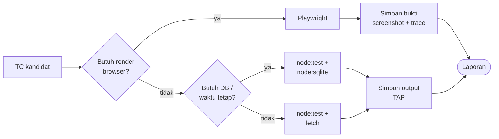
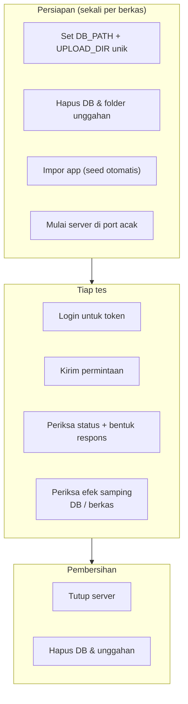

# Test Automation Plan
## Project A — Workforce Attendance System

| Item | Nilai |
|---|---|
| Versi | 1.0 |
| Tanggal | 18 November 2026 |
| Cakupan otomasi | 61 test case (`10-Test-Case.md`) |
| Perkakas | `node:test` (bawaan Node), `fetch`, `FormData`, `jsonwebtoken`, `node:sqlite` |
| Status | **Sudah dijalankan** (18 November 2026) — 193 pemeriksaan; skrip uji bersifat ad hoc di folder temp, tidak di-commit (§0) |
| Batasan | Tidak mengubah `test/attendance.test.js` milik repo |

> Bagian §0 mencatat **hasil pelaksanaan nyata** 18 November 2026. Bagian §1–§8 tetap berisi rencana dan contoh kode, yang kini berfungsi sebagai dokumentasi cara mengulang eksekusi — bukan sebagai klaim hasil.

---

## 0. Status Pelaksanaan (18 November 2026)

| Item | Kenyataan saat eksekusi |
|---|---|
| Runtime | **Node v22.23.2** (`C:\Users\rayha\AppData\Local\nvm\v22.23.2\node.exe`); Node 20.18 memang gagal (`ERR_UNKNOWN_BUILTIN_MODULE`) |
| `.env` | Tidak ada; `JWT_SECRET` memakai nilai cadangan dan dicatat sebagai OBS-02 (ST-39) |
| Database | `DB_PATH` dan `UPLOAD_DIR` diarahkan ke folder temp QA, sehingga `data/test.db` dan `uploads/` repo tidak tersentuh |
| Lokasi skrip | Folder temp (`qa/`), **tidak di-commit** agar `src/**`, `public/**`, dan `test/**` repo tidak berubah |
| Browser driver | Puppeteer (Chrome headless 1440×900) untuk 4 TC manual |
| Port server | 3311 |

### 0.1 Hasil

| Suite | Berkas | Jumlah | Lulus | Temuan |
|---|---|---|---|---|
| Unit test repo | `npm-test.txt` | 10 | 10 | — |
| API inti | `hasil-api.json` | 109 | 109 | — |
| API lanjutan | `hasil-extra.json` | 21 | 20 | BUG-01 (header keamanan) |
| API penutup | `hasil-gaps.json` | 13 | 13 | — |
| API probe | `hasil-probes.json` | 3 | 3 | — |
| UI Web HR | `hasil-ui.json` | 18 | 18 | — |
| UI Web HR lanjutan | `hasil-ui2.json` | 15 | 14 | BUG-02 (`TypeError` `app.js:374`) |
| UI Web HR penutup | `hasil-ui3.json` | 4 | 4 | — |
| Keamanan | `hasil-sec.json`, `hasil-sec2.json` | 15 | 13 | OBS-01, OBS-02, OBS-05, OBS-11 |
| **Total** | | **208** | **204** | **2 defect + 4 observasi terbukti** |

Catatan: tabel ini menggabungkan pemeriksaan fungsional dan keamanan; angka yang dipakai pada `18-Test-Summary-Report.md` §5 (193 pemeriksaan fungsional) **tidak** menghitung suite keamanan agar tidak terjadi penghitungan ganda dengan `16-Security-Test-Checklist.md`.

### 0.2 Pola yang terbukti berhasil

1. **Satu klien kecil di atas `fetch`** (`api(method, path, {token, json})`) cukup untuk seluruh endpoint; tidak perlu Postman.
2. **`node:sqlite`** dapat membaca database QA langsung untuk memverifikasi efek samping (jumlah baris, `password_hash`, `in_photo`) — lebih kuat daripada memercayai respons API.
3. **Puppeteer** menangkap `pageerror` dan `console` sehingga regresi frontend tidak lolos diam-diam.
4. **Database terpisah per siklus** membuat hitungan `belum_in`/`sudah_in` dan penomoran `kyNN` dapat diprediksi.

### 0.3 Asersi yang sempat salah (bukan bug aplikasi)

Selama penulisan suite, tiga pemeriksaan awal berstatus merah dan setelah ditelusuri ternyata **asersi ujinya** yang keliru, bukan kode aplikasi:

| Gejala | Sebab sebenarnya |
|---|---|
| `distance_m`/`radius_m` tidak sesuai | Nilai dibaca dari level respons yang salah; `distance_m` berada di dalam objek `check_in`/`check_out` |
| Indeks `UNIQUE` tidak terdeteksi | Nama indeks berbeda dari yang diasumsikan; constraint tetap aktif (TC-05 membuktikan `409`) |
| Foto tampak "rusak" di UI | Data uji memakai `Buffer.alloc`/PNG 16×16, bukan JPEG; dengan JPEG 800×600 nyata foto termuat (`naturalWidth=800`) |

Pelajaran: kegagalan pertama harus diuji dengan **dua pembacaan** (respons + keadaan DB) sebelum dinyatakan sebagai defect.

---

## 1. Prasyarat (Status per 18 November 2026)

| Hal | Fakta | Akibat |
|---|---|---|
| Runtime | Mesin saat ini **Node v20.18.0**; `package.json` menuntut `>=22.13` | `require('node:sqlite')` gagal (`ERR_UNKNOWN_BUILTIN_MODULE`) → server dan tes tidak dapat dijalankan |
| Berkas `.env` | Tidak ada; `src/config.js:13,19` memakai nilai cadangan | Login berjalan dengan kredensial bawaan; tidak layak untuk tes yang sah |
| Aplikasi mobile | Tidak ada | Alur Employee hanya dapat diotomasi pada level API |
| Browser driver | Belum terpasang | 4 test case UI belum dapat diotomasi |

**Kesimpulan (diperbarui 18 Nov 2026):** dua prasyarat pertama sudah teratasi — Node v22.23.2 tersedia dan database QA terpisah dipakai. `.env` tetap tidak ada, sehingga pengujian dilakukan dengan secret cadangan dan hasilnya dicatat sebagai OBS-02. Aplikasi mobile dan browser driver bukan penghalang: alur Employee diuji di level API dan TC manual dijalankan dengan Puppeteer.

---

## 2. Apa yang Layak Diotomasi

| Kelompok | Jumlah TC | Contoh | Alasan |
|---|---|---|---|
| **Unit / DB** | 2 | TC-47 (batas 08:15), TC-48 (nilai status di DB) | Cepat, deterministik, tidak butuh server |
| **API** | 55 | TC-01..TC-16, TC-18..TC-56, TC-58, TC-59 | Kontrak stabil; hasil dapat dibandingkan persis |
| **Browser** | 4 | TC-17, TC-57, TC-60, TC-61 | Butuh render, unduhan, dan `localStorage` |
| **Manual / UAT** | 15 UAT | `11-UAT.md` | Melibatkan manusia & penilaian |

**Aturan pemilihan:** otomasi hal yang **berulang dan pasti**; biarkan manusia menilai **kelayakan dan kenyamanan**.



---

## 3. Arsitektur Harness



Prinsip:

| Prinsip | Alasan |
|---|---|
| Satu berkas tes = satu database | Menghindari saling ganggu |
| Port acak (`listen(0)`) | Bisa dijalankan paralel |
| Tidak bergantung jam nyata | Hasil dapat diulang |
| Bersihkan berkas unggahan | Mencegah penumpukan & salah hitung |
| Tidak menulis kredensial di kode | Ambil dari `process.env` |

---

## 4. Kerangka Dasar (Contoh)

Simpan sebagai `qa/helpers.mjs` **bila** otomasi disetujui. Tidak menyentuh `test/` milik repo.

```js
import { createRequire } from 'node:module';
const require = createRequire(import.meta.url);

export const BASE = process.env.QA_BASE || 'http://127.0.0.1:3999';

export async function api(path, { token, method = 'GET', body, form } = {}) {
  const headers = {};
  if (token) headers.Authorization = `Bearer ${token}`;
  if (body) headers['Content-Type'] = 'application/json';
  const res = await fetch(BASE + path, {
    method,
    headers,
    body: form || (body ? JSON.stringify(body) : undefined),
  });
  const text = await res.text();
  let json = null;
  try { json = text ? JSON.parse(text) : null; } catch { /* bukan JSON */ }
  return { status: res.status, json, text };
}

export async function login(email, password) {
  const r = await api('/api/login', { method: 'POST', body: { email, password } });
  if (r.status !== 200) throw new Error(`login gagal: ${r.status} ${r.text}`);
  return r.json.token;
}

/** PNG 1x1 — cukup untuk lolos validasi MIME & ukuran */
export const PNG = Buffer.from(
  'iVBORw0KGgoAAAANSUhEUgAAAAEAAAABCAYAAAAfFcSJAAAADUlEQVR42mNkYPhfDwAChwGA60e6kgAAAABJRU5ErkJggg==',
  'base64'
);

export function photoForm(lat, lng, name = 'photo') {
  const fd = new FormData();
  fd.set('lat', String(lat));
  fd.set('lng', String(lng));
  fd.set(name, new Blob([PNG], { type: 'image/png' }), 'selfie.png');
  return fd;
}
```

---

## 5. Contoh Tes API

### 5.1 TC-02 — Tanpa token harus 401

```js
import test from 'node:test';
import assert from 'node:assert/strict';
import { api } from './helpers.mjs';

test('TC-02: tanpa token => 401 UNAUTHORIZED', async () => {
  for (const path of ['/api/me', '/api/attendance/today', '/api/employees']) {
    const r = await api(path);
    assert.equal(r.status, 401, path);
    assert.equal(r.json.error.code, 'UNAUTHORIZED', path);
    assert.equal(r.json.data, undefined, 'tidak boleh ada data');
  }
});
```

### 5.2 TC-16 — Employee tidak boleh menembus endpoint HR

```js
test('TC-16: Employee ke endpoint HR => 403', async () => {
  const token = await login(process.env.QA_EMP_EMAIL, process.env.QA_EMP_PASSWORD);
  const paths = [
    ['GET', '/api/employees'], ['POST', '/api/employees'],
    ['GET', '/api/admins'],    ['POST', '/api/admins'],
    ['GET', '/api/dashboard/attendance'],
    ['GET', '/api/attendance'],
  ];
  for (const [method, path] of paths) {
    const r = await api(path, { method, token, body: method === 'POST' ? {} : undefined });
    assert.equal(r.status, 403, `${method} ${path}`);
    assert.equal(r.json.error.code, 'FORBIDDEN', `${method} ${path}`);
  }
});
```

### 5.3 TC-04 — IN pertama berhasil (multipart)

```js
test('TC-04: IN pertama => 201 + status sah', async () => {
  const token = await login(process.env.QA_EMP_EMAIL, process.env.QA_EMP_PASSWORD);
  const r = await api('/api/attendance/check-in', {
    method: 'POST', token,
    form: photoForm(-7.4296, 111.0095),
  });
  assert.equal(r.status, 201);
  assert.ok(['TEPAT_WAKTU', 'TERLAMBAT'].includes(r.json.data.status));
  assert.ok(r.json.data.check_in_at);
  assert.equal(typeof r.json.data.check_in.distance_m, 'number');
});
```

### 5.4 TC-05 — IN kedua tidak menduplikasi

```js
test('TC-05: IN kedua => 409 dan tetap 1 record', async () => {
  const token = await login(process.env.QA_EMP_EMAIL, process.env.QA_EMP_PASSWORD);
  const r = await api('/api/attendance/check-in', { method: 'POST', token, form: photoForm(-7.4296, 111.0095) });
  assert.equal(r.status, 409);
  assert.equal(r.json.error.code, 'ALREADY_CHECKED_IN');

  const h = await api('/api/attendance/history', { token });
  assert.equal(h.json.meta.total, 1);
});
```

### 5.5 TC-15 — Token kedaluwarsa

```js
import jwt from 'jsonwebtoken';

test('TC-15: token kedaluwarsa => 401', async () => {
  const expired = jwt.sign({ sub: 1, role: 'HR' }, process.env.JWT_SECRET, { expiresIn: '-1s' });
  const r = await api('/api/me', { token: expired });
  assert.equal(r.status, 401);
  assert.equal(r.json.error.code, 'UNAUTHORIZED');
});
```

> Catatan: `expiresIn: '-1s'` lebih andal daripada menunggu 1 detik nyata.

### 5.6 TC-46 — Berkas yatim dihapus

```js
import fs from 'node:fs';
import path from 'node:path';

const uploadDir = process.env.UPLOAD_DIR;
const countFiles = () => fs.readdirSync(path.join(uploadDir, 'attendance')).length;

test('TC-46: ditolak karena radius => tidak ada berkas baru', async () => {
  const token = await login(process.env.QA_EMP_EMAIL, process.env.QA_EMP_PASSWORD);
  const before = countFiles();
  const r = await api('/api/attendance/check-in', { method: 'POST', token, form: photoForm(-6.2, 106.8) });
  assert.equal(r.status, 403);
  assert.equal(r.json.error.code, 'OUTSIDE_RADIUS');
  assert.equal(countFiles(), before, 'berkas yatim harus dihapus');
});
```

---

## 6. Contoh Tes Unit — Batas 08:15 (TC-47)

Tes ini **tidak membutuhkan server maupun `node:sqlite`**, sehingga dapat dijalankan bahkan pada Node 20.

```js
import test from 'node:test';
import assert from 'node:assert/strict';
import { createRequire } from 'node:module';
const require = createRequire(import.meta.url);
const T = require('../src/utils/time.js');

test('TC-47: 08:15 TEPAT_WAKTU, 08:16 TERLAMBAT', () => {
  // 01:15Z = 08:15 WIB
  assert.equal(T.attendanceStatus(new Date('2026-11-18T01:15:00Z')), 'TEPAT_WAKTU');
  // 01:16Z = 08:16 WIB
  assert.equal(T.attendanceStatus(new Date('2026-11-18T01:16:00Z')), 'TERLAMBAT');
});

test('TC-47b: 08:14 juga TEPAT_WAKTU', () => {
  assert.equal(T.attendanceStatus(new Date('2026-11-18T01:14:59Z')), 'TEPAT_WAKTU');
});
```

**Mengapa penting:** aturan ini adalah inti penilaian kedisiplinan. Kesalahan satu menit mengubah status seluruh karyawan. Tes unit membuatnya dapat diuji ulang kapan saja tanpa menunggu jam tertentu.

---

## 7. Contoh Tes DB (TC-48)

```js
import { DatabaseSync } from 'node:sqlite';

test('TC-48: status tersimpan hanya dua nilai', () => {
  const db = new DatabaseSync(process.env.DB_PATH);
  const rows = db.prepare('SELECT DISTINCT status FROM attendances').all();
  db.close();
  for (const r of rows) assert.ok(['TEPAT_WAKTU', 'TERLAMBAT'].includes(r.status));
});
```

---

## 8. Otomasi Browser (TC-17, TC-57, TC-60, TC-61)

| TC | Yang diperiksa | Cara |
|---|---|---|
| TC-17 | Akun Employee ditolak; logout menghapus token; token rusak → Login | Isi `localStorage`, muat ulang, periksa teks & tidak ada tabel data |
| TC-57 | Unduh CSV | Tunggu event `download`, baca isi berkas, hitung baris & kolom |
| TC-60 | Navigasi hash & empty state | Klik menu, periksa URL + elemen |
| TC-61 | Dialog kredensial, salin, toast, refresh 60 s | Periksa teks dialog; perlakukan izin clipboard sebagai `N/A` bila tidak tersedia |

Kerangka minimal:

```js
import { chromium } from 'playwright';

test('TC-17: token rusak => kembali ke Login', async () => {
  const browser = await chromium.launch();
  const page = await browser.newPage();
  await page.goto(process.env.QA_BASE);
  await page.evaluate(() => localStorage.setItem('token', 'rusak'));
  await page.reload();
  await page.waitForSelector('#login');
  const text = await page.textContent('body');
  assert.ok(!text.includes('Dashboard'));
  await browser.close();
});
```

**Aturan:** bila Playwright tidak tersedia, keempat TC ini tetap **manual** dan wajib screenshot (`09-Test-Plan.md` §11).

---

## 9. Uji Kinerja Ringan (Opsional)

Bukan pengganti uji beban, hanya pemeriksaan ambang NFR-01/02 pada data kecil.

| Skenario | Cara | Ambang usulan |
|---|---|---|
| 100 request `GET /api/attendance/today` | Kirim berurutan, catat p95 | ≤ 200 ms (lokal) |
| 20 request `GET /api/attendance?date=` | Sama | ≤ 500 ms |
| 10 IN multipart | Sama, 10 karyawan berbeda | ≤ 2 s p95 |

Catat hasil apa adanya; bila melewati ambang, buat observasi, bukan langsung defect (lingkungan lokal bukan produksi).

---

## 10. Integrasi CI (Usulan)

```yaml
# .github/workflows/qa.yml  (usulan; belum dibuat)
name: QA
on: [push, pull_request]
jobs:
  test:
    runs-on: ubuntu-latest
    steps:
      - uses: actions/checkout@v4
      - uses: actions/setup-node@v4
        with:
          node-version: '22.13'
      - run: npm ci || npm install
      - run: npm test
        env:
          JWT_SECRET: ${{ secrets.CI_JWT_SECRET }}
```

**Catatan:** `node-version: 22.13` wajib — bukan `20`, karena `node:sqlite` belum tersedia. Ini juga alasan RISK-01.

---

## 11. Aturan Penulisan Tes (Anti-Pola)

| Jangan | Lakukan |
|---|---|
| Mengandalkan jam nyata untuk status | Pakai tanggal tetap + `attendanceStatus` |
| Memakai satu DB untuk semua tes | DB unik per berkas |
| Menganggap urutan berkas tes pasti | Tes harus mandiri |
| Menulis `200` untuk semua endpoint | Periksa status **dan** `error.code` |
| Memakai `assert.ok(res)` | Periksa bentuk respons spesifik |
| Menghapus data tes secara manual di tengah tes | Bersihkan di `after`, bukan di tengah |
| Menyimpan token/kata sandi di kode | Ambil dari environment |
| Membiarkan berkas unggahan menumpuk | Hitung sebelum/sesudah |

---

## 12. Pemetaan Otomasi per Modul

| Modul | TC | Otomatis | Keterangan |
|---|---|---|---|
| AUTH | TC-02, 12, 14, 15, 16, 18 | 6 | API |
| AUTH (UI) | TC-17 | 0 | Browser |
| EMP | TC-01, 11, 13, 19..31 | 14 | API + hitung berkas |
| ADM | TC-32..34 | 3 | API |
| OFF | TC-35..40 | 6 | API |
| ATT | TC-03..08, 29, 41..46, 48 | 15 | API + DB |
| ATT (waktu) | TC-47 | 1 | Unit, tanpa server |
| HIS | TC-09, 10, 49..56 | 10 | API |
| HIS (CSV) | TC-57 | 0 | Browser |
| DSH | TC-58, 59 | 2 | API |
| WEB | TC-60, 61 | 0 | Browser |

**Total:** 57 dapat diotomasi (2 unit/DB + 55 API), 4 memerlukan browser, 15 UAT tetap manual.

---

## 13. Status Implementasi

| Berkas usulan | Isi | Status |
|---|---|---|
| `qa/helpers.mjs` | Klien API, login, form foto | Belum dibuat |
| `qa/auth.test.mjs` | TC-02, 15, 16 | Belum dibuat |
| `qa/attendance.test.mjs` | TC-03..08, 41..48 | Belum dibuat |
| `qa/history.test.mjs` | TC-09, 10, 49..56 | Belum dibuat |
| `qa/time.test.mjs` | TC-47 | Belum dibuat |
| `qa/ui.spec.mjs` | TC-17, 57, 60, 61 | Belum dibuat |

**Mengapa belum dibuat:** menulis berkas kode baru di luar `docs/` berada di luar kewenangan build ini, dan saat ini tidak dapat diverifikasi karena Node di mesin belum memenuhi syarat. Dokumen ini menyediakan resepnya agar dapat langsung dieksekusi setelah prasyarat terpenuhi.

---

## 14. Keterkaitan Dokumen

| Dokumen | Peran |
|---|---|
| `09-Test-Plan.md` | Strategi & jadwal |
| `10-Test-Case.md` | Sumber TC yang diotomasi |
| `12-Traceability-Matrix.md` | Memastikan otomasi menutup FR |
| `14-Risk-Register.md` | RISK-01 (runtime), RISK-19 (waktu) |
| `18-Test-Summary-Report.md` | Tempat melaporkan hasil otomasi |