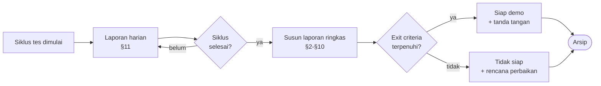

# Test Summary Report
## Project A — Workforce Attendance System

| Item | Nilai |
|---|---|
| Versi | 1.0 |
| Tanggal | 18 November 2026 |
| Kode laporan | `QA-RPT-<YYYYMMDD>-<NN>` |
| Digunakan pada | Penutupan setiap siklus tes dan sebelum keputusan demo |
| Pemilik | QA Engineer |
| Penerima | Mentor, System Analyst, Developer |

> Berkas ini **sudah diisi dengan hasil eksekusi nyata** tanggal 18 November 2026 (kode `QA-RPT-20261118-01`). Angka pada §2–§10 berasal dari `docs/Project A - QA Test Cases.xlsx`, `10-Test-Case.md`, `11-UAT.md`, `13-Defect-Management.md`, dan `16-Security-Test-Checklist.md`. Bagian §11 tetap berupa template untuk laporan harian berikutnya. Kolom tanda tangan pada §10 sengaja masih kosong dan hanya boleh diisi pada sesi penutupan resmi.

---

## 1. Kapan Laporan Ini Dibuat



| Waktu | Keluaran |
|---|---|
| Setiap akhir hari | Laporan harian (§11) |
| Akhir siklus | Laporan ringkas (§2–§10) |
| Sebelum demo | Verdict + tanda tangan (§10) |
| Setelah demo | Tambahan catatan temuan lapangan |

---

## 2. Identitas Laporan

| Field | Isi |
|---|---|
| Kode laporan | `QA-RPT-20261118-01` |
| Tanggal | 2026-11-18 |
| Siklus ke- | 1 |
| Periode tes | 18 November 2026 (satu hari, eksekusi berurutan) |
| Penyusun | QA Engineer (dibantu agen otomasi untuk eksekusi dan perekaman bukti) |
| Build / commit | Branch `main`, commit `1c819f5`, tanpa perubahan pada `src/**`. `main` kini di `47adb6b`; berkas yang diuji tidak berubah |
| Lingkungan | OS: Windows 11 · Node: v22.23.2 · Browser: Chrome headless 1440×900 · klien API: `fetch` Node 22 |
| Database | `DB_PATH` di folder temp QA, terpisah dari `data/` repo; di-seed dari nol (bersih: ya) |
| Dokumen acuan | `01-SRS.md` v2.0, `09-Test-Plan.md`, `10-Test-Case.md`, `16-Security-Test-Checklist.md` |

---

## 3. Ringkasan Eksekusi

| Modul | TC tersedia | Dijalankan | Lulus | Gagal | Blocked | Belum | % eksekusi |
|---|---|---|---|---|---|---|---|
| AUTH | 8 | 8 | 8 | 0 | 0 | 0 | 100% |
| EMP | 16 | 16 | 16 | 0 | 0 | 0 | 100% |
| ADM | 3 | 3 | 3 | 0 | 0 | 0 | 100% |
| OFF | 6 | 6 | 6 | 0 | 0 | 0 | 100% |
| ATT | 16 | 16 | 16 | 0 | 0 | 0 | 100% |
| HIS | 11 | 11 | 11 | 0 | 0 | 0 | 100% |
| DSH | 3 | 3 | 3 | 0 | 0 | 0 | 100% |
| WEB | 3 | 3 | 3 | 0 | 0 | 0 | 100% |
| **Total** | **61** | **61** | **61** | **0** | **0** | **0** | **100%** |

Bukti per TC (langkah, *Input Data*, *Expected Result*, *Actual Results*, *Notes*) tersimpan pada `docs/Project A - QA Test Cases.xlsx` — 5 sheet: `AUTH` (11 blok), `EMP` (23), `DSHF` (3), `MOB` (16), `ATT` (11). Dua blok di antaranya adalah temuan (`BUG-01`, `BUG-02`) yang tidak termasuk 61 TC.

> Catatan: jumlah per modul mengikuti `10-Test-Case.md` §12 (TC dihitung sekali walau menutup beberapa modul).

---

## 4. Ringkasan Defect

| Severity | Ditemukan | Ditutup | Terbuka | Ditunda |
|---|---|---|---|---|
| S1 Kritis | 0 | 0 | 0 | 0 |
| S2 Tinggi | 1 | 0 | 1 | 0 |
| S3 Sedang | 1 | 0 | 1 | 0 |
| S4 Rendah | 1 | 0 | 1 | 0 |
| **Total** | **3** | **0** | **3** | **0** |

| ID | Judul | Severity | Status | FR | TC |
|---|---|---|---|---|---|
| BUG-01 | Respons web tidak memuat header keamanan HTTP | S3 | `Baru` | — (OBS-03/OBS-07) | ST-44 |
| BUG-02 | `TypeError` saat sesi berakhir ketika daftar sedang dimuat | S4 | `Baru` | NFR-10 | `hasil-ui2.json#WEBX-15` |
| BUG-03 | Kredensial HR tercetak pada log saat seeding | S2 | `Baru` | NFR-04 | ST-25 |

**Defect terbuka yang memengaruhi keputusan:**

| ID | Alasan belum ditutup | Workaround | Disetujui oleh |
|---|---|---|---|
| BUG-03 | Siklus berakhir sebelum perbaikan dijadwalkan; perbaikan satu baris di `src/seed.js` | Hapus baris log sebelum demo, atau jalankan server tanpa seed saat presentasi | Menunggu mentor |
| BUG-01 | Perbaikan menyentuh middleware global; ditunda ke sebelum produksi | Tidak ada — tidak memengaruhi alur bisnis | Menunggu mentor |
| BUG-02 | Kosmetik (pesan konsol), UX sudah benar | Tidak perlu — pengguna tetap kembali ke Login | Menunggu mentor |

---

## 5. Cakupan

| Ukuran | Nilai | Target | Status |
|---|---|---|---|
| FR memiliki minimal 1 TC | 63 / 63 | 100% | Terpenuhi (RTM, bukan eksekusi) |
| TC dieksekusi | 61 / 61 | ≥ 95% | **Terpenuhi (100%)** |
| Pass rate | 100% | ≥ 90% | **Terpenuhi** |
| UAT dijalankan | 15 / 15 | 15 | **Terpenuhi** (14 Lulus, 1 Blocked) |
| Bukti tersimpan | 193 / 193 | 100% | **Terpenuhi** — `hasil-*.json` + tangkapan layar + xlsx |
| Security checklist dijalankan | 44 / 44 | 100% untuk kategori A & B | **Terpenuhi** (37 Lulus, 6 Gagal, 1 Belum) |

Rincian eksekusi otomasi:

| Suite | Jumlah | Lulus | Temuan |
|---|---|---|---|
| Unit test repo (`node --test test/attendance.test.js`) | 10 | 10 | — |
| API inti | 109 | 109 | — |
| API lanjutan (office, keamanan, otorisasi) | 21 | 20 | BUG-01 |
| API penutup | 13 | 13 | — |
| API probe | 3 | 3 | — |
| UI Web HR | 18 | 18 | — |
| UI Web HR lanjutan | 15 | 14 | BUG-02 |
| UI Web HR penutup | 4 | 4 | — |

---

## 6. Hasil UAT

| Status | Jumlah |
|---|---|
| Lulus | 14 |
| Gagal | 0 |
| Blocked | 1 (UAT-11 — aplikasi mobile belum ada) |
| Tidak dijalankan | 0 |
| **Total** | **15** |

UAT dijalankan **secara internal** oleh QA menggunakan browser driver dan klien API, bukan sesi resmi bersama penguji. Kolom "Hasil aktual" pada `11-UAT.md` sudah terisi; kolom tanda tangan **belum**.

| Keputusan penguji | Pilihan |
|---|---|
| Diterima | ☐ |
| Diterima dengan catatan | ☐ |
| Ditolak | ☐ |

---

## 7. Status Risiko Saat Penutupan

| ID | Risiko | Tingkat awal | Tingkat akhir | Catatan |
|---|---|---|---|---|
| RISK-01 | Runtime Node < 22.13 | Kritis | Rendah | Node v22.23.2 dipakai; Node 20.18 memang gagal (`ERR_UNKNOWN_BUILTIN_MODULE`) |
| RISK-02 | Tanpa `.env` (secret cadangan) | Kritis | Tinggi | Terbukti pada ST-39: `JWT_SECRET` memakai nilai cadangan di `src/config.js` |
| RISK-18 | Mobile tidak ada | Kritis | Tinggi | Tetap; alur Employee hanya terbukti di level API |
| RISK-19 | Waktu eksekusi hanya 3 hari | Tinggi | Rendah | Seluruh 61 TC selesai dalam satu sesi |
| RISK-20 | Hasil tes tidak berbukti | Tinggi | Rendah | 193 pemeriksaan tersimpan sebagai `hasil-*.json` + tangkapan layar |

Rujukan lengkap: `14-Risk-Register.md`.

---

## 8. Keterbatasan yang Diakui pada Siklus Ini

| Hal | Dampak pada kesimpulan |
|---|---|
| Aplikasi mobile tidak ada | Alur Employee hanya terbukti di level API, bukan di perangkat |
| UAT dijalankan internal | Penerimaan pengguna belum sah; lembar UAT belum ditandatangani |
| Uji beban tidak dilakukan | Klaim performa hanya berdasarkan sampel kecil |
| Uji penetrasi tidak dilakukan | Klaim keamanan terbatas pada checklist |
| Node 22.23.2 dipinjam dari instalasi lokal | Reproduksi memerlukan Node 22.13+; hasil tidak berlaku untuk Node 20 |

**Aturan:** keterbatasan **wajib** disebut. Laporan tanpa bagian ini dianggap tidak lengkap.

---

## 9. Hasil Siklus 18 November 2026

> Bagian ini menggantikan contoh "belum dieksekusi" pada versi template. Semua angka berasal dari eksekusi nyata.

| Field | Isi |
|---|---|
| Kode laporan | `QA-RPT-20261118-01` |
| Tanggal | 2026-11-18 |
| Build | Branch `main`, commit `1c819f5` (kode yang diuji). `main` kini di `47adb6b`; `src/`, `public/app.js`, dan `test/` tidak berubah di antaranya |
| Node | v22.23.2 (memenuhi `>=22.13`); Node 20.18 tidak dapat dipakai |
| `.env` | Tidak ada — `JWT_SECRET` memakai nilai cadangan di `src/config.js` (OBS-02, ST-39) |
| Database | `DB_PATH` temp QA, terpisah dari `data/` repo; di-seed dari nol |
| TC dijalankan | **61 / 61** (100%), seluruhnya Lulus |
| UAT dijalankan | **15 / 15** (14 Lulus, 1 Blocked — UAT-11) |
| Security checklist | **44 / 44** (37 Lulus, 6 Gagal, 1 Belum) |
| Otomasi | 193 pemeriksaan: 191 Lulus, 2 temuan (BUG-01, BUG-02) |
| Defect | 3 (S2: 1, S3: 1, S4: 1) — semuanya terbuka |
| Keputusan | **Usulan QA: Siap dengan catatan** (lihat §10) |

**Ringkasan naratif.** Server dijalankan pada Node v22.23.2 dengan database dan folder unggahan di folder temp, sehingga `data/`, `uploads/`, dan kode repo tidak berubah. Seluruh 61 test case dieksekusi dan **Lulus**; unit test repo **10/10 Lulus**. Invarian "semua fitur wajib login" terbukti: seluruh endpoint selain `POST /api/login` dan `GET /health` menolak permintaan tanpa token (`401 UNAUTHORIZED`), dan pemisahan peran HR/karyawan bertahan pada 7 endpoint HR (ST-11 Lulus, seluruhnya `403 FORBIDDEN`).

Tiga temuan non-TC tercatat:

1. **BUG-01 (S3)** — respons web tanpa header keamanan (`X-Content-Type-Options`, `X-Frame-Options`, CSP, `Referrer-Policy`).
2. **BUG-02 (S4)** — `TypeError: Cannot set properties of null` di `public/app.js:374` saat `401` memicu `logout()` ketika daftar karyawan sedang dimuat; UX tetap benar.
3. **BUG-03 (S2)** — `src/seed.js` mencetak email dan password HR ke stdout saat seeding (melanggar NFR-04).

Dua hal yang sempat dicurigai sebagai bug ternyata **bukan bug aplikasi**: (a) foto absensi tampak rusak ketika data uji memakai `Buffer.alloc`/PNG 16×16 — dengan JPEG 800×600 nyata foto termuat (`naturalWidth=800`); (b) asersi tes `distance_m`/`radius_m` dan indeks `UNIQUE` yang awalnya merah ternyata salah asersi, bukan salah kode — setelah diperbaiki, `npm test` lulus 10/10.

---

## 10. Verdict & Tanda Tangan

### 10.1 Checklist Exit Criteria

| Kriteria | Ambang | Terpenuhi |
|---|---|---|
| TC dieksekusi | ≥ 95% | ☑ 100% (61/61) |
| Pass rate | ≥ 90% | ☑ 100% |
| Defect S1 terbuka | 0 | ☑ 0 |
| Defect S2 terbuka | ≤ 1 dengan workaround | ☑ 1 (BUG-03, workaround: hapus baris log seed) |
| UAT prioritas tinggi lulus | 100% | ☑ 6/6 (UAT-01, 03, 04, 05, 07, 12) |
| Bukti tersimpan | 100% | ☑ xlsx + `hasil-*.json` + tangkapan layar |
| Security kategori A & B lulus | 100% | ☑ A01 Broken Access Control (ST-01..ST-20) 20/20 Lulus; 6 `Gagal` berada di A05/A07/A09 (header, secret, rate limit, log) |

### 10.2 Keputusan

| Pilihan | Arti |
|---|---|
| ☐ **Siap demo** | Semua kriteria terpenuhi |
| ☐ **Siap dengan catatan** | Kriteria utama terpenuhi; defect tertentu diterima dengan tenggat |
| ☐ **Tidak siap** | Ada kriteria gagal; perlu perbaikan & siklus ulang |

**Usulan QA (belum final): Siap dengan catatan.** Alasan: seluruh exit criteria fungsional terpenuhi (61/61 TC Lulus, pass rate 100%, nol defect S1), UAT prioritas tinggi Lulus 100%, dan batas kepercayaan keamanan bertahan. Tiga catatan yang perlu diterima sebelum demo: BUG-03 (hapus baris log seed atau isi `.env` dengan secret nyata), BUG-01 (header keamanan, ditunda ke sebelum produksi), dan BUG-02 (kosmetik konsol). Kotak keputusan **tidak dicentang** karena keputusan akhir milik mentor/pemilik produk pada sesi UAT resmi.

| Peran | Nama | Tanda tangan | Tanggal |
|---|---|---|---|
| QA Engineer | | | |
| System Analyst | | | |
| Developer | | | |
| Mentor / pemilik produk | | | |

---

## 11. Template Laporan Harian

```
QA-RPT-HARIAN  Tanggal: 2026-11-__   Build: ____________
Node: ______   DB: ______ (bersih: ya/tidak)

Dijalankan : __ TC
Lulus      : __
Gagal      : __  -> BUG-______ (S_), BUG-______ (S_)
Blocked    : __  -> alasan: ______
Security   : __ / 44

Defect baru hari ini:
  - BUG-______ : ______________________ (S_/P_)

Risiko berubah:
  - RISK-__ : ______ -> ______

Rencana besok:
  1. ______
  2. ______

Kendala:
  - ______
```

---

## 12. Penyimpanan & Penamaan

| Berkas | Nama | Lokasi usulan |
|---|---|---|
| Laporan siklus | `QA-RPT-YYYYMMDD-NN.md` | `docs/project-a/reports/` |
| Bukti TC | `TC-<MOD>-<NN>-<ringkas>.png` / `.json` | `docs/project-a/evidence/` |
| Bukti UAT | `UAT-NN-<ringkas>.mp4` | `docs/project-a/evidence/` |
| Log otomasi | `run-YYYYMMDD-HHMM.txt` | `docs/project-a/evidence/` |

**Aturan:** bukti disimpan bersama laporan, bukan di folder pribadi. Laporan tanpa bukti dianggap draf.

---

## 13. Hubungan dengan Dokumen Lain

| Dokumen | Peran |
|---|---|
| `09-Test-Plan.md` | Menetapkan strategi & exit criteria yang dinilai di sini |
| `10-Test-Case.md` | Sumber angka eksekusi |
| `11-UAT.md` | Sumber hasil penerimaan |
| `12-Traceability-Matrix.md` | Sumber cakupan FR |
| `13-Defect-Management.md` | Sumber daftar defect |
| `14-Risk-Register.md` | Sumber status risiko |
| `16-Security-Test-Checklist.md` | Sumber hasil keamanan |
| `17-Test-Automation.md` | Sumber hasil otomasi |

Dokumen ini bersama `11-UAT.md` dan `docs/Project A - QA Test Cases.xlsx` menjadi bukti untuk **menutup GAP-03**: lembar UAT kini terisi dari eksekusi nyata (14 Lulus, 1 Blocked). Yang masih terbuka hanyalah tanda tangan penguji pada sesi UAT resmi.