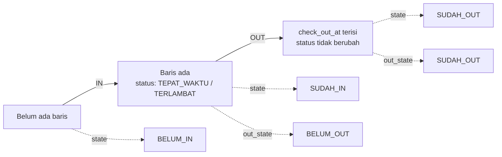

# Glossary (Daftar Istilah)
## Project A — Workforce Attendance System

| Item | Nilai |
|---|---|
| Versi | 1.0 |
| Tanggal | 18 November 2026 |
| Tujuan | Menyamakan arti istilah antara dokumen, kode, dan percakapan |
| Sumber | `src/`, `public/`, `01-SRS.md`, `docs/ETHES_TECH Project.docx` |
| Aturan | Bila istilah di dokumen berbeda dengan kode, **kode yang menang** — lalu catat sebagai deviasi |

> Gunakan istilah di sini secara konsisten. Banyak kebingungan pada proyek absensi berasal dari kata yang sama dipakai untuk hal berbeda (mis. "status" vs "state", "kode karyawan" vs "kode akun").

---

## 1. Istilah Domain

| Istilah | Arti | Rujukan |
|---|---|---|
| **Absensi** | Satu catatan kehadiran seorang karyawan pada satu tanggal kerja, terdiri atas IN dan (bila ada) OUT | tabel `attendances` |
| **Check-in (IN)** | Tindakan mencatat kedatangan: menyimpan jam, foto, koordinat, office, dan jarak | `attendance.js:75-85` |
| **Check-out (OUT)** | Tindakan mencatat kepulangan; **tidak** mengubah `status` yang sudah ditetapkan saat IN | `attendance.js:94+` |
| **Tanggal kerja (`work_date`)** | Tanggal (YYYY-MM-DD) di zona `Asia/Jakarta` saat IN terjadi; menjadi kunci keunikan | `utils/time.js:7` |
| **Jam kerja** | 08:00 WIB (`config.js:22`) | `config.js` |
| **Toleransi keterlambatan** | 15 menit (`config.js:23`); batas = 08:15 | `utils/time.js:19-23` |
| **Keterlambatan** | Kondisi saat waktu IN **lebih besar** dari 08:15; 08:15 tepat masih tepat waktu | `utils/time.js:22` |
| **Office** | Lokasi fisik dengan koordinat dan radius yang sah untuk absensi | tabel `offices` |
| **Radius** | Jarak maksimum (meter) dari office agar absensi diterima; 10–5000 m | `offices.js` |
| **Geofence** | Penerapan radius: absensi di luar radius ditolak `OUTSIDE_RADIUS` | `attendance.js:40-41` |
| **Jarak (`distance_m`)** | Jarak hasil hitung Haversine antara koordinat karyawan dan office | `utils/geo.js` |
| **Foto bukti** | Berkas gambar dari kamera saat IN/OUT; wajib ada | `middleware/upload.js` |
| **Bukti yatim** | Berkas yang sudah terunggah tetapi transaksi ditolak; harus dihapus | `attendance.js:50` |
| **Karyawan aktif** | `employees.status = 'ACTIVE'`; hanya mereka yang dapat login & absen | `attendance.js:54-57` |
| **Kredensial awal** | Password acak yang ditampilkan **sekali** saat akun dibuat | `employees.js:73`, `admins.js:44` |

---

## 2. Status dan State

Ini bagian yang paling sering tertukar. Ada **tiga konsep berbeda**:

### 2.1 `status` — tersimpan di database

| Nilai | Arti | Disimpan sejak |
|---|---|---|
| `TEPAT_WAKTU` | Waktu IN ≤ 08:15 | Saat IN |
| `TERLAMBAT` | Waktu IN > 08:15 | Saat IN |

Hanya **dua** nilai ini yang pernah masuk kolom `status`. Nilai lain tidak sah.

### 2.2 `state` — status hari ini (dihitung saat diminta)

| Nilai | Arti | Sumber |
|---|---|---|
| `BELUM_IN` | Belum ada catatan absensi hari ini | `attendance.js:66` |
| `SUDAH_IN` | Sudah IN, belum OUT | `attendance.js:66` |
| `SUDAH_OUT` | Sudah IN dan sudah OUT | `attendance.js:66` |

Muncul pada `GET /api/attendance/today` bersama `can_check_in` dan `can_check_out`.

### 2.3 `out_state` — status kepulangan pada satu baris

| Nilai | Arti |
|---|---|
| `BELUM_OUT` | `check_out_at` masih kosong |
| `SUDAH_OUT` | `check_out_at` sudah terisi |

### 2.4 Nilai filter `status` yang diterima API

`TEPAT_WAKTU`, `TERLAMBAT`, `BELUM_OUT`, `SUDAH_OUT`, `BELUM_IN` (`attendance.js:15`).

- `BELUM_OUT`/`SUDAH_OUT` adalah **filter**, bukan nilai tersimpan.
- `BELUM_IN` hanya berlaku untuk **satu tanggal** (`attendance.js:119`).

**Aturan penulisan:** jangan menyebut `BELUM_IN` sebagai "status di database". Sebut **state** atau **status turunan**.

---

## 3. Peran & Kode Identitas

| Istilah | Arti | Contoh bentuk | Rujukan |
|---|---|---|---|
| **HR Admin** | Peran pengguna Web HR; dapat mengelola karyawan, office, dan melihat semua absensi | — | `users.role = 'HR'` |
| **Employee** | Peran pengguna aplikasi/klien API; hanya data sendiri | — | `users.role = 'EMPLOYEE'` |
| **`account_code`** | Kode akun HR | `HR01`, `HR02` | `utils/hr-code.js` |
| **`employee_code`** | Kode karyawan | `ky01`, `ky02` | `employees.js:28` |
| **`employee_id`** | Kunci numerik karyawan | `1`, `2` | `employees.id` |
| **`user_id`** | Kunci numerik akun | `1`, `2` | `users.id` |

> **Catatan penting:** `account_code` dan `employee_code` **berbeda**. HR tidak punya `employee_code`; karyawan tidak punya `account_code`. README menyebut `EMP001`, padahal kode aktual `kyNN` (D-08).

---

## 4. Istilah Teknis

| Istilah | Arti di proyek ini | Rujukan |
|---|---|---|
| **JWT** | Token akses bertanda tangan; berisi `sub` (id user) dan `role` | `auth.js:19` |
| **Bearer token** | Format header `Authorization: Bearer <token>` | `middleware/auth.js:9` |
| **Middleware `auth`** | Memverifikasi token dan memuat user dari DB; gagal → 401 | `auth.js:7-19` |
| **`requireRole`** | Membatasi endpoint pada satu peran; gagal → 403 | `auth.js:21-22` |
| **Auth Gate** | Invarian: semua fitur wajib login; hanya login & health yang publik | `01-SRS.md` §0 |
| **bcrypt** | Algoritma hash password (cost 10) | `admins.js`, `employees.js` |
| **multer** | Pustaka unggah berkas; menangani `multipart/form-data` | `middleware/upload.js` |
| **multipart** | Format permintaan untuk mengirim berkas + field teks | `attendance.js:46-52` |
| **SQLite** | Basis data berkas tunggal | `src/db.js` |
| **`node:sqlite`** | Modul SQLite bawaan Node ≥ 22.13 (tanpa kompilasi) | `package.json` |
| **WAL** | Mode jurnal SQLite yang dipakai (`journal_mode = WAL`) | `db.js` |
| **`PRAGMA user_version`** | Penanda versi skema untuk migrasi bertahap (1 → 3) | `db.js` |
| **`ON DELETE CASCADE`** | Menghapus baris turunan otomatis | `db.js` |
| **Seed** | Data awal: akun HR + satu office demo | `src/seed.js` |
| **`serialize`** | Fungsi yang mengubah baris DB menjadi bentuk respons API | `attendance.js:18-26` |
| **CSV** | Berkas ekspor dipisah koma dari Web HR | `public/app.js` |

---

## 5. Pola ID Dokumen

| Awalan | Arti | Dokumen |
|---|---|---|
| `FR-<MODUL>-NN` | Functional Requirement | `01-SRS.md`, `06` |
| `NFR-NN` | Non-Functional Requirement | `01` |
| `BR-NN` | Business Rule | `01` §5 |
| `UC-NN` | Use Case | `02` |
| `AD-NN` | Activity Diagram | `03` |
| `FC-NN` | Flowchart | `05` |
| `BP-NN` | Business Process | `08` |
| `US-NN` | User Story | `07` |
| `TC-NN` | Test Case | `10` |
| `UAT-NN` | Skenario UAT | `11` |
| `ST-NN` | Security Test | `16` |
| `RISK-NN` | Risiko | `14` |
| `CR-YYYYMMDD-NN` | Change Request | `15` |
| `BUG-YYYYMMDD-NN` | Defect | `13` |
| `D-NN` | Deviasi dokumen vs implementasi | `01` §10 |
| `GAP-NN` | Kesenjangan yang diakui | `06` |
| `OBS-NN` | Observasi keamanan (belum defect) | `16` §10 |
| `TD-NN` | Test Data | `09` §5 |
| `TR-NN` | Test Risk | `09` §9 |
| `BL-NN` | Backlog perbaikan | `08` §10 |
| `R-NN` | Risiko proses (asal, kini dipetakan ke RISK) | `08` §9 |

**Aturan:** satu ID hanya merujuk satu hal. Jangan memakai ulang nomor yang sudah dihapus.

---

## 6. Istilah yang Sering Tertukar

| Jangan tertukar | Perbedaan | Cara menyebut yang benar |
|---|---|---|
| Status vs State | `status` tersimpan; `state` dihitung | "status `TERLAMBAT`", "state `SUDAH_IN`" |
| `BELUM_IN` sebagai status | Itu state/filter, bukan nilai kolom | "state `BELUM_IN`" |
| `BELUM_OUT` sebagai status | Itu filter/`out_state` | "filter `BELUM_OUT`" |
| IN vs check-in | Sama; pilih satu dalam satu dokumen | "check-in (IN)" pada penyebutan pertama |
| Kode karyawan vs kode akun | `kyNN` vs `HRNN` | sebut lengkap: `employee_code` / `account_code` |
| Absen vs absensi | "Absen" sering berarti tidak hadir; "absensi" = pencatatan kehadiran | "absensi" untuk proses, "tidak hadir" untuk ketidakhadiran |
| Office vs radius | Office = lokasi; radius = batas jarak | "office dengan radius 100 m" |
| Token vs sesi | Token stateless; tidak ada sesi server | "token JWT", bukan "sesi" |
| Logout | Hanya menghapus token di klien | "logout di klien" |
| Defect vs Gap | Defect = menyimpang dari requirement; Gap = belum ada/ketergantungan | lihat §7 |
| Observation vs Defect | Observation = dugaan dari tinjauan; belum terbukti | "OBS-01" sampai diverifikasi |
| UAT vs TC | UAT = penerimaan pengguna; TC = verifikasi teknis | jangan menulis "UAT lulus" untuk TC |
| Verifikasi vs Validasi | Verifikasi = sesuai spesifikasi; validasi = sesuai kebutuhan pengguna | TC = verifikasi, UAT = validasi |
| `work_date` vs `created_at` | `work_date` = tanggal kerja; `created_at` = waktu baris dibuat | "tanggal kerja" |
| WIB vs zona server | Perhitungan selalu `Asia/Jakarta`, bukan zona mesin | "WIB (`Asia/Jakarta`)" |
| Radius vs jarak | Radius = ambang; jarak = hasil ukur | "jarak 45 m, radius 100 m" |

---

## 7. Tiga Jenis "Kekurangan"

| Jenis | Definisi | Contoh di proyek ini | Penanganan |
|---|---|---|---|
| **Defect** | Perilaku menyimpang dari requirement yang sudah disepakati | IN kedua menghasilkan dua baris | `13-Defect-Management.md` |
| **Gap** | Sesuatu yang **memang belum ada** atau bergantung pihak lain | Mobile belum ada; tidak ada `updated_at` | Dicatat di `06` §Gap, tidak dihitung defect |
| **Backlog** | Usulan perbaikan yang belum disetujui | Rate limit, verifikasi wajah | `08` §10, butuh CR bila dikerjakan |

**Mengapa penting:** mencampur ketiganya membuat laporan terlihat "banyak bug" padahal sebagian adalah keputusan atau pekerjaan mendatang.

---

## 8. Satuan & Format

| Hal | Format | Contoh |
|---|---|---|
| Tanggal | `YYYY-MM-DD` | `2026-11-18` |
| Waktu tersimpan | ISO 8601 dengan offset `+07:00` | `2026-11-18T08:05:00+07:00` |
| Zona waktu | `Asia/Jakarta` | selalu, tanpa mengikuti zona mesin |
| Koordinat | Derajat desimal; lat −90..90, lng −180..180 | `-7.4296`, `111.0095` |
| Jarak / radius | Meter (bilangan bulat pada respons) | `45`, `100` |
| Ukuran foto | Maksimum 5 MB | `5 * 1024 * 1024` |
| Paginasi | `page` mulai 1; `limit` maksimum 200 | `?page=2&limit=50` |
| Rentang tanggal | Maksimum 366 hari | `from`/`to` |

---

## 9. Kode Error yang Sering Ditemui

| Kode | HTTP | Arti | Sumber |
|---|---|---|---|
| `UNAUTHORIZED` | 401 | Token tidak ada / tidak valid / user hilang | `auth.js:10,13,16` |
| `FORBIDDEN` | 403 | Peran tidak sesuai atau data milik orang lain | `auth.js:22`, `attendance.js:145,158` |
| `INVALID_CREDENTIALS` | 401 | Email/password salah | `auth.js:15-16` |
| `ACCOUNT_INACTIVE` | 403 | Karyawan nonaktif | `auth.js:17-18`, `attendance.js:56` |
| `VALIDATION` | 400 | Input tidak sah | berbagai route |
| `ALREADY_CHECKED_IN` | 409 | Sudah IN hari ini | `attendance.js:79` |
| `NOT_CHECKED_IN` | 409 | OUT tanpa IN | `attendance.js` |
| `ALREADY_CHECKED_OUT` | 409 | Sudah OUT | `attendance.js` |
| `PHOTO_REQUIRED` | 400 | Foto tidak dilampirkan | `attendance.js` |
| `INVALID_PHOTO` | 400 | Ukuran/tipe tidak sah | `upload.js`, `app.js:24` |
| `GPS_REQUIRED` | 400 | Koordinat tidak ada/tidak sah | `attendance.js` |
| `OUTSIDE_RADIUS` | 403 | Di luar radius office | `attendance.js:40` |
| `NO_OFFICE` | 409 | Tidak ada office aktif | `attendance.js` |
| `DUPLICATE_CODE` | 409 | `employee_code` sudah dipakai | `employees.js` |
| `DUPLICATE_EMAIL` | 409 | Email sudah dipakai | `employees.js`, `admins.js` |
| `NOT_FOUND` | 404 | Data/endpoint tidak ada | `app.js:20` |

---

## 10. Cara Memelihara Daftar Ini

1. **Istilah baru** yang muncul di kode atau dokumen → tambahkan satu baris.
2. **Istilah yang berubah arti** → perbarui definisi, jangan hapus sejarahnya.
3. **Istilah yang hanya dipakai sekali** → pertimbangkan untuk tidak dimasukkan.
4. Setiap perubahan istilah inti (status, peran, kode) wajib lewat `15-Change-Request-Log.md` bila memengaruhi requirement.

---

## 11. Keterkaitan Dokumen

| Dokumen | Istilah yang paling perlu konsisten |
|---|---|
| `01-SRS.md` | FR, BR, status, peran, kode error |
| `04-ERD.md` | nama tabel & kolom |
| `05-Flowchart.md` | state, keputusan, error |
| `06`/`07` | FR, US, acceptance criteria |
| `10`–`13` | TC, UAT, BUG, severity |
| `14`–`18` | RISK, CR, ST, OBS, verdict |